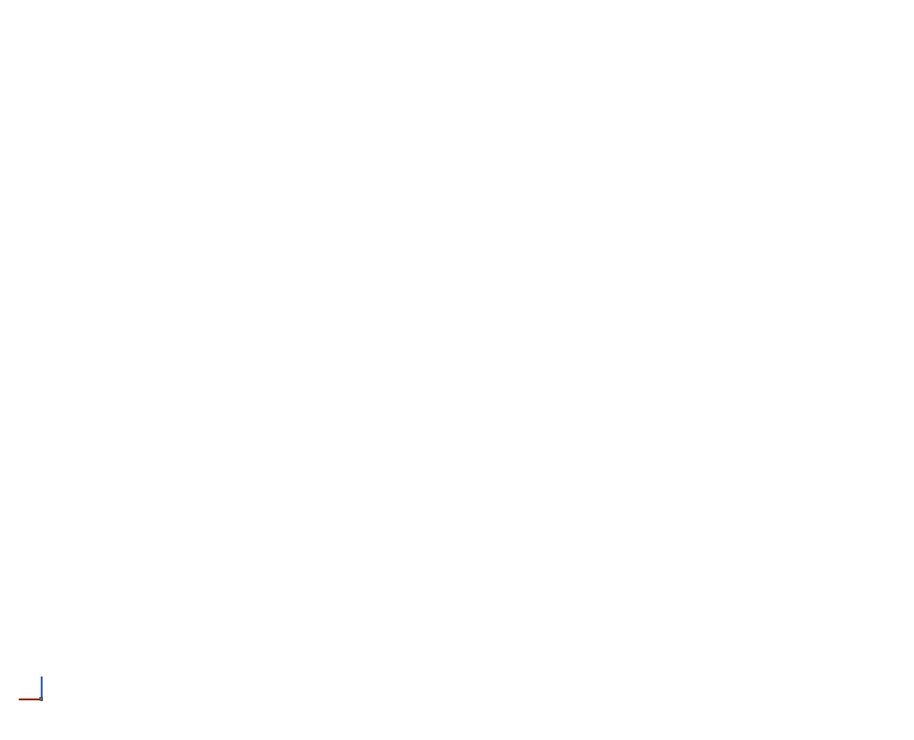

# Approved cave restoration — 11 November 2026

The user rejected the repeated ring galleries and long straight entrance tunnels.
The accepted appearance is the profile-8 passage/chamber study, with its strata
follow-up. The experimental network implementation reused some machinery but
changed anatomy, proportions, floor shape and composition; earlier technical
qualification never established visual equivalence.

## Change

- Remove ring placement, room-cell morphology and the separate profile-9 ISPC kernels.
- Remove the roughly 500 m appended entrance passages.
- Route enabled generation through the original profile-8 scalar/NEON spatial
  field: its three footprints, independent roof pockets, undercuts, retained roof
  mass and one rolling floor. The frozen geological review fixture is unchanged
  in density; its route metadata now follows the actual shared floor.
- Place independent instances with deterministic seed/density. Retain full
  approved proportions on ordinary planets. Uniformly fit that same anatomy on
  small planets; absent geology never substitutes another shape.
- Retain canonical rock/stratum/material queries, authored edits, the existing
  recipe UI and stock native VPP meshing, LOD, rendering and collision.

This restores the accepted anatomy. It does **not** complete varied, interconnected
multi-level procedural caves or natural entrances. Saved branching/dimensional
settings remain present; they cannot select an unapproved construction. Density
and seed still affect occurrence/placement. Further generalisation requires
visual comparison against the frozen accepted reference and user acceptance.

## Regression gates

Run the frozen SpatialPrototype.GeometryAndDelivery test, the 72-case
AlwaysEnabledMinimum matrix, CurrentRift shape/floor tests, approved placement
anatomy/strata/selection tests and actual CurrentRift native rendered overview and
zoom checks. Record actual outcomes before publishing. Historical profile-9
performance and multi-level evidence does not qualify this change.

## Verified outcome

The final six UE 5.7 Mac arm64 tests passed: approved anatomy/floors/strata,
deterministic placement/selection, 72 enabled-minimum scale/profile/access cases,
actual Rift walking floors, native fields/edits/persistence, and the rendered
CurrentRift overview/zoom scenario. Earlier in this restoration, the frozen
SpatialPrototype.GeometryAndDelivery baseline and the eligibility, inspection,
controls/background and small-body tests also passed. The final focused rerun
follows the lateral-probe and physical-grade corrections recorded in the
[qualification](../conformance/ApprovedCaveRestoration/qualification.json).

All 371 host inputs match the independent source checkout. The retained accepted
SIMD kernel is byte-identical to its previous definition (whitespace trimmed).
The rejected family kernels are removed. Final Rift result: 64 approved
compositions, no appended entrances, zero clearance/foundation failures. Native
overview inspection readies in 3.340 s (11.513 s including plan/base preparation);
close-up refinement takes 36.581 s and remains a performance gap. No ecosystem
headroom or new walkthrough-freeze qualification is claimed. VPP remains stock.

