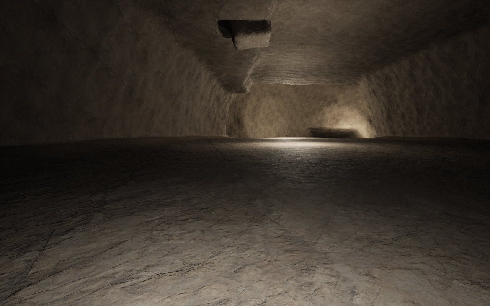
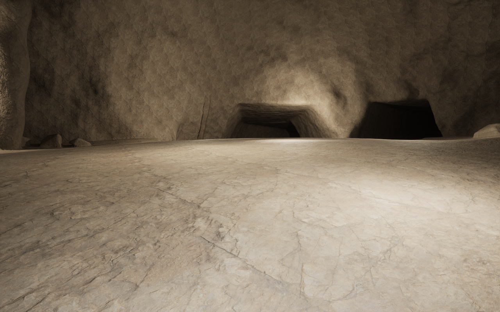
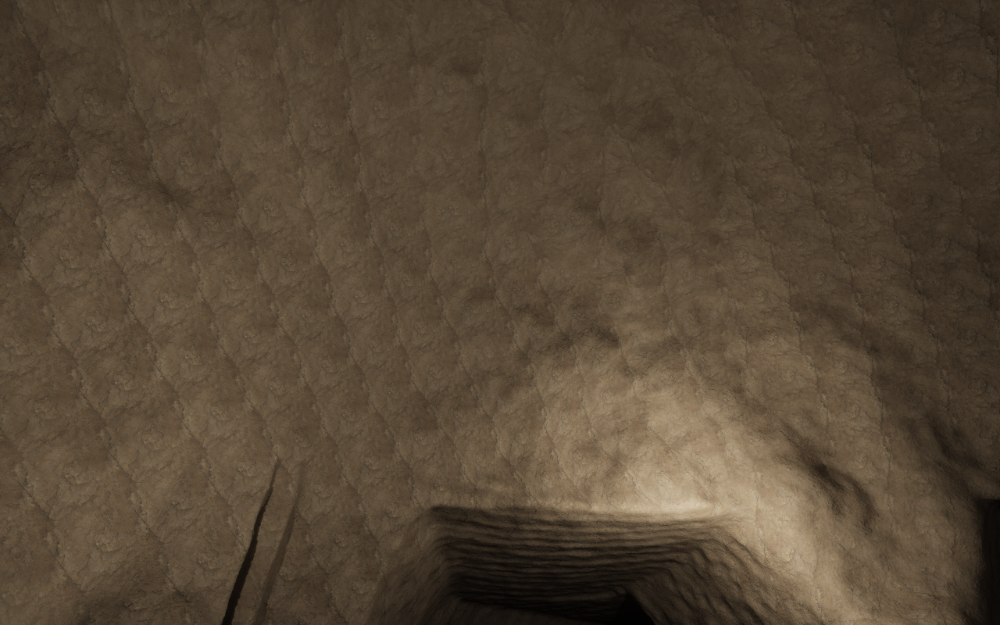
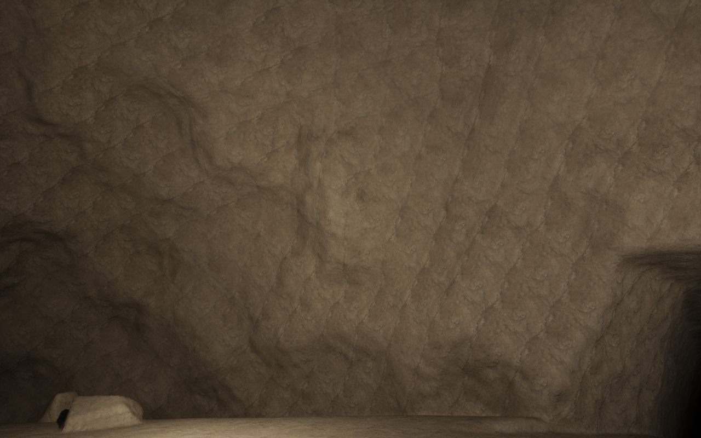

# Bedded carbonate karst, profile 6

The references for this family are Mammoth Cave's broad, layered passages and
Carlsbad's large, irregular chambers. Profile 5 failed human visual review:
rounded swept sections, a gutter floor and lumpy walls still dominated its
appearance. Passing its field and native integration tests did not qualify its
natural appearance. Saved profiles 1–5 remain frozen.

On subsequent manual review, this candidate failed the visual target: openings
remained regular and floors too flat. The user also fell through the entrance
floor while walking forward. Its recorded internal passage walk was not an
entrance qualification. See [profile 7](OrganicKarst.md) for the direct reference
comparison and native collision admission.

## Shape and scale

The existing watershed receiver/confluence graph, positively soluble carbonate
host, restored bedding contact and canonical rock deformation still determine
placement. The new dry family uses one bedding floor, including the reconnecting
side route. Its roof and width vary independently above that floor. Entrances
become rising walk-in branches intersecting the actual surface. No separate
navigation floor or mesh contributes to the cave.

The reference fixture is `Examples/BeddedKarst.json`, with a 600 m fitted surface
radius and 5 m authored cave radius. Its passages are substantially wider than
they are tall. Chamber lengths are 75–90 m, widths 47–56 m, and nominal heights
26–33 m. These are dimensions of this bounded construction, not a reconstruction
of either cave system. NPS describes the Mammoth reference passage as about
[60 ft wide and 30 ft high](https://home.nps.gov/places/audubon-and-little-bat-avenue-beneath-your-feet.htm).
Carlsbad's complete Big Room is far larger than one room in this fixture.

Broken wall beds and low shoulders shape the passage. Real bed contacts supply
unequal joint blocks rather than a repeated groove around the whole gallery.
Native field probes retain only wall remnants with both exposure and attachment
to surrounding bedrock. A native plane
intersects its irregular vault to form the broad bedding ceiling. Small native
noise is subordinate wall detail. The reference uses the existing Rock surface
for its carbonate units and thin partings; broad proof-material colour bands
are not used to imply cave structure. Rooms join unequal bays with different roof
heights. Native solid bedrock buttresses and partly embedded breakdown occupy
the margins, leaving the central crossing open. Transported blocks use unequal
native joint-plane corner fractures, rounding and limited weathering; they do
not retain the earlier perfect cube faces. In-place buttresses retain the
original rock coordinate; displaced breakdown has a rigid map to its roof-rock
source. Blocks are placed on the canonical curved floor and its marginal
shoulders, rather than on a tangent plane. No dissolution, collapse dynamics, sediment transport or secondary
mineral growth is simulated. Carlsbad's calcite decorations are not yet modeled.

## Floor continuity

All underground controls use the same restored bedding datum. The floor query
uses the existing immutable canonical rock field, preserving its deformation and
planetary curvature. Width or roof-height edits do not lift or drop the floor.
Small world-coordinate relief is shared across all passage and room features.
Low bedrock shoulders rise at the margins, leaving a broad clear walking floor.
Native intervals are hard-unioned into complete passages before passages and
rooms are smoothly joined. This prevents repeated blending from corrugating
the roof. Macro wall-relief noise has one physical wavelength over a whole
passage; changing it with the nearest section scales planet-centred coordinates
and creates artificial squeezed ridges. The shared native floor constraint is applied after those unions, so
repeated spline intervals cannot progressively erode the floor at a doorway.
The entrance uses the same construction on a smoothly graded floor.

A whole candidate is rejected if its enlarged sampled footprint lacks cover or
host support. New dry networks also reserve separate conservative envelopes;
rooms on different horizons must not accidentally cut through each other's floors.
These finite checks remain approximations, not continuous geological certificates.

## Ownership and compatibility

UE owns curve interpolation. VPP supplies the native spline nearest-point kernel,
spheres, planes, cubes, blends, Perlin and AABB indexing. The existing scene and
planet stamp provide the native field. VPP continues to own voxel generation,
meshing, LOD, collision, sculpting and compressed saves. No engine or VPP source
is modified. Runtime sampling retains immutable data, never mutable assets.

Typed settings and explicit Character edits select profile 6. The historical
UObject/CDO cave default remains 2, preserving native delta-package loading.
Saved profiles are never silently regenerated. New form values are appended.
The existing eye, indicator, Character knob, reseed, details and movement remain
the authoring interface. `Tools/create-bedded-karst-review.py` creates a missing
`DA_BeddedKarst`; it leaves existing assets untouched.

## Review gates

Inspect actual native surfaces at the normal character's roughly 1.6 m eye height.
Check passage width/ceiling proportions, room scale, bedrock shoulders and the
passage-to-room floor. Native character movement must cross the transition with
the ordinary moving 25 m VPP collision invoker. Scalar probes test broad walking
floors and junctions independently of the open graph. Also retain old-profile,
UI/Undo, background, package, native field, sculpt and independent reload checks.
Passing those checks does not constitute human artistic acceptance.

The isolated walking review uses eight engine workers through VPP's supported
native scheduler API before creating terrain (six background workers and two
foreground workers on the qualified 16-core host). This is a per-process review
setting; the ordinary editor and navigation comparison retain their defaults.
A two-background-worker attempt retained native ownership and 78.51 m of
continuously grounded movement, but timed out at 900 seconds while waiting for
LOD/inspection captures. A later startup-console attempt applied the worker
change after terrain tasks were queued and stalled in scheduler restart. Both
records are retained; neither counts as a passing qualification. The Lab now
applies the optional `-CLCaveReviewWorkers=8` before creating the voxel world.

## Qualified development checkpoint

On 7 November 2026, the isolated macOS arm64 UE 5.7.4/VPP 2.0p8 host passed
26 editor/field cases, including both focused profile-6 cases, and the native
rendered/navigation case after the final block-fracture and review-framing
refinement. Three editor warnings were external Google connectivity timeouts;
the rendered case reported zero warnings or errors. The full warning text is
retained in the record. The complete
[evidence record](../conformance/BeddedKarst/qualification-mac-arm64.json) retains
the commands, source hashes, metrics, failed attempts and explicit exclusions.

The reference builds four complete networks: 20 passages, four rooms, six native
bedrock buttresses, 22 transported blocks and seven attached wall-bed remnants.
Passage section envelopes span 12.54–35.23 m. The 224 independent floor probes
include entrance grades, passage mouths, lateral floor positions and chamber
crossings; their maximum offset from the intended floor datum is 0.0993 m.
Native field checks find at least 30 m of clear chamber width at human eye height
and 20 m of vertical air above the common floor.

The automatic native character crossed 78.76 m of passage-to-room approach,
with 2,076/2,076 moving frames grounded. Its measured eye height was
1.622 m. The existing 25 m moving collision invoker, terrain runtime and
native owners remained stable. The same world then passed native removal
(-98.07 → 136.72 cm), backfill (-77.95 cm solid),
unchanged outside-brush occupancy/geological identity and a 247,030-byte
compressed VPP save. A separate process cold-loaded that slot and reproduced all
136 retained field/material/geology probes with maximum measured field
error 0.000000 cm. Negative field values mean solid.

The current native editor case measures 16.45 ms p95 against the unchanged 50 ms
gate. Its 842,450 native vertices have a maximum field residual of
0.484881 m against the unchanged 0.5 m gate. The maximum knob
builds 8 networks in 7 domains (483,456 vertices,
0.302424 m maximum residual). The earlier frozen-profile-5
sequential control is retained beside the record. Navigation
starts no generation input requests and copies no meshes. The frozen control
precedes the final new6-only noise and breakdown refinements; it is not a second
same-revision timing.

These are normal-eye native captures before mining, using the fixture's existing
Rock material and temporary Lab review lights. They show actual terrain, not
inspection meshes or a rendered concept. Human artistic acceptance remains open.

