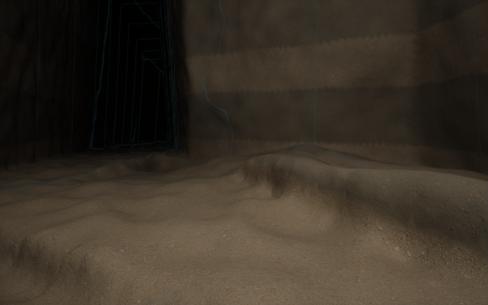
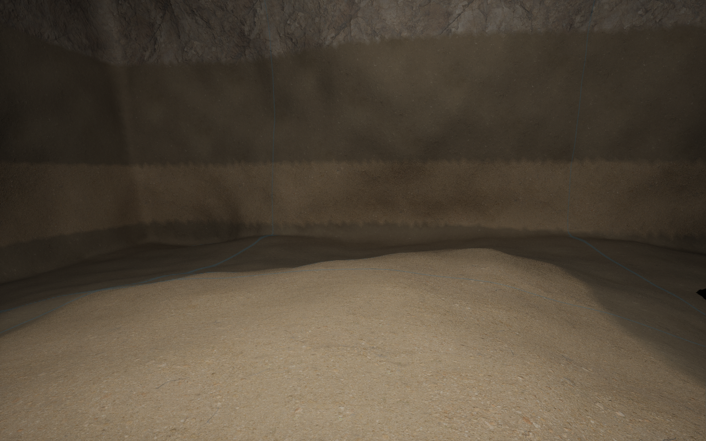

# Cave morphology profile 4

**Status — 6 November 2026: failed visual acceptance and deferred.** The user
rejected the box-like cuts as less cave-like. Native physics/save evidence below
does not establish acceptable cave appearance. Caves stay off in the starter
planet set; no further morphology work is part of this cleanup.

Profiles 1–3 qualified connected negative space and native presentation, but their
shared oval sections and ellipsoidal junction lobes failed the visual target. Their
passing tests did not establish natural morphology. Profile 4 develops the two
existing families; it adds no new cave family or editor control.

## Research and construction

[Paris et al. (2021)](https://aparis69.github.io/public_html/projects/paris2021_Karsts.html)
separate geological routing from implicit geometry and section development.
Their public Karst-Synthesis code explicitly omits the implicit surface generator;
it does not supply a ready-made morphology implementation.
[Franke and Müller (2022)](https://doi.org/10.1016/j.cag.2021.10.002)
address passage morphology, surfaces and speleothems as well as networks.
[BGS cave forms](https://www2.bgs.ac.uk/mendips/caveskarst/caveform.htm) and
[USGS cave geology](https://pubs.usgs.gov/sir/2008/5023/44toomey.htm)
describe bedding/joint controls, phreatic conduits, vadose canyons and breakdown.
These sources support different construction priors; they do not establish the
accuracy of this implementation or prescribe its numerical coefficients.

| Family | Profile 4 construction |
| --- | --- |
| Structural fissure | Planar reaches with discrete joint changes; tapered/sheared, high cleft sections; angular enlarged intersections. |
| Dry carbonate karst | Existing recharge/bedding routing; broad bedding slots, rounded upper conduits, keyholes with narrow incised floors, canyons and smooth section transitions. |
| Chambers | Separate width, height and length; asymmetric faceted roofs, tapered walls, bounded native relief, and angular roof scars. |
| Breakdown | Static solid rock blocks embedded at room margins, with source-rock coordinates retained through rigid displacement. |

The existing deformed stratigraphic coordinate supplies sampled section frames.
Bedding-slot height uses a physical bed thickness near the inception horizon.
Geological frames and host/cover checks are sampled approximations. Section-type
transitions are declared development priors, not reconstructed palaeo-water tables.
No chemistry, stress solution, mass-conserving collapse simulation or measured
cave reconstruction is claimed.

## Native ownership and demonstrated gaps

The audited VPP 2.0p8 API supplies native spline nearest-point evaluation,
`FVoxelSphereShape`, `FVoxelCubeShape`, native volume blend operators, Perlin noise
and the AABB index. VPP remains the sole voxel generation, meshing, LOD, moving
collision, sculpting and compressed-save platform. No custom mesher or streaming
manager is introduced.

Those native operators do not choose geological passage anatomy, derive bedding
frames from Catalyst's rock history, or carry source-stratum identity for rock
moved from a roof. Catalyst constructs those immutable inputs and coordinate maps,
then evaluates native shapes and blends inside its existing scene provider.
Room and passage surfaces are the same signed field used for gameplay, not a
separate decorative cave mesh. Breakdown is native solid terrain and can be mined;
only the displaced part inside the original cave air receives source-rock mapping.
Underlying unexcavated bedrock retains its original geology.

Fine native noise is deliberately small. It cannot substitute for wall/floor/roof
anatomy. Larger chamber relief is bounded separately. Smooth union radii are reduced
to avoid inflating every adjacent spline interval into a swollen tube.

Sediment transport/deposition and secondary mineral growth are not implemented.
The current source-rock model supplies no validated sediment provenance or growth
history, so assigning arbitrary sediment materials would fabricate geology.
Further erosional wall forms and selective soluble/insoluble bedding remain open.
These are cave-development specializations, not evidence that VPP needs replacing.

## Compatibility and review

Typed/new-factory profiles and explicit knob changes resolve version 4. Existing
saved versions 1–3 retain their construction until explicitly edited through the
knob. The UObject/CDO cave version remains frozen at 2 because UE packages can omit
properties equal to the historical default. Changing that default silently changes
old assets; the fresh-process legacy package test guards this boundary.

Separate create-only native assets are `DA_FissureMorphology`,
`DA_KarstMorphology` and `DA_CaveMorphology`, under
`/Game/LandformDesigner/Caves`. Existing cave recipes are not overwritten.
`Tools/create-cave-morphology-review.py` uses native asset/factory APIs and leaves
any existing asset untouched. The Lab's `Open Cave Morphology Review.command`
opens the isolated qualified host. The normal cave indicator dims the surface and
displays all native cave boundaries; normal orbit/zoom and the existing one-knob,
eye, indicator, reseed and directly expanded details remain the product UI.

Qualification includes anatomy probes, dense connected-route clearance, bulk/sparse
field parity, source-rock identity, native package geometry parity, same-scale
untextured rendered comparisons, all-domain visibility and navigation, and native
character contacts/walking/mining/placement/save/load. A short chamber walking
probe does not establish traversability of every route or junction. New cooked,
ACF, multiplayer and production-scale qualification remain outside this change.

Exact results and retained comparison images are in
[the qualification record](../conformance/CaveMorphology/qualification-mac-arm64.json).

## Native diagnostic gap observed in qualification

The 74-case broad editor run passed 73 cases. `Saved500m100` completed all its
functional assertions but recorded a handled `!CachedHash` ensure in VPP 2.0p8's
`FVoxelInvalidationCallstack::ComputeHash`, reached from render-task dependency
finalization through `FVoxelInvalidationQueue::FindInvalidation` / `AddCaller`.
The same case passed in a fresh process. The bounded predecessor-sequence recheck
is retained alongside the original report; the original failure is not discarded.

Audited native source publishes a shared invalidation callstack and lazily fills
its mutable optional hash without synchronization. That is consistent with two
readers entering hash computation together, but no concurrency instrumentation
established the root cause. This remains an unresolved native diagnostic gap.
No VPP diagnostic was disabled, no vendor source was modified, and no replacement
invalidation or streaming layer was introduced. Passing focused reruns is not a
claim that this intermittent diagnostic is fixed.

The first karst gameplay attempt also caught a proof assumption: a fixed metre
behind a collision hit lay in another void. It had four native contacts, completed
the walk and passed source-property probes; no mining was attempted at that air
point. The proof now queries native candidate/control pairs and requires both to
be solid before sculpting. It uses the host character's standard 25 m moving
collision-invoker radius for the walking variant; the old proof enlarged it to
40 m. The legacy non-walking variant retains that setting. Neither correction
changes generated geology or adds an alternative collision/streaming owner.

## Earthworks may join voids

An already-air brush centre is legitimate. Sculpting removes rock anywhere inside
its brush volume; it can break through thin walls and join openings, including
caves of different geological families. Neither candidate generation nor player
editing rejects that connection. The solid target/control selection above is
only an excavation measurement in the Lab proof, not a constraint on player tools.

`CaveBreakthrough.json` is a controlled native earthworks fixture, not a new
geological cave type: two enclosed voids with a two-metre wall and matching floor
levels. The `-CLCaveBreakthrough` Lab proof checks native air/solid occupancy and
capsule obstruction, sculpts with its brush centre already inside the second void,
then checks the opening and grounded character traversal into that void. A cold
reader must reproduce the saved fields and walk the connection again. Natural
caves with different floor levels can require further mining, steps or other
normal earthworks; this does not imply an automatic floor or navigation manager.

## Recorded result on macOS arm64

The 74-case broad run passed 73 cases; the native diagnostic case described above
passed both focused rechecks. The subsequent breakthrough fixture check also
passes: 75 distinct editor cases passed across those documented runs, with the
original ensure retained as unresolved evidence. All eight native gameplay
writer/reader processes pass without an ensure or fatal diagnostic.

The natural fissure, karst and mixed cases retain 86 / 146 / 138 probes on cold
reload with zero measured field error. Native runtime checks cover 12 / 10 / 18
exposed breakdown probes. Preview navigation p95 is 15.32 / 16.97 / 17.19 ms, with
no navigation-triggered input builds or mesh copies. These timings describe the
bounded preview cases, not cold game-world initialization or production scale.

In the controlled breakthrough, the brush centre was already 50 cm inside air.
The wall probe changed from -100 cm solid to +140 cm air. A capsule obstruction
became clear, and the character walked 8.49 m through the connection with 177
native grounded frames. The independent reader restored all four probes exactly
and walked 8.50 m through it again. This verifies the connection, not a new
geological family or automatic floor generation.

Native interior comparison (existing rock material and one proof light):

The same-scale untextured exterior views of the void boundaries, all-cave
captures and raw reports are retained in the qualification directory. These
images support human review; they do not certify final cave realism.
