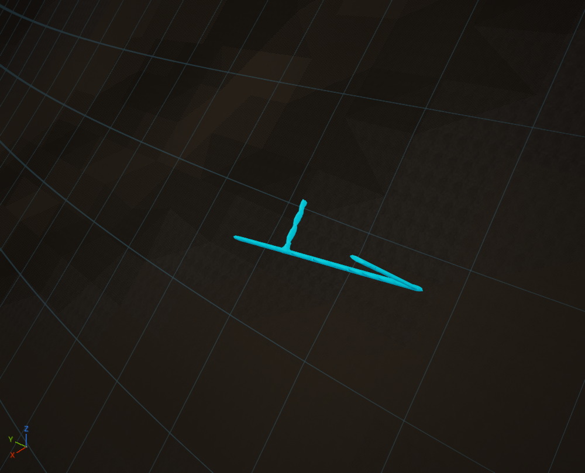

# Structural fissure cave layer

Caves supplies the first bounded underground generator: short, branching fissure
networks in selected rift/shear Landforms with explicitly declared fracture-capable
rock. The same immutable result cuts the native VPP scene and supplies its debug
view. Karst, lava tubes, large caverns and ice cavities remain future families.

## Review

Open `/Game/LandformDesigner/Caves/DA_FissureCaves`. The portable source is
[Examples/Caves.json](../Examples/Caves.json). Its sandstone, siltstone and shale
succession explicitly declares clastic lithology and fracture potential; it is a
review recipe, not an inferred reconstruction of geological history.

In **Geology → Caves**, use the ordinary eye, 0–100 knob and reseed. The native
chevron exposes advanced properties directly beneath that row. The second icon
switches cave inspection on independently of the eye. No additional tab, preview
checkbox, selector or settings panel is introduced. **Landforms → Include** remains
the sole default choice of available regional Landforms.

Cave inspection dims the existing native preview lighting and presents the actual
connected cave void in shaded cyan through the surface. Enabling it frames a
network automatically. Left drag orbits, middle drag pans and the wheel zooms
around that network. **F** or the existing **Frame** control returns to the whole
planet; click a cyan network handle to inspect another. Turning inspection off
restores normal lighting. These display preferences never alter the saved recipe.
The debug view is currently a globe diagnostic.

The volume is the intersection of generated cave air, the original rock and the
final air after authored earthworks. Entrance cutters stop at the actual surface,
backfill removes filled portions, and unrelated excavations are not highlighted.
This replaces the initial tiny capsule outlines/axes, which did not make the
connected passages readable or permit useful close-up inspection.

## Native ownership and feature audit

VPP remains the sole voxel generator and presenter, including LOD, collision and
sculpt/save behavior. Its volume spline stamps/graphs, volume layers, sphere/cube
shapes and native volume blending were inspected. Native spline stamps can express
curved passages, but do not supply the geological network, host eligibility or
planetary placement policy. This first straight-segment family lowers into the
existing `FCLCompiledVolumes` path. That path already uses VPP's sphere kernel,
subtraction blend and conservative AABB index. Its previously qualified capsule
coordinate specialization is reused; no spline-distance implementation, voxel
mesher, alternative presentation platform, scheduler or streaming manager is added.

Native UE lighting provides dimming. VPP's native volume layers and layer stack
isolate an additional diagnostic `AVoxelWorld` from the terrain in the same preview
scene. It presents the same accepted cave field using VPP's meshing, component
publication and LOD, with collision disabled. A native custom MegaMaterial uses
UE translucency, disabled depth testing and normal-based emissive shading to show
the solid cave-air volume through the dim planet. No diagnostic UAsset is saved.

The demonstrated gap is an application inspection view: VPP supplies field
execution, isolated layers, native mesh presentation and custom material binding;
it does not know which generated air belongs to Catalyst's cave recipe or which
network the designer wants framed. Catalyst supplies that field selection,
publication pairing and camera focus. The existing terrain owner remains intact.
The inspection owner is retained while enabled/disabled and receives input only
when the accepted terrain plan changes. Camera motion starts no recipe or stamp
input, and extracts no mesh. Its VPP LOD updates remain native.

The structural prior follows the distinction in [NPS open and closed faults](https://home.nps.gov/grba/learn/nature/geologic-faults-and-earth-movement.htm)
and [USGS cave fractures](https://www.usgs.gov/media/images/cave-fractures): structural
orientation can guide an opening, while fault proximity alone does not establish a
cave. Here an explicit host fracture potential supplies an authored opening prior.
The resulting recipe is a procedural geological approximation, not a geomechanical
fracture, collapse, dissolution or groundwater simulation.

## Geological prerequisites

Schema 23 adds Caves and typed rock-host metadata. A Rock unit retains its existing
identity, surfaces, mining resistance and erodibility, and can now declare lithology
and fracture potential independently. Old units remain `Unknown` with zero fracture
potential. No lithology is guessed from hardness, artwork or a unit's name, and no
old recipe is upgraded or repainted on load.

This first profile requires Rock, tectonics and generated regions. The candidate's
selected region must be a Continental rift or Transform/shear Landform, and its
local base-geology evidence must positively satisfy that profile. Node positions
remain within that same qualified profile; missing evidence, unsupported selected
Landforms or an empty available palette do not create random substitute caves.

The host rule is deliberately conservative: all three units in the existing Rock
palette must have known non-ice lithology and positive fracture potential. The
minimum of those potentials scales occurrence. A mixed unknown or protected unit
leaves the body uncut, with a readiness reason on the compiled result. This avoids
claiming selective 3D host clipping before that feature exists. Typed units are a
foundation for formation-aware generation; they are not a complete depositional,
chemical or eruption history. Province evidence versions retain their prior rules.

## Geometry and the knob

A fixed seeded equal-area candidate set is independent of the camera and mesh LOD.
Candidate density is 16/km², using the midpoint of the fitted minimum/maximum surface
radii as an explicit reference sphere. Acceptance uses requested network density ×
reference area / candidate count × host potential, including the small-body minimum
of 16 samples. This preserves physical occurrence scaling despite integer rounding.
It does not claim the exact area of a rough triangulated terrain surface.

The knob develops occurrence, physical passage length, aperture, depth and branching.
Zero development creates no cuts. Advanced values are resolved physical quantities;
changing the knob resolves the profile again. Reseeding changes candidate rotation,
occurrence and shape variation while retaining deterministic body-space identities.
Local extension/shear gradients guide the main axis. Three joined elliptical native
capsules form a fissure; optional branches and surface connectors use the same native
cutters. Radius, cover and depth are in metres, independent of preview scale.

The current proof admits at most 16,384 candidates and the existing 64 native volume
operations. Exceeding a budget refuses the complete result with a diagnostic; it
never silently drops networks, stretches features or coarsens the physical density.
These are qualification limits of this bridge, not limits claimed for VPP. The
finite candidate and node sampling is a placement approximation rather than an
exact continuous province/roof mask. Broad networks, exact contacts, larger-scale
placement and stable host-specific clipping require further qualification.

## Shared scene and persistence

Compilation finishes base terrain, elevation fitting, Rock and optional Watershed
before deriving cave cuts. Authored solid operations follow the natural caves,
allowing later backfill. Explicit backfill material is blended against the already
cut field; a cavity does not acquire a painted replacement geology. Cave walls use
the canonical Rock field, so strata and unit identities remain coherent at exposed
positions. Height-only fallback refuses a cave volume scene.

The existing `FCLRecipeEvaluation` worker owns generation, measured candidate
progress, cancellation, latest-result publication and shutdown. No second queue or
worker is added. Native VPP publication owns visible terrain; debug always reads
that published plan. A stale diagnostic is hidden while an authoring replacement
publishes; ordinary native camera/LOD updates retain the diagnostic.

The recipe stores the parameters and host declarations, not a camera-derived cave
mesh. Reload recreates deterministic native cuts. [The native qualification](../conformance/Caves/qualification-mac-arm64.json)
records actual bulk/sparse field parity, canonical rock/material identity, explicit
backfill, recipe reload, background equality, all eleven knob positions, editor
Undo, cold native-asset reload, dimming/restoration and navigation checks. It does
not establish a new cooked mining/character/contact/save qualification for caves;
the prior native sculpt-save pipeline is reused unchanged. Water reanalysis after
excavation, groundwater, speleothems, support/collapse physics, new cave families
and multiplayer remain outside this proof.

The next geological step is selective host/formation support and one eligible cave
family at a time. Karst needs soluble formations and an explicit water-flow/level
approximation; lava tubes need suitable flow history and geometry. A broad province
label cannot stand in for those inputs.

## Connected inspection qualification — 5 November 2026

The [native editor qualification](../conformance/CaveInspection/qualification-mac-arm64.json)
passes 56 checks, including cave fields, clipping/backfill, native rendered volume,
live input replacement, navigation and affected geology/volume/editor regressions.
The frozen 65 recipe has two networks, ten cutters and two entrances. The recorded
native view contains 4,605 inspection vertices; the maximum sampled cave-field
residual is 0.369 m at this native LOD. The 90-frame close-up navigation p95 is
23.12 ms; movement starts no new stamp/recipe input and copies no mesh.

The user's saved review asset, including its own knob/settings changes, is retained.
This qualification uses the portable frozen recipe for repeatability and separately
roundtrips the saved native asset's own payload. It adds no cooked cave gameplay,
mining, collision or sculpt-save claim.
