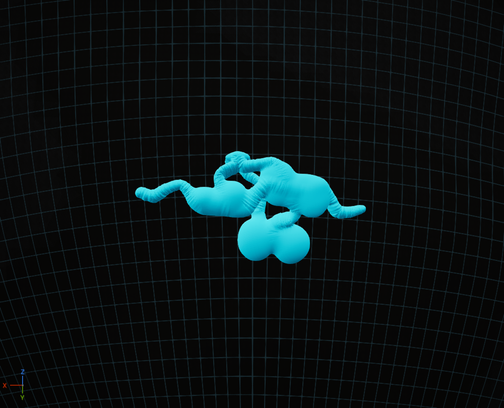
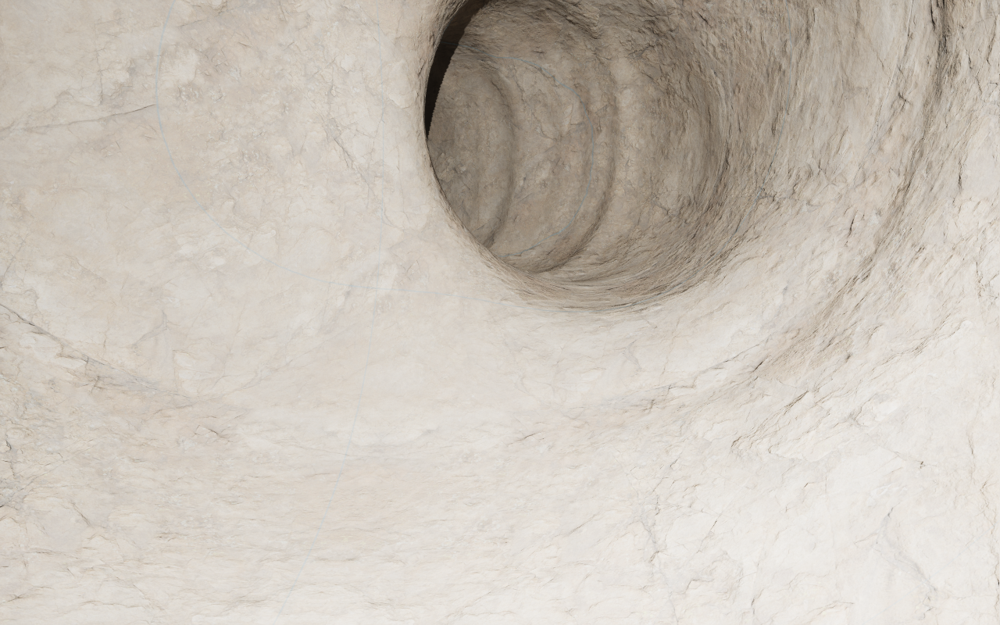
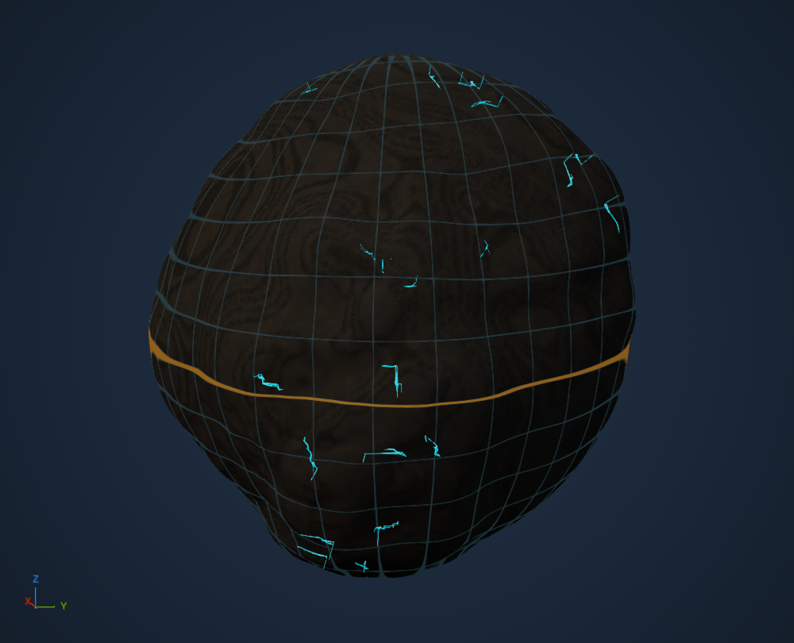
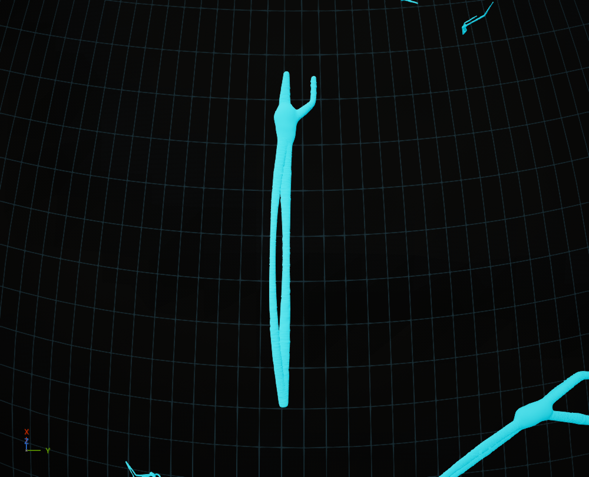
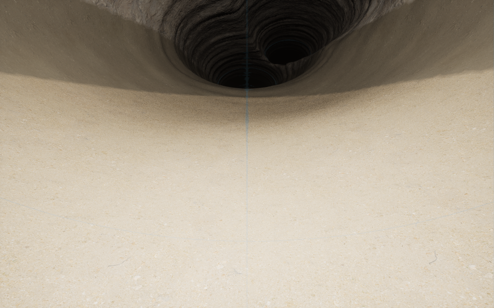
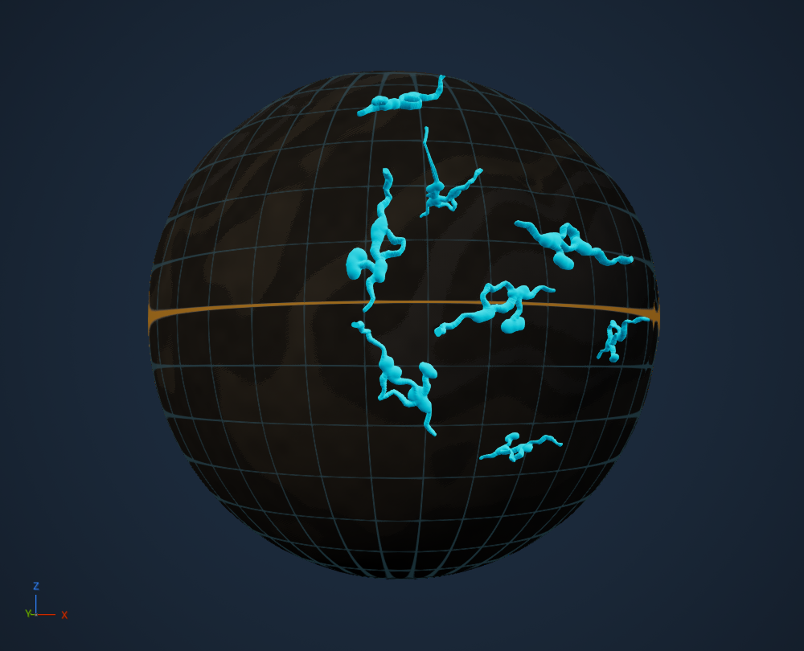
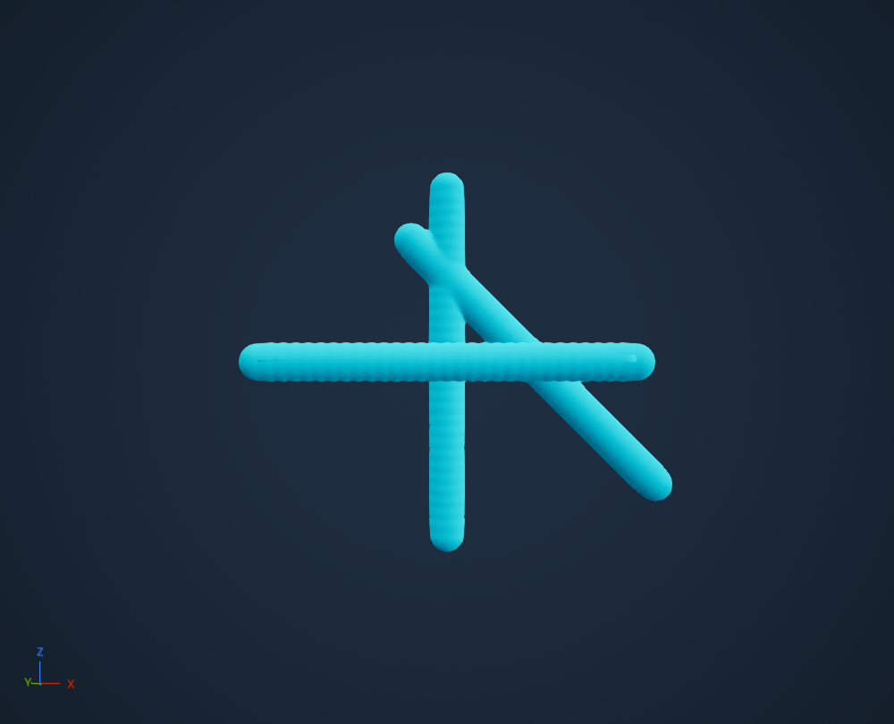

# Generated cave volumes

The current opt-in spatial family is [seeded multi-level carbonate caves, profile 9](ProceduralCaveFamily.md). Profiles 1–8 retain their saved definitions.

The opt-in [spatial passage/chamber prototype, profile 8](SpatialCavePrototype.md)
replaces swept sections for the next morphology review. Existing UI defaults
remain [Organic carbonate karst, profile 7](OrganicKarst.md).
[Profile 6](BeddedKarst.md) failed visual review for regular openings and flat floors;
its manual entrance fall is reproduced and addressed in the profile-7 record.
[Profile 5](NaturalKarst.md) failed human visual review after manual exploration.
[Profile 4](CaveMorphology.md) remains the failed-appearance historical checkpoint.
Earlier milestones below retain their historical scope; connected volume tests
alone did not qualify natural cave appearance.

The cave layer generates connected underground negative spaces in the planet's
native VPP field. Its floors, walls and ceilings are terrain surfaces with the
same canonical rock strata as the exterior. Native VPP sculpting can enlarge,
connect, mine or fill those spaces. The cyan debug view displays those same void
boundaries through a dimmed planet, with no camera change or independent geometry.

## Correction and acceptance

The previous three straight capsule segments, optional branch and uniform oval
section were a field/presentation prototype. They failed the intended cave
morphology. Earlier passing qualifications establish their recorded plumbing,
minimum counts and editor behavior; they do not establish natural cave realism.
The first volumetric milestone retained the recipe schema and added shared
junctions, curved passages, variable sections, enlarged junctions, loops and lower
levels. That qualified connected spaces, but its shared oval anatomy still failed
the visual target. Profile 4 adds the distinct section and room constructions in
[Cave morphology](CaveMorphology.md). Existing saved profiles remain unchanged
until the knob explicitly resolves the current profile.

The retained research separates geological constraints, network construction,
passage volumes and wall details:

- [Paris et al., 2021](https://diglib.eg.org/items/a4e7985c-af52-4b55-bd1a-eeeff6c47422): geological network skeletons and implicit conduit construction.
- [Franke and Müller, 2022](https://doi.org/10.1016/j.cag.2021.10.002): efficient phenomenological cave networks, passage forms, surfaces and suitable speleothems.
- [KarstNSim](https://github.com/ring-team/KarstNSim_Public): geological/hydrological network controls and separately generated passage sections.

Those works inform the separation of responsibilities. This structural profile
is not an implementation of their karst algorithms, a geomechanical fracture
solver or a calibrated reconstruction of cave history. It assumes explicitly
fracture-capable hosts and approximates openings along primary/conjugate joints
oriented by the existing extension/shear evidence. Enlarged joint intersections
are an authored structural opening prior. The carbonate karst specialization below adds a bounded dissolution morphology.
Lava-flow history and speleothem growth remain separate family work.
They must not be implied by this profile or by a broad province label.

## Native feature reconciliation

VPP 2.0p8 supplies the spline/shape/blend/noise/index operators and remains the
sole voxel generator, mesher, LOD, collision, sculpt and save platform. Audited:
`FVoxelVolumeSplineStampRuntime`, `UVoxelSplineStampFunctionLibrary`,
`FVoxelSplineSegment`, `FSplineCurves`, `FVoxelSphereShape`, native volume blends,
`FVoxelAABBTree`, PerlinNoise3D and `Get Voxel Flat Normal`.

`FCLCompiledCaveVolume` lowers immutable geological construction data into those
native operators inside the existing canonical scene provider. It calls the same
exported nearest-cubic-spline kernel as VPP's GetClosestSplineKey3D node. UE owns
curve interpolation and interval bounds. Legacy profiles use VPP's sphere kernel for normalized elliptical sections and
ellipsoidal chamber lobes. Profile 4 reuses native sphere and cube kernels for
geological sections, rooms, roof scars and solid breakdown; native blends join
the spaces and native subtraction cuts the planet. VPP Perlin supplies wall relief. No
spline-distance algorithm, noise implementation, mesher, sculpt persistence or
streaming manager is copied or replaced.

Catalyst's specializations are the geological graph, body-frame section placement,
physical dimensions, host/province selection, deterministic feature identity,
roof checks and the final scene ordering. A stable section frame handles steep
shafts without a radial/tangent singularity. The existing worker retains plain
immutable data; it never creates spline actors/components or reads mutable graph
assets while sampling. The native kernel ABI is pinned to the qualified VPP build.
A future ABI/platform change requires requalification.

The old 64-operation mask belongs to the authored-edit qualification profile. It
cannot accommodate meaningful natural networks. Generated caves now use VPP's
native AABB tree directly with a separate bounded natural-feature collection:
4,096 passages, 2,048 chamber/scar volumes and 65,536 solid features, in addition
to the existing 16,384 placement
candidate limit. Overflow refuses the complete build. Authored edits retain their
existing order and limits. These are bridge budgets, not VPP feature limits.

## Generation and editing contract

Structural caves require selected rift/shear Landforms with positive local evidence
and explicitly fracture-capable, known non-ice rock hosts. Carbonate karst has the
separate prerequisites below. The current conservative host
rule requires the entire three-unit palette to be compatible. Sampled footprint,
roof and cover checks reject a whole candidate before publication; these checks
are not a continuous mathematical roof/host certificate.

Enabled caves request at least one complete eligible network at every knob
position. The eye is the way to request zero. Algorithms 2–6 resolve density to a requested complete-network count over estimated
eligible physical area, then visits stable occurrence-ranked sites. The automatic
profile is `6 * Character²` networks per eligible km². Physical area is measured at
the fitted surface midpoint, using the existing equal-area candidate sampling.
Counts round upward and retain the enabled minimum. Complete-fit capacity (and spacing in legacy profiles and the new bedded-karst family)
can limit a request; readiness reports requested and accepted counts explicitly.
It never silently stretches caves to fill a planet or fabricates host geology.
Missing prerequisites or an impossible complete fit produce an explicit error.
The minimum never fabricates eligible geology or an independent debug-only cave.

One immutable result defines the actual solid/air field, geological queries and
diagnostic boundaries. Authored earthworks and native sculpting follow natural
cave generation. Backfill can deliberately fill a generated cave; the minimum
does not undo player edits. Rock identity remains a canonical geological query; profile 4 maps transported
breakdown back to its roof-rock source.

The UI remains the standard eye, indicator, one knob, reseed and directly expanded
advanced properties. Cave debug dims the current planet and displays every network
at its real physical scale. Ordinary navigation, camera position and native
owners remain unchanged. Existing native bounded diagnostic domains are retained;
all networks are active together and none are camera-streamed. Debug uses VPP's
native voxel-normal material node to reveal surface form.

## Verification

Acceptance requires connected open volumes, measured section/chamber variation,
multiple graph layouts, native surface geometry and visual review. Native editor
checks also cover exact saved 500 m and reference 2 km planets, all-cave/far-side
visibility, no camera changes, normal navigation cost, native field parity,
canonical geology, backfill, deterministic recipe reload and background equality.
Test-only detail captures happen after the navigation benchmark; they do not add
product navigation behavior.

`ACLGeneratedCaveProofGameMode` is an isolated Lab qualification host. It uses the
actual generated 500 m recipe, ordinary `ACLPlanet`, native VPP generation/LOD and
moving collision invoker, then puts the normal character inside a generated
chamber. It checks floor/ceiling/wall contacts, grounded character frames,
underground native sphere mining, solid placement and compressed native sculpt
saving. A fresh process loads the recipe and sculpt save and compares native
fields, surfaces, rock properties and stratum identities at retained probes.

Exact results, visual evidence and remaining limits are recorded in the adjacent
qualification record. Passing these bounded examples does not qualify every
advanced dimension, whole-planet scale, geological family or cooked target.

The earlier structural milestone (`5097cd0`) is retained in its
[qualification record](../conformance/CaveVolumes/qualification-mac-arm64.json):
60 distinct native/editor checks pass across the full regression and focused
rendered-test correction. The latter uses a matched hidden-cave image control to
check shaded, subpixel far-side coverage rather than assuming the old bright
cyan material. Recorded cave navigation p95 is 19.34 / 18.64 / 20.88 ms for the 2 km,
500 m at 1 and saved 500 m at 100 cases, with no input starts or mesh copies during
navigation. Normal globe/property-scroll regressions pass as well.

The standalone native writer retained four floor/ceiling/wall contacts and 1776
grounded character frames. A native wall probe changed from -95.34 cm solid to
137.44 cm air after mining, then -74.47 cm solid after placement. A control outside
the brush remained unchanged. The compressed native save is 174493 bytes. A fresh
process reproduced all 34 retained field/surface/property/geology probes with
zero measured distance error. This establishes the recorded editor/standalone
case; new cooked and route-by-route traversal qualifications remain open.

Loading a version-1 cave profile upgrades only density equal to its former automatic
`0.8 * Character` value; a custom density and all other advanced dimensions remain
authored. Version 2 records the new semantics. This deliberately revises the
unreleased automatic abundance profile requested by the user. Import, PostLoad and
direct compile use the same upgrade; PostLoad does not save or dirty the asset.
A manually authored value exactly equal to the old automatic value is
indistinguishable and receives the same upgrade. Moving the knob resolves the full
current profile. At globe scale some metre-sized passages are subpixel;
ordinary zoom exposes their actual surfaces. No diagnostic size inflation is used.

## Carbonate karst

The next cave family uses the **included Carbonate Platform Landform**, a finite
Rock bedding history, an explicitly carbonate three-unit palette with positive
`DissolutionPotential`, and the existing Watershed result. Generic rock hardness,
a name, a biome or the province label cannot supply soluble-host evidence. The
first profile conservatively requires the whole palette to be compatible;
selective mixed soluble/insoluble beds, evaporite and marble karst remain open.
Only positively established carbonate succession is added to province evidence;
age, eruption and other unknown histories remain unknown.

The retained [Paris et al. study](https://diglib.eg.org/items/a4e7985c-af52-4b55-bd1a-eeeff6c47422)
and [KarstNSim](https://github.com/ring-team/KarstNSim_Public) motivate separate
geological routing constraints, connected graphs and varying conduit volumes.
This is an efficient geological construction prior, not their numerical model or
a calibrated dissolution/groundwater evolution solver.

The adapter locates a site through Watershed's **existing UE mesh AABB tree**,
follows its acyclic receiver chain and requires an actual incoming confluence for
a secondary recharge branch. Ocean/lake cells cannot seed these terrestrial
routes. It chooses an actual older Rock bedding contact below the sampled roof
and deforms the conduit with the existing canonical Rock coordinate. It does not
run another drainage search or trace every surface hill underground. Rounded
phreatic-style reaches, keyhole vadose-style sections, a confluence chamber and a
developed upper bypass provide distinct three-dimensional passage morphology.
The optional recharge shaft really intersects the terrain; a buried receiving
continuation is **not** falsely labelled a spring. There is no new family selector:
included Landforms and host geology select the family.

Native VPP supplies the section implementation too. A keyhole is the smooth union
of an upper oval and a narrower, downward-offset oval, both evaluated by the same
native sphere kernel in the existing spline section frame. Native spline bounds,
shape bounds, minimum section resolution and blends include the lower slot.
These sections feed the shared planet negative-space field and the same debug
surfaces, collision, sculpting and saves. The invariant diagnostic material graph
is shared by native transient UObject references across network domains; no
per-camera generation or custom streaming manager is introduced.

The inception contact is a historical geometry prior, not a solved water table.
The current surface receiver graph guides topology, not subsurface discharge or
hydraulic head. No sink/spring flow transfer, groundwater balance, flooded cave
surfaces, sediment transport, speleothems or time-evolving chemistry is claimed.
Changing reference rain scales Watershed discharge but does not regenerate cave
history. Routes may follow folded bedding up and down as a phreatic prior; this is
not a promise of open-channel gravity flow along every reach. Roof/host checks are
sampled, not a continuous geological certificate.

The automatic density now requests several complete caves on the saved 500 m
structural case. Native debug continues to dim the current globe and show all
networks at real scale, including the far side, without changing the camera.
`Examples/KarstCaves.json` and `Tools/create-karst-review.py` supply a separate
portable recipe and create-only-if-missing native review asset. Existing user
assets are never replaced.

### Demonstrated adapter gaps and native corrections

Rock used to compile after province placement, leaving explicit carbonate evidence
unknown during selection. After canonical Rock compilation, neutral province
placeholders are reclassified by the **existing** equal-area geology classifier
using captured native neutral child inputs. They cannot change height/material.
Physical regional forms mixed into this reconciliation refuse explicitly: they
need geology-before-relief ordering, which this bounded neutral-placeholder proof
does not claim. The worker creates no UObjects and generic/unknown palettes keep
their previous evidence. Existing regional relief is not generated twice.

A tight karst corner reproduced a roughly 0.7 m field jump across 2 cm of physical
space. Individual noise-free native queries isolated an incompletely converged
nearest key on a long cubic interval; neither wall noise nor network overlap
explained that point. The public native kernel has fixed Newton tolerances.
The adapter now uses UE evaluation/derivatives to reparameterize the same Hermite
curve into shorter exact cubic intervals (a 4 m control-extent target), then uses
VPP's native nearest-key kernel and bounds for each interval and native smooth
union for the section volumes. Local radial section frames and UE's native axis
fallback handle changing directions. No nearest-distance algorithm was copied.
A frozen corner regression retains the three-axis field-step check. The separate
65,536 native-interval budget refuses an oversized build before publication.

Complete native support bounds reserve distinct network sites, including a
potential surface-access envelope when entrances are off. This keeps separate
network domains from presenting internal overlapping boundaries and leaves their
identities stable when entrances are toggled. It is static placement validation,
not a streaming policy. Density is measured over host/province-compatible area;
terrestrial drainage, full-route cover, geometry and reservation checks can lower
complete-fit capacity.

The larger diagnostic also exposed component overhead. It now uses VPP's native
`RenderChunkSize=128` for cave domains and shares the identical transient native
material. The ordinary terrain/runtime worlds retain their existing settings.
An exact max-intersection optimization uses the native sphere node with the
calibrated lower height bound to omit expensive natural-surface evaluation where
it cannot change the cave boundary. Earthwork/backfill cases retain the full
intersection path. Independent full-field queries, including surface/exterior
points, qualify that pruning to the recorded floating-point tolerance.

The rendered test reads native geometry back only as its verification oracle;
those full CPU readbacks can take seconds on millions of vertices. Product
navigation does not copy native meshes or perform that verification pass.

### Current qualification

[Karst and abundance qualification](../conformance/KarstCaves/qualification-mac-arm64.json)
retains 63 passing distinct native/editor checks: the full regression plus the
matched-control correction of one screenshot oracle. It includes all-cave native
surfaces, far-side visibility, unchanged camera/owners, navigation, background
compilation, geological eligibility, connected volumes, native fields and recipe
persistence. The current native library asset cold-loads and round-trips its
explicit hosts and selected Carbonate Platform source.

The saved 500 m recipe now gives 1 / 1 / 1 / 1 / 2 / 3 complete networks at knob
0 / 1 / 25 / 50 / 75 / 100. Loading its former automatic profile at 100 gives three
without moving the slider or rewriting its saved bytes. The 2 km karst recipe
has 21 native networks at its saved setting and 22 at maximum. Complete-fit
capacity is reported explicitly. Host potentials are declared eligibility gates
in this bounded profile, not calibrated dissolution/formation-rate controls.

Recorded navigation p95 is 20.75 ms for karst and 18.23 ms for saved 500 m at 100.
The rendered karst field residual is 0.254 m at the saved setting and 0.266 m at
maximum. Every generated network is represented by native surfaces; navigation
starts no inputs and copies no meshes. The corrected screenshot oracle compares
against an identical dimmed image with native cave components hidden, rather
than requiring a fixed shaded cyan brightness.

The karst writer retained four native chamber contacts and 1791 grounded character
frames. Mining changed its wall field from -82.49 to 139.89 cm; native placement
returned it to -75.83 cm solid. Its compressed native save is 213675 bytes. A fresh
process restored all 216 retained probes with zero measured field error and exact
surface/property/unit/stratum identities. The structural writer/reader repeated
the same proof at 500 m, restoring 98 probes with zero error. These are native
standalone cases, not new cooked or route-by-route traversal claims.

The outside-brush control checks occupancy and geological identity. Native
`FVoxelSphereVolumeModifier::Apply` uses smooth max for removal; admitted sculpt
data can legitimately change a field magnitude outside the sphere when the new
cavity is nearer. The karst control stayed solid and retained its identity while
its value changed. The previous invariant-magnitude assertion was a harness
assumption, not a VPP editing guarantee. Cold readers compare the resulting raw
fields exactly; mining/control summary fields in those reader reports are unused.

All 23 protected workspace edits, 115 component content files and 176 existing
review-host content files remain byte-identical. The separate new karst asset
and launcher are committed; the saved fissure review asset is preserved.

## Mixed families and intersections

A planet can include Structural and Carbonate Karst formations together. Included
Landforms and demonstrated host geology select the family at each eligible site;
there is no family selector added to the cave row. Carbonate beds can also be
fracture-capable. `Examples/MixedCaves.json` is a bounded reference of that case,
with Carbonate Platform, Continental Rift and Transform Belt included.

New factory planets, typed profiles and knob changes resolve cave algorithm 3.
The UObject/CDO serialization default remains 2: native packages can omit fields
matching their old CDO, so changing that default silently reinterpreted saved
recipes. A native load check demonstrated this for both saved cave assets.
Freezing that default preserves their profile and disk bytes; newly created
packages explicitly retain 3. Algorithm 3 removes the previous
centroid spacing and non-overlapping support reservation. Complete roof/host and
construction-budget checks still apply. Independent formations may intersect,
including across families. Native VPP smooth union combines their air volumes
before planet subtraction, producing one editable void with no internal source
wall. Formation IDs and geological provenance remain available after a join;
formation count is not a count of disconnected physical caves. The generator
does not force every formation to connect. Profiles 1/2 retain their prior
placement rules until the user resolves the current knob profile.

The debug presenter previously used one native voxel world per formation. That
would incorrectly show internal surfaces at an intersection. It now groups
potentially overlapping support boxes using VPP's AABB tree and UE GeometryCore's
disjoint set, and presents each complete group through one native VPP union.
Support includes potential entrances so a fixed formation set retains native
owners when entrances are removed. Removing entrance constraints can admit
different eligible formations; unchanged domain IDs retain their native owners.
These are static inspection domains, not a connectivity simulation:
boxes can overlap while solid rock still separates their cavities. No links are
invented from a box intersection. Every domain is active together.

Native audit: VPP's `FVoxelVolumeSplineStampRuntime::GetChildren` can supply
per-segment support bounds. Applying it to every short exact evaluation interval
in this adapter caused excessive native query splitting over overlapping bounds
in the large mixed reference. That attempted adaptation is rejected. Inspection
retains the standard single bound for each combined domain; the existing native
AABB tree selects spline features within it. Native physical voxel spacing
follows the narrowest section: a 25 cm cap for
small sections, up to 50 cm in wide systems, and at least four samples across the
minimum passage diameter. Acceptance retains the same 0.5 m surface-field error
bound. Native wall noise is sent to the existing SIMD kernel in batches; a
separate check compares it against the prior scalar binding.

`FVoxelRenderSubsystem::TryInitializeRootChunks` and `FVoxelRenderTree` use an
enclosing render domain and can subdivide empty space at fine physical detail.
Consequently this change retains bounded static domains rather than demanding a
single fine-resolution whole-planet diagnostic render box. VPP owns all mesh
production, LOD and presentation. No custom streaming manager or mesh builder is
introduced. Long chains of overlapping supports can enlarge a diagnostic domain;
production-scale performance of that case remains unqualified.

The native operator fixture separately checks same-family and cross-family open
junctions, nearby disconnected cavities with overlapping bounds, and backfill.
The generated mixed reference must demonstrate real independent positive-air
field overlap between the two geological families, not merely intersecting graph
lines or bounding boxes. Rendered
native vertices are checked against the complete union field to reject internal
walls.

The [mixed qualification](../conformance/MixedCaves/qualification-mac-arm64.json)
records 70 passing distinct checks across the regression and focused native
asset/timing corrections. The actual library package reloads with profile 3 and
reproduces the qualified passage points, sections and incision. Existing saved
fissure/karst packages retain profile 2 without becoming dirty. All 23 protected
workspace edits, 115 component content files and 177 original review content
files retain their captured hashes.

The 800 m reference contains eight structural formations and one carbonate karst
formation with a real positive-volume cross-family junction, presented in seven
native inspection domains. The maximum knob produces 24 formations in 23 domains.
Every native mesh vertex is checked against the complete union field: maximum
residual is 0.248285 m at the saved setting and 0.243303 m at maximum. Navigation
p95 is 27.76 ms, with zero input starts or mesh copies. Timing isolates only the
few-second sample from the older review editor, then resumes it; competing-editor
failures and the unchanged 50 ms budget are retained in the record.

Actual native gameplay uses the library's exported recipe. It retains four
chamber contacts and 1,253 grounded writer frames. Mining changes the wall field
from -100.63 cm to 139.35 cm air; native placement returns it to -75.72 cm solid.
The outside control remains solid with unchanged material/geology. Its field
magnitude changes because a nearer cavity was mined. A 192,302-byte compressed
native save reloads in an independent process, reproducing all 216 retained
field/material/geology probes with zero measured field error. This proves the
recorded chamber and probe set, not full-route traversal or every natural
junction's player clearance. No new cooked, ACF or multiplayer claim is made.

The larger 2 km reference is retained as an unaccepted workload reproducer; its
concurrent-editor timing is not an isolated performance comparison. Long chains
of overlapping support remain a qualification gap. They do not establish a need
for a custom streaming manager.

The current one-family reference is [organic carbonate karst, profile 7](OrganicKarst.md).
It replaces profile 6's roof clip and low-relief floor with unequal dissolution
lobes and a shared rolling floor. Saved profiles 1–6 retain their morphology;
new explicit Character edits select 7. The manual entrance fall also led to
native collision admission in the existing radial movement adapter, documented
with the reproduced failure and normal-speed entrance proof.
