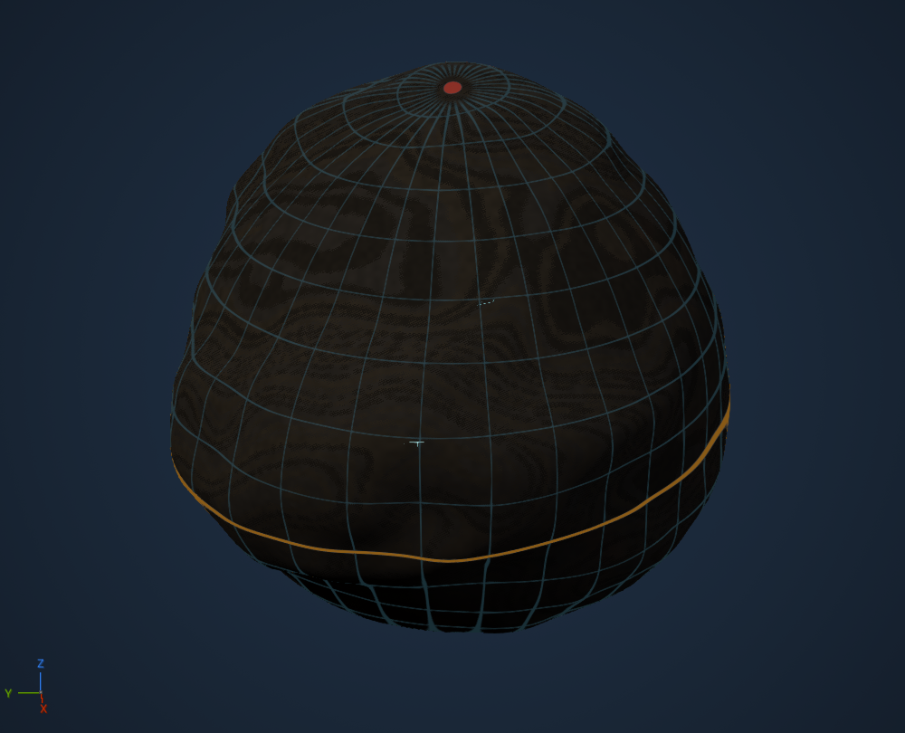
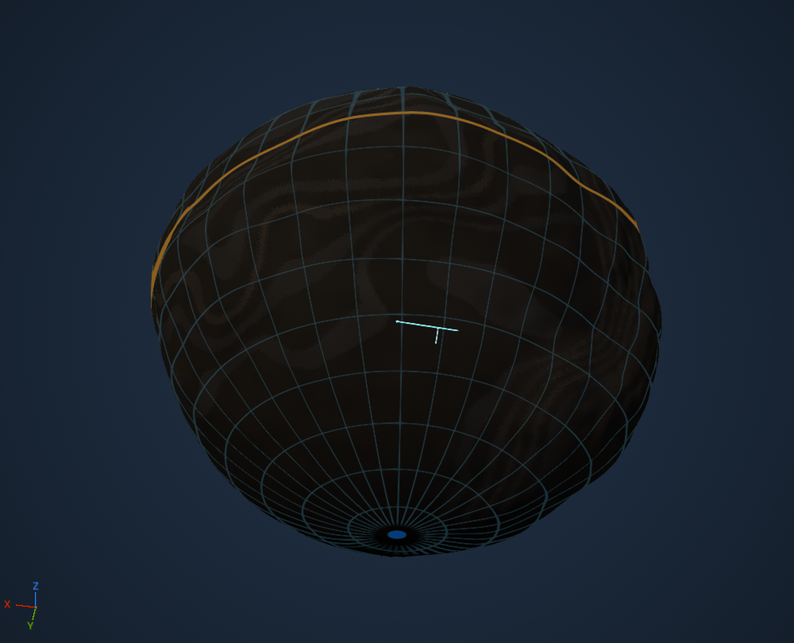

# Structural fissure cave layer

Caves supplies the first bounded underground generator: short, branching fissure
networks in selected rift/shear Landforms with explicitly declared fracture-capable
rock. The same immutable result cuts the native VPP scene and supplies its debug
view. Karst, lava tubes, large caverns and ice cavities remain future families.

## Review

Open `/Game/LandformDesigner/Caves/DA_FissureCaves`. The portable source is
[Examples/Caves.json](../Examples/Caves.json). Its sandstone, siltstone and shale
succession explicitly declares clastic lithology and fracture potential; it is a
review recipe, not an inferred reconstruction of geological history.

In **Geology → Caves**, use the ordinary eye, 0–100 knob and reseed. The native
chevron exposes advanced properties directly beneath that row. The second icon
switches cave inspection on independently of the eye. No additional tab, preview
checkbox, selector or settings panel is introduced. **Landforms → Include** remains
the sole default choice of available regional Landforms.

The cave indicator dims the existing native preview lighting and shows the
surfaces of **all generated caves together**, in shaded cyan through the planet,
including the far hemisphere. It keeps the current camera, selection and ordinary
globe navigation unchanged. Turning it off hides those surfaces and restores the
lighting. There is no cave focus mode, automatic zoom, network picking or handle.
Caves keep their actual physical dimensions; a metre-wide passage occupies very
few pixels when the whole kilometre-scale planet is framed.

The volume is the intersection of generated cave air, the original rock and the
final air after authored earthworks. Entrance cutters stop at the actual surface,
backfill removes filled portions, and unrelated excavations are not highlighted.
This replaces the initial tiny capsule outlines/axes, which did not make the
connected passages readable. The subsequent automatic focus/select experiment
was rejected: debug is an all-cave display preference, not a navigation mode.

## Native ownership and feature audit

VPP remains the sole voxel generator and presenter, including LOD, collision and
sculpt/save behavior. Its volume spline stamps/graphs, volume layers, sphere/cube
shapes and native volume blending were inspected. Native spline stamps can express
curved passages, but do not supply the geological network, host eligibility or
planetary placement policy. This first straight-segment family lowers into the
existing `FCLCompiledVolumes` path. That path already uses VPP's sphere kernel,
subtraction blend and conservative AABB index. Its previously qualified capsule
coordinate specialization is reused; no spline-distance implementation, voxel
mesher, alternative presentation platform, scheduler or streaming manager is added.

Native UE lighting provides dimming. Each generated network has a tightly bounded,
centred native `AVoxelWorld`, isolated by its own native volume layer/stack. All
networks are active and displayed together in the existing preview scene. VPP owns
their field sampling, subdivision, meshing, components and publication. Native
collision is disabled for these editor diagnostics. Native custom MegaMaterials
use UE translucency, disabled depth testing and normal-based emissive shading.
No diagnostic material UAsset is saved.

The native audit demonstrated two presentation gaps with the earlier setup:

- Native camera-distance quality 4 sampled the thin caves away in the fixed globe
  reproducer: two generated networks, zero native surface vertices.
- Applying fine native quality 8192 to a single planet-spanning domain reached
  `voxel.MaxRenderChunks`. VPP 2.0p8's render tree is rooted at the voxel-world
  origin and uses one enclosing box, so fine subdivision also covers empty space
  between distant networks.

The correction uses native configuration and bounded static diagnostic domains.
Each network's existing cutter operations are lowered through `FCLCompiledVolumes`
into the same native kernels; the native world is centred on that network while
the stamp's body-coordinate transform stays canonical. Native quality 8192 retains the qualified fissure surfaces at overview distance.
Voxel detail is resolved in body-space metres before display normalization: at
most 20 cm per cell, refined to at least four cells across the narrowest passage
diameter, then converted to VPP's integer display-space voxel size.
The main terrain world and its normal quality are unchanged. This is editor
presentation, not a new cave generator or a production streaming requirement.

Catalyst supplies cave provenance, field clipping and publication pairing. It
retains native domain owners by stable network identity across accepted edits and
adds/removes them only when the generated network set changes. Camera motion
starts no input, extracts no mesh and does not select or retire networks. Every
network remains active regardless of which hemisphere faces the camera. The
existing progress display reports native network readiness while input is built;
ordinary navigation shows no authoring progress.

The structural prior follows the distinction in [NPS open and closed faults](https://home.nps.gov/grba/learn/nature/geologic-faults-and-earth-movement.htm)
and [USGS cave fractures](https://www.usgs.gov/media/images/cave-fractures): structural
orientation can guide an opening, while fault proximity alone does not establish a
cave. Here an explicit host fracture potential supplies an authored opening prior.
The resulting recipe is a procedural geological approximation, not a geomechanical
fracture, collapse, dissolution or groundwater simulation.

## Geological prerequisites

Schema 23 adds Caves and typed rock-host metadata. A Rock unit retains its existing
identity, surfaces, mining resistance and erodibility, and can now declare lithology
and fracture potential independently. Old units remain `Unknown` with zero fracture
potential. No lithology is guessed from hardness, artwork or a unit's name, and no
old recipe is upgraded or repainted on load.

This first profile requires Rock, tectonics and generated regions. The candidate's
selected region must be a Continental rift or Transform/shear Landform, and its
local base-geology evidence must positively satisfy that profile. Node positions
remain within that same qualified profile; missing evidence, unsupported selected
Landforms or an empty available palette do not create random substitute caves.

The host rule is deliberately conservative: all three units in the existing Rock
palette must have known non-ice lithology and positive fracture potential. The
minimum of those potentials scales density-driven occurrence. An enabled layer
with unknown/protected hosts or missing prerequisites now refuses compilation
with an explicit reason; it does not accept a successful empty cave result. This avoids
claiming selective 3D host clipping before that feature exists. Typed units are a
foundation for formation-aware generation; they are not a complete depositional,
chemical or eruption history. Province evidence versions retain their prior rules.

## Geometry and the knob

A fixed seeded equal-area candidate set is independent of the camera and mesh LOD.
Candidate density is 16/km², using the midpoint of the fitted minimum/maximum surface
radii as an explicit reference sphere. Acceptance uses requested network density ×
reference area / candidate count × host potential, including the small-body minimum
of 16 samples. This preserves physical occurrence scaling despite integer rounding.
It does not claim the exact area of a rough triangulated terrain surface.

While the layer is enabled, every knob position—including 0 and 1—requests at
least one admissible cave network. The eye toggle is the way to produce zero.
The knob develops density, physical passage length, aperture, depth and branching.
Advanced values are resolved physical quantities;
changing the knob resolves the profile again. Reseeding changes candidate rotation,
occurrence and shape variation while retaining deterministic body-space identities.
Local extension/shear gradients guide the main axis. Three joined elliptical native
capsules form a fissure; optional branches and surface connectors use the same native
cutters. Radius, cover and depth are in metres, independent of preview scale.

The existing seeded physical-density draws run first. If they produce no network,
the compiler tests eligible candidates in deterministic draw order and places the
first complete network that satisfies the same province, host and path rules.
Positive density results are unchanged; the minimum does not add another cave to
an already populated world. Zero advanced density means the enabled minimum with
no density-driven extras. If no complete network can fit the selected geology and
dimensions, the build fails explicitly. No unsupported hosts, provinces or fake
debug-only caves are substituted. This corrects the enabled-layer contract without
changing recipe schema 23 or the native operation format; it changes previously
empty enabled outputs, as explicitly requested. Saved assets are not rewritten.

The current proof admits at most 16,384 candidates and the existing 64 native volume
operations. Exceeding a budget refuses the complete result with a diagnostic; it
never silently drops networks, stretches features or coarsens the physical density.
These are qualification limits of this bridge, not limits claimed for VPP. The
finite candidate and node sampling is a placement approximation rather than an
exact continuous province/roof mask. Broad networks, exact contacts, larger-scale
placement and stable host-specific clipping require further qualification.

## Shared scene and persistence

Compilation finishes base terrain, elevation fitting, Rock and optional Watershed
before deriving cave cuts. Authored solid operations follow the natural caves,
allowing later backfill. Explicit backfill material is blended against the already
cut field; a cavity does not acquire a painted replacement geology. Cave walls use
the canonical Rock field, so strata and unit identities remain coherent at exposed
positions. Height-only fallback refuses a cave volume scene.

The existing `FCLRecipeEvaluation` worker owns generation, measured candidate
progress, cancellation, latest-result publication and shutdown. No second queue or
worker is added. Native VPP publication owns visible terrain; debug always reads
that published plan. A stale diagnostic is hidden while an authoring replacement
publishes; ordinary native camera/LOD updates retain the diagnostic.

The recipe stores the parameters and host declarations, not a camera-derived cave
mesh. Reload recreates deterministic native cuts. [The native qualification](../conformance/Caves/qualification-mac-arm64.json)
records actual bulk/sparse field parity, canonical rock/material identity, explicit
backfill, recipe reload, background equality, all eleven knob positions, editor
Undo, cold native-asset reload, dimming/restoration and navigation checks. It does
not establish a new cooked mining/character/contact/save qualification for caves;
the prior native sculpt-save pipeline is reused unchanged. Water reanalysis after
excavation, groundwater, speleothems, support/collapse physics, new cave families
and multiplayer remain outside this proof.

The next geological step is selective host/formation support and one eligible cave
family at a time. Karst needs soluble formations and an explicit water-flow/level
approximation; lava tubes need suitable flow history and geometry. A broad province
label cannot stand in for those inputs.

## Planet-wide inspection qualification — 5 November 2026

The [planet-wide qualification](../conformance/CaveOverview/qualification-mac-arm64.json)
supersedes the earlier [focus/select experiment](../conformance/CaveInspection/qualification-mac-arm64.json).
The latter remains historical evidence and is not the accepted debug interaction.

The qualification checks every generated network's native vertices and projected
surface pixels at fixed globe framing, camera invariance on toggle and accepted
recipe edits, the far hemisphere, 100 progression, and retained native owners.
The saved user asset is preserved; frozen portable recipes provide repeatability.
No cooked cave gameplay, mining, collision or sculpt-save claim is added.

All 56 native/editor checks pass. At 65, both networks have native surfaces
(77,374 vertices; maximum sampled cave-field residual 0.0722 m). At 100, all three
networks have surfaces (160,362 vertices; residual 0.0727 m). The 90-frame globe
navigation p95 is 15.61 ms, with no input starts or mesh copies during
movement. The native source fields, clipping/backfill and saved asset checks pass.
These measurements qualify the frozen 2 km body and recorded profiles; arbitrary
advanced dimensions and larger scenes require separate qualification.

## Enabled minimum and the saved 500 m planet — 5 November 2026

The exact saved recipe is frozen in [Examples/CavesSmall.json](../Examples/CavesSmall.json).
Before the correction, its fitted reference radius was 369.293 m, reference area
1.713771 km², density 0.8/km² and host prior 0.6. Eight of 28 candidates satisfied
local province evidence, but all eight tested seeds produced zero networks. This
was empty generation, not missing native rendering.

The [small-planet qualification](../conformance/CaveMinimum/qualification-mac-arm64.json)
checks enabled minima across the knob, explicit disabled zero, density extras,
prerequisite refusal, deterministic reload and native all-cave rendering of that
500 m recipe at both 1 and 100. The 2 km reference remains in the same rendered
regression. Camera invariance, far-hemisphere visibility, native owner reuse,
clipping/backfill and no input/mesh copies during navigation remain required.

Physical voxel sizing also corrects the fixed display resolution: smaller bodies
no longer over-refine their normalized cave domains, while narrow low-knob passages
receive sufficient native samples. VPP owns all subdivision, meshing and presentation.
No custom renderer or streaming manager is introduced.

All 59 checks passed (58 clean and one successful Rock test carrying an unrelated
HTTP connectivity-probe timeout). The exact small planet produces one network at
both 1 and 100. In the final 90-frame native runs, navigation p95 was 18.21 ms at 1
and 18.62 ms at 100, with zero new input starts or mesh copies during movement.
Physical detail remains subject to VPP's minimum 1 cm display voxel size and the
recorded profile limits.

