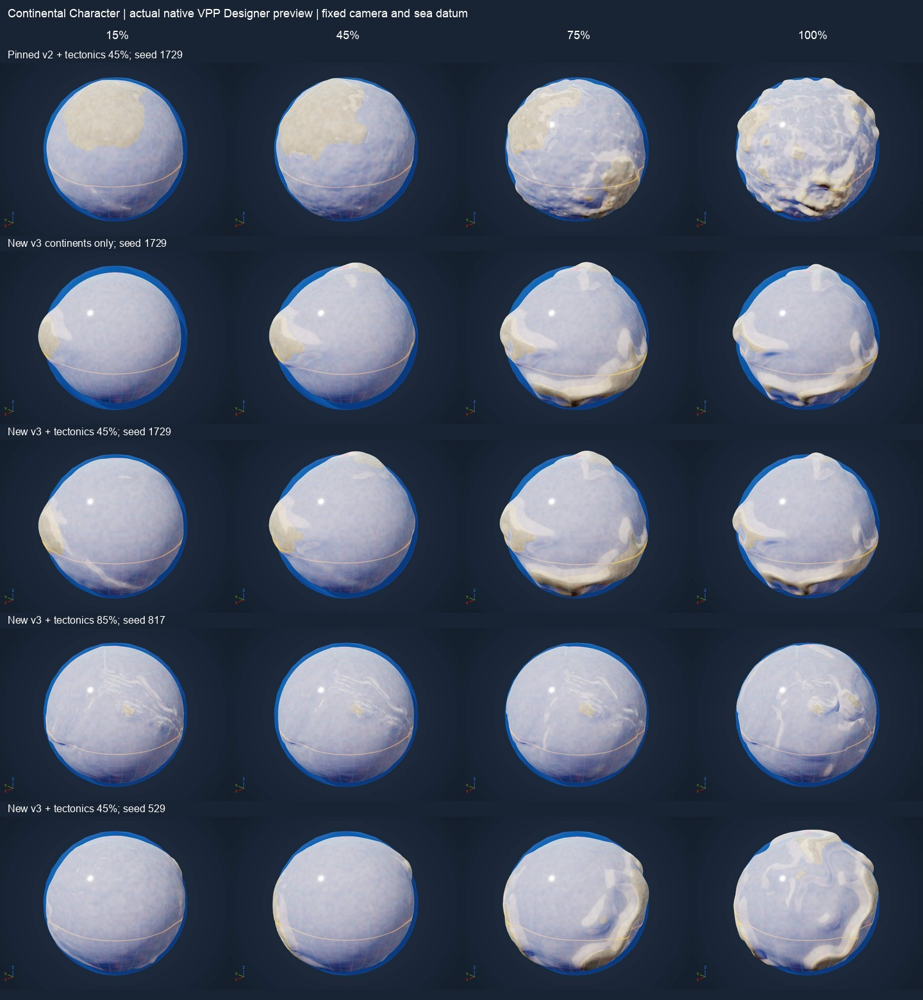

# Continental Character

The Planet Designer's **Geology → Continents → Character** control now authors
continental algorithm 3. Continents remain a foundation layer combined with the
existing Tectonics layer. A plate can carry both crust types, and a continental
mass can cross plate boundaries. This is a curated artistic construction, not a
mantle, drift, erosion or geological-history simulation.

## Character across the range

The control coordinates independent smooth curves rather than multiplying a
fixed terrain's height. The completed surface still reaches the planet's exact
SurfaceMin/SurfaceMax guides, so the progression must change geography after
that fitting.

| Control region | Composition |
| --- | --- |
| 0% | No continental shape, datum contribution or change to tectonic crust classification |
| 0–22% | A broad elongated foundation develops; another domain enters gradually |
| 22–50% | Larger continental interiors and additional connected, asymmetric masses |
| 50–78% | Maximum broad extent gives way to separation; coasts and narrow connections become more varied |
| 78–94% | Further domains enter while existing masses separate and fragment |
| 94–100% | Six established domains hold; extent, coast character and fragmentation finish the endpoint |

Each domain combines elongated, bent lobes, with stable seeded anchors and axes.
The same complete seed pool is constructed at every position. Fractional
next-domain weights replace integer-count redistribution. Extent, elongation,
fragmentation, coastline warp, coastal profile and subdued interior detail have
different curves. The endpoint is a composed fragmented world, not every
Advanced setting at maximum. Domain count is a construction control, not a
promise about the exact number of connected land areas above OceanHeight.

The broad basin/rise, shelf transition and interior profile remains sloping;
it does not clamp land into flat caps. Exact guide distances still determine
physical slopes: a large SurfaceMin/Max gap on a small world is an exaggerated
miniature profile, not Earth-scale relief. Ocean is the existing optional visual
reference sphere; this work adds no water renderer or collision.

At small positive settings, shared crust classification blends from the consuming
tectonic version's own uniform context before fully expressing the continents. This
avoids a latent tectonic jump at continental zero. A sole zero-effect layer
retains the existing empty sphere. As with tectonics, a constant sphere cannot
also reach two distinct final surface guides: an amplitude-continuous transition
from zero is not claimed when this is the sole shape layer.

## Native ownership and the specialization

VPP remains the sole voxel generation and presentation platform: the accepted
recipe uses the existing native planet stamp, layers, material, world, meshes,
LOD and moving collision invokers. The new portfolio uses the actual persistent
native Designer preview; it creates no reference terrain mesh.

The source audit reuses `FVoxelComputeNode_PerlinNoise3D` for new coastline and
interior variation, through the same private checked native binding as generic
noise layers. Kernel absence or a changed pin ABI refuses compilation. Worker
sampling retains an immutable function pointer and plain compiled data; it does
no UObject lookup or I/O. No second Perlin implementation, generation scheduler,
streaming manager, preview renderer or collision system is added.

The remaining specialization is the existing Landform geological model's
continental arrangement, basin/interior profile and curated control curves.
Native noise and field operations do not supply this plate-independent crust
model or the Designer's one-knob product mapping. The installed VPP 2.0p8
public graph/PCG headers and content were checked for continental/tectonic presets;
none supplies this model. Its native noise node is declared in
`VoxelGraph/Public/Nodes/VoxelNoiseNodes.h`. Tectonics consumes the same
compiled crust context and contributes deformation once, without adding another
continental elevation. Continental edits retain plate IDs, sites and motion;
the crust-dependent deformation can respond. Legacy noise/profile versions keep
their pinned kernels, rather than silently replacing accepted worlds.

This construction follows the distinction between plates and crust types in
[USGS's plate description](https://pubs.usgs.gov/gip/dynamic/tectonic.html) and
uses [NOAA's continental-margin overview](https://www.noaa.gov/education/resource-collections/ocean-coasts/ocean-floor-features)
as morphological reference. Those sources do not establish Landform's curve
coefficients or prove its artistic quality.

## Saved worlds and editing

Opening an existing planet or changing Variation preserves its continental
algorithm and resolved values. A continental knob gesture explicitly adopts
algorithm 3 in the existing single Undo transaction. The tectonic control is
unchanged. Advanced exposes the resolved next-domain blend, elongation and
fragmentation alongside the other continental settings. Direct Advanced edits
persist until the next continental knob gesture reapplies the curated mapping.

The portable `Examples/ContinentalCharacter.json` and isolated review asset
`/Game/LandformDesigner/ContinentalCharacter/DA_ContinentalCharacter` provide the
new profile without changing any existing saved planet. Open that asset in
Planet Builder and use Geology. Preview → Ocean shows the sea datum; ordinary
Walk here uses the existing shared inspection workflow.

Run `scripts/create-continental-character-review.py` through Unreal Python to
create missing review assets and export an external runtime recipe/reference
pair under `Saved/Verification/continental-character/runtime-input`. Existing
review assets are preserved on reruns. The component and host qualification
records pin actual checks, numerical and native rendered portfolios, platform,
source/binary hashes and preserved inputs. The visual portfolio is bounded
review evidence; arbitrary seeds, Advanced edits and future presets need the
same quality gate.

## Native visual portfolio

The gallery compares 15/45/75/100% from the actual native Designer preview,
with identical camera, materials, lighting and OceanHeight reference. Rows show
pinned continental v2 with tectonics, v3 alone, v3 with tectonics 45%, then two
other seeds (tectonics 85% and 45%). The full run captures eight positions, two
angles and all five groups: 80 native frames. The first row's different
construction is retained as a historical comparison, not silently migrated.

## Qualification — 4 November 2026

The [Mac record](../conformance/continental-character-mac-arm64.json) pins source,
binaries, assets and retained evidence. All **158 affected editor checks** pass:
157 clean and one with the existing disabled Mesh Modeling engine debug-material
dependency warning. The native continental portfolio and cooked runtime have no
material fallback. Two older picking tests now initialize their explicit isolated
reference fixtures; this changes no production preview path.

* Dense sweep: 1001 positions × three seeds × 256 directions = 768,768 raw probes.
  Largest 0.1% step is 0.701406% of guide span; largest shared-crust step is
  0.01408691. No integer domain-count redistribution occurs.
* Final portfolio: 72 cases across three seeds, eight positions and three
  tectonic contexts. Smallest consecutive final-shape RMS is 2.180565% of guide
  span after final fitting. Guides remain exact and plate IDs/sites/motion are
  retained under continental variation.
* Legacy control: 624 original-binary algorithm-2 height/material probes are
  unchanged. Current zero matches disabled continents, and entry is checked
  against the separate neutral contexts of tectonic versions 2, 4, 5 and 6.
* Native stamp field residual is at most 3.98e-11 cm in the bounded numerical
  cases. This describes the mathematical zero set, not triangle approximation.
* The fully cooked review recipe passes **12 walking sites**, covering poles,
  equator, a patch boundary, plate centres and boundaries at natural/half/flat
  curvature. All **3,772 / 3,772** measured walking frames retain native VPP
  ground contact. Maximum floor/field error is **0.02467 cm**; maximum
  rigid visual corner error is **0.03502 cm**, below the unchanged 2 cm
  presentation limit. Native materials and the shared scene remain active.

These are bounded functional and visual checks. Every unreviewed seed or
Advanced edit is not certified, and the existing strict 60 fps, broader planetary
precision, geological history, drainage and erosion gates remain open. Mars is
complete as its library entry; the active project focus is Planet Designer
authoring. Multiplayer remains outside this work.
