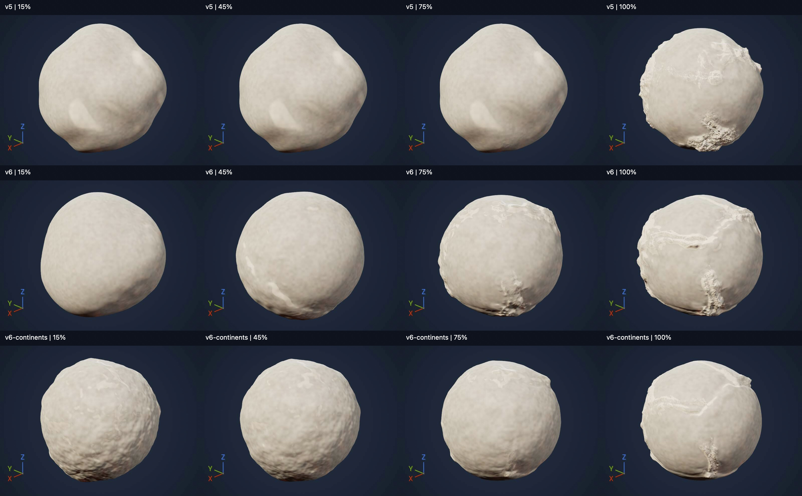

# Guided planet geology and final surface heights

Schema 17 replaces intensity-only geology authoring with a guided character
progression. A preset is the authored relationship between a knob and its
advanced data. Continents and Tectonics remain composable layers.

## One knob

The one-knob experience is a product-quality contract. It must supply useful,
visually distinct, realistic compositions throughout its range. Moving parameters
or passing field tests alone does not establish that quality. Zero means no
contribution from the controlled feature; later positions introduce different
effects, some peak and recede, and others reach a plateau. The upper end is a
deliberately composed extreme, with more unusual configurations left to Advanced.
Profiles need fixed-camera visual review, several seeds and intermediate settings,
not just screenshots of the two endpoints.

### Tectonic character, algorithm 6

Tectonics now uses independently timed tracks instead of giving every variable
the same five interpolation intervals. These are artistic compositions, not a
claim that planetary evolution follows a single chronological path:

| Region of the control | Developing character |
| --- | --- |
| 0% | Exactly no tectonic deformation; the other planet layers remain |
| 0–15% | Broad stress-related flexure and gentle regional relief |
| 15–35% | Rifts/spreading features emerge; broad deformation gains structure |
| 35–60% | Fault zones, collision shoulders and paired margin features become distinct |
| 60–85% | Folded orogens develop while early rift dominance recedes |
| 85–100% | Narrower, rougher and more strongly folded mountain systems; arc/fault strengths already hold at their caps |

Rifting peaks near 38% and settles to a lower plateau after 78%. Transform
strength enters after 18%, holds from 42–60%, then reaches its final cap at 84%.
Folding starts after 38%; trenches after 40%. Plate count reaches eight at 84%
and then holds, so the final interval develops the existing network rather than
rapidly replacing it. Arc strength caps at 90%, while
fold structure continues developing. Width holds early, then narrows. Motion
peaks during early rifting, eases, then rises into the high end. Regional
frequency changes independently. Advanced exposes the resolved values, including
fold/arc/trench strength and the next-plate blend, while the default inspector
continues to present a single control.

New plates crossfade between stable seeded network states, avoiding integer-count
pops. Broad flexure follows the same stress network as the narrower features;
low-frequency noise supplies secondary variation. The old motion dead threshold
is absent from algorithm 6. Without an explicit continental layer, this profile
uses uniform rocky crust context; it does not silently add continental elevation.
Shared continental crust, when present, still controls collision vs margin behavior.

Zero matches disabling tectonics, including final range fitting. A sole zero-effect
tectonic layer uses the existing empty-sphere behavior. Sub-micrometre contributions
are not amplified into full-height terrain. A sole tectonic layer still changes
from a constant sphere at zero to a nonconstant field at positive settings: exact
two-guide fitting cannot also guarantee an amplitude-continuous transition there.
With another nonconstant layer present, zero simply removes the tectonic contribution.
For nonconstant generated surfaces,
the final SurfaceMin/Max rule still fixes absolute extrema: the knob must vary
shape, distribution and feature character, because merely scaling amplitude can
be removed by that normalization. This does not relax the final guide contract.

The numerical sweep and rendered portfolio are qualification evidence, not a
guarantee that every unreviewed seed or arbitrary Advanced edit is aesthetically
finished. Future tuning must retain the same quality gate. This delivery changes
the tectonic profile; the continental algorithm 2 mapping below remains pinned.

The [Mac qualification](../../Projects/LandformLab/Docs/TectonicCharacter.md)
records the measured sweep, render review and runtime checks. The gallery compares
15/45/75/100% at fixed cameras: algorithm 5, algorithm 6 in the same saved planet
context, then algorithm 6 with continents enabled. Late algorithm-6 surfaces use
higher mesh resolution for geometric review; this is not a renderer performance
comparison. Materials and lighting are unchanged.

### Historical tectonic character, algorithm 5

The former tectonic preset followed five authored configurations: broad quiet structure,
rifting, mixed margins, collision belts, then fragmented extreme terrain. These
are useful artistic configurations, not stages of a physical time simulation.
Intermediate settings interpolate the curves smoothly; plate count is discrete.

| Resolved setting | 0% | 25% | 50% | 75% | 100% |
| --- | ---: | ---: | ---: | ---: | ---: |
| Plate count | 2 | 3 | 5 | 7 | 10 |
| Motion | .10 | .24 | .42 | .36 | 1.40 |
| Relief contribution | .08 | .12 | .20 | .36 | .75 |
| Belt width (degrees) | 18 | 15 | 12 | 9 | 10 |
| Crust thickness ratio | .012 | .017 | .023 | .030 | .050 |
| Boundary warp | .10 | .16 | .24 | .22 | .36 |
| Roughness | .06 | .10 | .17 | .30 | .65 |
| Collision strength | .10 | .16 | .24 | .40 | .95 |
| Rift strength | .06 | .24 | .18 | .16 | .60 |
| Transform strength | .04 | .12 | .20 | .24 | .55 |
| Interior relief | .16 | .16 | .15 | .14 | .14 |

Motion and belt width reverse direction along this path. Each field participates
in the compiled geometry: topology, deformation, broad collision shoulders,
boundary shape, surface texture, boundary-type balance or quiet interior relief.
Algorithm 5 retains broad interior structure throughout the range, while young
boundary deformation stays small. It also reserves more unsaturated range for
that background. This prevents final height fitting from promoting small young
ridges to full-height walls. The last quarter develops pronounced, rougher belts;
100% is an authored usable extreme, with further exaggeration available in
Advanced. Quiet retains structure. Extreme introduces more fragmented, sharper terrain.
The chosen guide heights determine its absolute vertical extent at every setting.

Continental character grows then fragments domains, rather than expanding a
fixed continent mask monotonically:

| Resolved setting | 0% | 25% | 50% | 75% | 100% |
| --- | ---: | ---: | ---: | ---: | ---: |
| Domain count | 1 | 2 | 3 | 5 | 8 |
| Extent | .70 | .95 | 1.25 | .95 | .70 |
| Relief contribution | .25 | .45 | .60 | .80 | 1 |
| Coast warp | .06 | .16 | .28 | .40 | .60 |
| Interior roughness | .010 | .020 | .035 | .055 | .080 |
| Coast sharpness | .8 | 1 | 1.4 | 1.7 | 2.2 |

Advanced shows resolved, directly editable values. There are no override
checkboxes. Advanced edits persist until the next knob gesture reapplies the
chosen preset. Variation retains those values and changes the layer seed.
The recipe stores resolved settings, position and algorithm versions; workers do
not depend on editor widgets to reconstruct a planet.

## One tectonic model in the authoring workflow

The old Moving plates and Controlled boundary options were implementation
experiments. Controlled boundary isolates a two-plate test configuration; it is
not a second observed category of planet. Current authoring uses the planet-wide
plate network (algorithm 6). Old controlled-boundary recipes and their tests keep
their original algorithms, without a model selector in the current inspector.

Convergent, divergent and transform boundaries coexist within a plate network;
see [USGS, Understanding plate motions](https://pubs.usgs.gov/gip/dynamic/understanding.html).
Landform's curves and coefficients above are authored controls, not empirical
values claimed by that source. Crust thickness is a ratio used for deformation
shoulders; this is not a mantle, erosion or geological-history simulation.

## Exact final SurfaceMin and SurfaceMax

These are planet-global extrema of the completed generated surface. They are
not merely limits or an amplitude scale for individual layers. For an outer
radius of 1000 m, guides at .3 and .6 mean the actual lowest generated surface
radius is 300 m and the actual highest is 600 m.

The compiler first composes the complete raw field: noise operations, continental
and tectonic layers, editorial structures, native stamps, regional Landforms,
generated regions and their blends. One final monotone range mapping then places
its lowest and highest points at the two guides. Intermediate raw construction
defers the old outer-radius clipping, so that it does not flatten features before
this final mapping. The final field remains inside both guides. Schema 17 also removes the old
quarter-radius cap on the raw geological contribution; the final surface mapping
owns the height range.

The range is compiled from deterministic spherical probes, known stamp
footprints and refined extrema. The final map clamps any unsampled outliers to
the same exact guide bounds. It is shared by all patches; patches never fit
independent ranges. Dense qualification checks look for unwanted clipped terraces.
There is no universal claim that every possible asset/function has its exact raw
extremum located by this numerical search. The mapped field nevertheless reaches
both guide values and cannot exceed them.

VPP, globe, planet cross-section and walking collision query that same final
field. Tessellation/LOD approximates the field; extrema guarantees describe the
procedural field rather than each finite triangle mesh. The Ocean display remains
a sphere at OceanHeight and never changes generation settings.

A newly created empty planet remains a perfect sphere. A constant configured
field cannot reach two distinct requested extrema: compilation reports that
conflict rather than silently violating the guides. Removing/reversing required
surface guides also reports an error.

## Version boundary

Schemas 14–16 and earlier algorithms retain their previous generation. Opening
an old asset does not mutate it. The current inspector projects a guided draft;
the next explicit geology edit adopts schema 17 in one Undo transaction.
Algorithms 4 and 5 keep their previous resolved geometry; the next explicit
tectonic knob gesture applies the new algorithm 6 progression in one Undo transaction.
Variation alone does not change a saved recipe's algorithm.
Legacy override flags remain serialized for older recipes, with no editor or
Blueprint exposure. They are ignored by the current resolved-value algorithms.

[TectonicCharacter.json](../Examples/TectonicCharacter.json) is the algorithm 6
review planet. [GuidedGeology.json](../Examples/GuidedGeology.json) pins the former algorithm 5
example. Existing LayeredGeology, ContinentalBase and TectonicBase examples remain
pinned historical fixtures. GuidedGeologyV1 pins the former algorithm 4 example. Landform assets remain terrain-type configurations;
this final planet range is not saved into them.

## Radial Guide measurements

The shared annotation overlay shows every guide's radial distance from Core in
metres rounded to the nearest whole metre, with Core at 0 and Sky boundary at the planet's outer radius. Only the
name is editable in place; measurements are derived display values. They update
as guides move or the preview radius changes, in both Designer and Planet Builder.

A right-hand bracket measures SurfaceMin to SurfaceMax. When OceanHeight is
strictly inside that range it also marks the two ocean intervals, preserving the
total above the bracket. Callout leaders locate exact render heights; bracket
endpoints use those aligned label rows so short projected intervals stay readable.
Missing or reversed surface guides omit the bracket; an absent/outside ocean
omits only its subdivision. These annotations never change recipe data.
