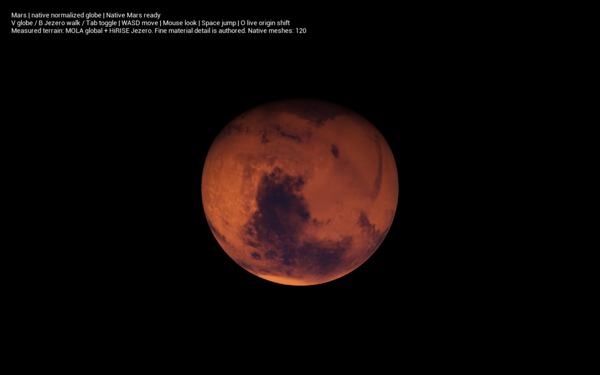
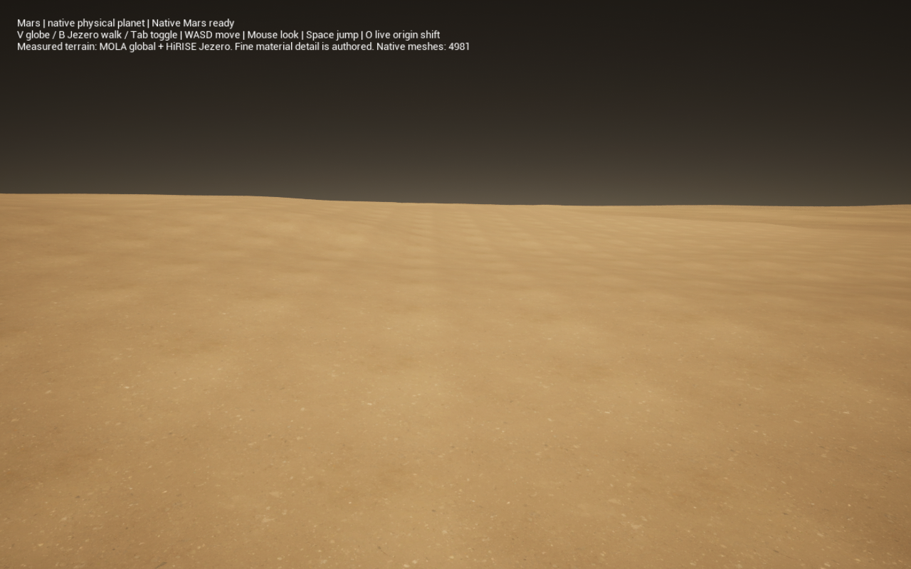

# Mars measured-terrain library

The first Mars profile is a reusable measured world, exposed as
`/CatalystLandform/Measured/DA_Mars`. Its schema 19 server recipe carries a
resource ID, revision and digest. UE asset paths remain client bindings. Native
VPP owns heightmap storage/interpolation, the planet stamp, volume layer/stack,
meshing, Nanite presentation, materials, LOD selection and moving collision.
There is no Landform streaming manager or replacement mesher.

## Source and coverage contract

* Global shape: final version 2 MGS/MOLA mean **planetary radius**, 32 pixels per
  degree, 11520 × 5760 cells; roughly 1.85 km spacing at the equator. The original
  signed big-endian metre offsets are retained in native float storage. This is
  neither elevation above an ellipsoid nor a procedural height fit. MOLA fills
  unobserved bins by interpolation: not every grid cell is a direct observation.
* Fine region: the central 4096 × 4096 cells of HiRISE
  `DTEEC_048842_1985_048908_1985_U01`, approximately 4.1 km across, near Jezero
  18.462743°N, 77.522796°E. Original projection pixels are 1.0096633268711 m.
  PROJ inverse equirectangular coordinates retain the source's local projection
  sphere/15° standard parallel; its projection radius is not a terrain datum.
* HiRISE values are heights above the **Mars2000 areoid**. Offline native GDAL preparation
  adds the resampled MOLA 16 ppd Mars2000 areoid radius, then stores offsets
  from 3396000 m. It never treats an areoid elevation as ellipsoid height.
  The selected crop has 100% valid source coverage. An independent mask remains
  explicit; invalid regional cells retain global context, never artificial air.
* Regional borders blend into MOLA over 100 m. These blended elevations are a
  declared integration policy, not additional measurements. Generic interior
  NoData boundaries fall back pointwise; smooth transitions around arbitrary
  internal holes have not been qualified. No unlimited regional atlas is claimed.
* The global longitude seam is periodic through native sampler halos. The
  half-cell polar caps converge to the original first/last-row means. These cap
  values are interpolation policy, not new polar measurements.
* All shape coordinates are IAU2000 body-fixed, planetocentric latitude and
  east-positive longitude. The existing canonical/native reflection is explicit:
  `(X,Y,Z) -> (X,-Y,Z)`. A quaternion does not hide this reflection.

Global minimum/maximum radius is 3372798 / 3417293 m. The recipe's outer sky
boundary is 3425000 m. Guides annotate those physical limits; they never
rescale measured terrain. Unsupported procedural height layers are rejected
rather than silently changing the source. Existing schema 2–18 behavior remains
pinned. Existing native volume operations can compose after the radial source;
Mars edit/combat/ACF qualification is not claimed by the walk proof.

Global colour is NASA Viking/MDIM context from ASU, reduced to 8192 × 4096
(about 2.6 km/pixel at the equator). Original tile extents, hashes and ordering
are pinned. It is an uncalibrated composite with older image control, not a
metre-accurate albedo map or a measured fine surface. Within 20 km, orbital colour gives way to authored PBR; the orbital transition
ends at 200 km. Nearby PBR detail reuses
the existing scanned rock, scree and soil materials. That grain/normal detail
is authored appearance and does not add measured geometry. Atmospheric dust,
sunlight and exposure in the review host are authored native UE settings, not
a retrieved climate/photometric model.

The cooked release must import the actual editor-exported JSON, reproduce ten
original-source radius samples, reject corrupt/missing resource pins without
changing the live native world, and retain native contact through a separate
25317 / −17129 / 9067 cm origin shift. This shift is not aligned to the 50 cm
voxel grid. Runtime retirement is checked explicitly. Native LOD republishing
after an interactive origin shift can visibly regenerate terrain; uninterrupted
frame-by-frame presentation during that rebuild is not qualified. The initial reflection-
exported definition hash failed the cooked gate; versioned explicit semantic
encoding replaces that unstable representation, including case-folded IDs and
fixed field names. This is a resource-identity specialization, not voxel work.

The original sources and numerical oracle are pinned in
[the source record](../conformance/Mars/source-oracle-v1.json),
[terrain source lock](../Tools/Mars/sources.json) and
[colour source lock](../Tools/Mars/color-sources.json). A 2 cm software binding
check does **not** claim 2 cm terrain accuracy: source quantization, stereo
artifacts, interpolation, datum/model resolution and historical image control
remain separate uncertainties.

## Native capability audit and justified specializations

| Requirement | Native capability reused | Remaining specialization / evidence |
| --- | --- | --- |
| Persistent measured raster | UE `Texture.Source` R32F; VPP `UVoxelHeightmap_Height` and immutable native data | `SetHeights` editor data is transient; use the existing native texture source so reopening and cooking work. No custom raster serializer. |
| Sampling | `UVoxelHeightmapFunctionLibrary::SampleHeightmap`, native bilinear interpolation | Its public input is a centred planar XY chart. `CLMeasuredTerrain` binds planetary coordinates, periodic halos, polar convergence, explicit regional coverage and physical radius. It does not implement another raster interpolator. |
| Scientific input | GDAL/rasterio PDS decoding and bilinear areoid resampling; PROJ projection conversion offline; native UE/PROJ body-coordinate capability audited separately | Native VPP's heightmap/UE GeoReferencing actor does not declare this PDS quantity, areoid conversion, geographic coverage or source provenance. Add a typed pinned manifest and fail-closed activation. Explicit versioned semantic hashing avoids cooked/editor reflection-name differences. No runtime download/IO on workers. |
| Geometry and demand | Existing `FCLPlanetStamp` + native VPP sphere kernel, layers, stamps, world, Nanite, LOD and attached collision invoker | Route measured physical radii through the existing stamp/scene boundary. No custom generation scheduler, moving window or streamer. |
| Mars-specific artwork | Native VPP per-world mega material and surface assets; native UE material graphs | Existing Landform catalog resolution was global. Pass an explicit client catalog into compilation and bind its native per-world material; keep global settings and existing assets unchanged. Scientific identity excludes client artwork locations. |
| Globe and physical material coordinates | Existing normalized-preview metadata and double-float canonical texture-phase adapter; native UE body-relative double-float arithmetic | Add planetocentric colour UVs in the owned Mars material. Reuse the existing native preview scale/mapping contract. The native actor remains unscaled. |
| Atmospheric lighting away from global Z | Native UE planet-centred Sky Atmosphere and directional-light per-pixel atmosphere transmittance | The default global transmittance calculation assumes the planet-top Z location; use the native per-pixel option. No atmosphere renderer is added. |

Native versions are UE 5.7.4 CL51494982 / VPP 2.0p8. Relevant pinned source entry
points are `VoxelHeightmap_Height.cpp::Serialize`,
`VoxelHeightmap_HeightData.cpp::CreateImpl`,
`VoxelHeightmapFunctionLibrary.cpp::SampleHeightmap`, `VoxelConfig.cpp`, and
UE `SkyAtmosphereCommonData.cpp::GetTransmittanceAtGroundLevel`.
[Epic's native atmosphere guide](https://dev.epicgames.com/documentation/en-us/unreal-engine/sky-atmosphere-component-in-unreal-engine?application_version=5.7)
also describes the planet-top versus per-pixel transmittance choice.

## Reproduce and review

Install the pinned Python dependencies from `Tools/Mars/requirements.txt` into
an isolated environment, then run:

```sh
python Tools/Mars/prepare-mars.py --source /path/to/source-cache --output /path/to/prepared --fetch
python Tools/Mars/prepare-color.py --source /path/to/colour-cache --output /path/to/prepared --fetch
```

Run `Tools/Mars/create-mars-assets.py --prepared /path/to/prepared`, followed by
`create-mars-look.py` with the same argument, through LandformLab's editor Python.
These tools write only the new `/CatalystLandform/Measured` folder and copy that
owned folder back from the staged plugin to the component. They never edit
existing planetary assets. The original multi-hundred-MB PDS archives stay in
the source cache; native UE assets and pinned preparation tools are versioned.

Stage/build LandformLab, run `scripts/create-mars-proof.py` in editor Python, then:

```sh
python3 scripts/package-mars-proof.py
python3 scripts/play-mars.py
```

Run `scripts/qualify-mars.py --output /path/to/new-report-directory` for the
cooked globe, walk and separate origin cases; `--compare-lod-limit` also records
the native far-LOD comparison. Qualification rejects material/shader fallback
and requires captured rendered images, a non-editor binary and closed native
resource/runtime lifecycles.

The app stays open for interaction. **V** selects the native normalized globe;
**B** selects the physical Jezero walk. Tab toggles views; WASD moves, mouse looks, Space jumps,
and **O** requests a live UE origin shift. View switching replaces a diagnostic
world; walking and origin shifts retain their native world/runtime/invoker.
The globe uses native stamp scaling; the voxel world and meshes are not scaled.

The qualified physical root has identity rotation/scale; live UE origin translations
are tested. Arbitrary rotated roots and enhanced-curvature Mars presentation
remain unqualified. The default physical walk uses unrestricted native VPP LODs. Optional
`-CLMarsLimitFarLOD` reproduces the native MaxLOD 8 comparison. Neither profile
uses a Landform sampling window. Coverage at fine resolution is the declared
Jezero crop; the rest of the planet remains MOLA context. This does not qualify
an uninterrupted planet-circumnavigation, multiple simultaneous high-detail
regions or a production 16.67 ms wall-p99 budget. Multiplayer is out of scope.

Primary sources:
[MOLA archive](https://pds-geosciences.wustl.edu/missions/mgs/megdr.html),
[MOLA format](https://pds-geosciences.wustl.edu/mgs/urn-nasa-pds-mgs_mola_topography_derived/document/egdrsis.htm),
[HiRISE Jezero DTM](https://hirise.lpl.arizona.edu/dtm/ESP_048842_1985),
[HiRISE DTM interpretation](https://hirise.lpl.arizona.edu/dtm/about.php),
[ASU Viking mosaic](https://mars.asu.edu/data/mdim_color/).

## Qualification checkpoint — 4 November 2026

[The native qualification record](../conformance/Mars/qualification-mac-arm64.json)
pins the binary, library assets, source inputs, editor checks and cooked cases.
The rendered globe and Jezero captures below come from that cooked binary.
These checks establish this bounded profile; the source uncertainty and
production/presentation gates above remain open.




