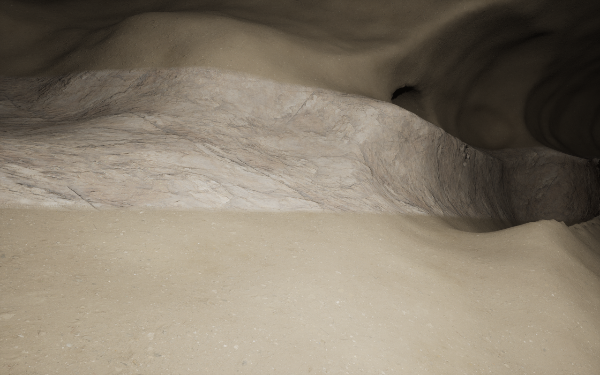
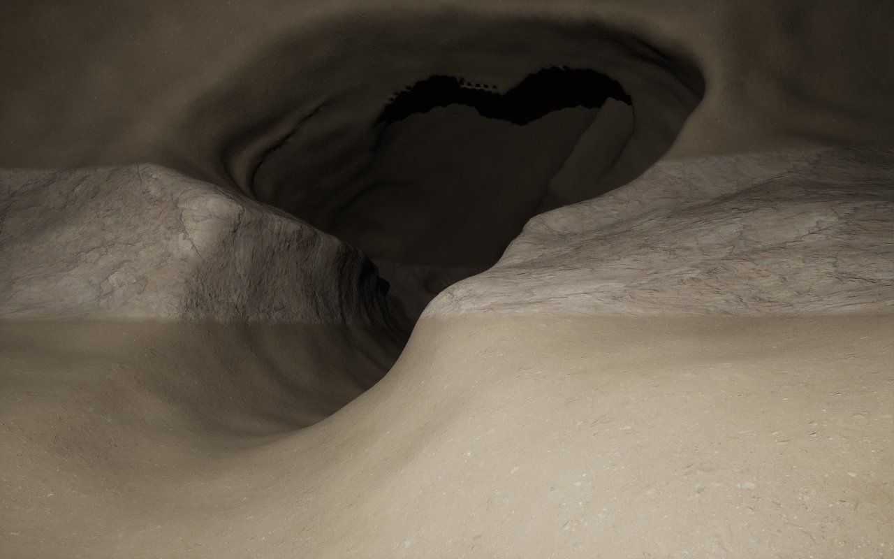

# Dry carbonate karst, profile 5

Status: failed human visual review on 7 November 2026 after native manual
exploration. Rounded passages, a gutter floor and lumpy surfaces still did not
meet the natural-cave target. Current work is [profile 6](BeddedKarst.md).
Profile 4 also failed visual acceptance; native qualification did not establish
natural appearance. This document retains the historical profile-5 checkpoint.
This milestone changes one family, dry carbonate karst. Structural caves keep
profile 4's construction. It introduces no product UI controls.

## Definition and native ownership

A recipe, rather than one noise field, defines the caves. The planet seed,
cave-layer seed, physical settings and pinned algorithm version determine stable
candidate sites. The existing builder requires a positively eligible carbonate
province, finite soluble rock sequence and the canonical watershed. Receiver
routes, a real confluence and a deformed older bedding horizon establish the
passages, reconnecting higher route and chamber location. These are declared
construction priors, not a simulated dissolution or groundwater history.

The immutable output contains network identities, graph nodes, passage control
points, physical width/height sections and bedding frames, plus chamber poses
and dimensions. It is built in advance within the existing budgets. Camera
movement changes native LOD; it does not select new cave layouts. One global
cave-layer seed is combined with the planet seed and stable feature identities;
there is no separate planet-sized noise texture for each family.

`FCLCompiledCaveVolume` lowers this geometry through UE's Hermite curves and
VPP's native spline nearest-point, sphere, smooth-union, noise and AABB kernels.
The existing `FCLScene` composes the resulting void into the radial planet field;
`FCLPlanetStampRuntime` converts metres/centimetres and supplies native bulk and
sparse stamp queries through `FVoxelStampUtilities::ApplyDistances`. VPP owns
voxel generation, meshing, LOD, collision, sculpting and compressed saves. Player
earthworks are additional saved state. Debug boundaries sample the same void.

Thus a fixed recipe and qualified algorithm/resources reproduce the whole cave
layer. A noise seed and base radius alone do not specify it. The implementation
does not promise bit-identical output across unqualified platforms or versions.

## Morphology

Profile 5 retains geological routing and host/cover checks. A single coherent
passage construction replaces profile 4's cycling section types: a broad vault,
narrower incised floor channel and unequal bedding-level side recesses, joined by
native smooth unions.
Broad correlated section changes create constrictions and enlargements. Stable
feature phases produce asymmetry; native Perlin adds only small wall relief.
Recharge entrances retain their existing shaft construction.

Each confluence chamber has independent length, width and height and a bedding
frame. Enlargement develops above the shared route floor so passage mouths do
not sit over an artificially deep bowl. Its vault and uneven side volumes use the
same native rounded operators.
The new family omits profile 4's box-derived roofs, angular roof scars and solid
breakdown. It does not assign invented sediment or secondary mineral growth.

[BGS cave forms](https://www2.bgs.ac.uk/mendips/caveskarst/caveform.htm) and
[NPS passage forms](https://home.nps.gov/maca/learn/nature/how-mammoth-cave-formed.htm)
support joint/bedding controls and distinct passage anatomy. They do not validate
these coefficients, constitute a cave reconstruction or establish artistic
acceptance. Sampled geological frames, cover and route checks remain finite
approximations.

## Compatibility and review

At this historical checkpoint, typed/factory settings and an explicit Character
edit selected algorithm 5. New explicit edits now select profile 6.
Saved algorithms 1–4 keep their previous geometry. The UObject/CDO's historical
version 2 remains frozen because native delta packages may omit default-valued
properties. New enum values are appended; old values are not renumbered.

`Examples/NaturalKarst.json` is a separate bounded review fixture.
`Tools/create-natural-karst-review.py` creates a missing native
`/Game/LandformDesigner/Caves/DA_NaturalKarst` asset; an existing asset is left
untouched. Review uses the existing editor, eye, cave indicator, Character knob,
reseed, details and normal navigation. No starter planet is rewritten.

Qualification and retained limitations are recorded in
[the platform record](../conformance/NaturalKarst/qualification-mac-arm64.json).
Visual acceptance requires review of actual passages and chambers; scalar field
checks and exterior cyan boundaries alone do not establish it. Full-route
traversability, groundwater/sediment history, new cooked/ACF/multiplayer validation
and production-scale generation remain outside this bounded milestone.

## Native result, 7 November 2026

All 24 focused editor regressions and both native rendered cases passed with
zero test warnings or errors. This includes the new upper-vault/narrow-channel
probes, bulk/sparse parity, background generation, native package loading,
frozen saved profiles and existing UI/Undo. The bounded fixture produces five
networks, 25 passages and five chambers; the maximum-knob case produces nine
networks. Native boundary residuals were 0.418 m and 0.351 m respectively at the
existing diagnostic resolution and unchanged 0.5 m gate.

Navigation p95 was 24.31 ms for profile 5 and 21.60 ms for the frozen profile 4
control, with no navigation-triggered input builds or mesh copies. The earlier
candidate's 59.90 ms failure is retained. Another Examples editor was active;
its main window was minimized for the final pair. Geometry was also refined
between runs, so this does not establish the original failure cause. The native
diagnostic and 50 ms threshold were not relaxed.

The independent gameplay writer and reader both passed with the standard 25 m
moving collision invoker. They retained four native contacts, walked 2.50 m,
and exercised native mining, backfill and compressed saving. The cold reader
reproduced all 136 geometry/geology probes with zero measured field error.
No fatal or ensure diagnostic was observed in these final runs. This does not
resolve the previously recorded VPP invalidation-hash ensure.

These actual native interior captures use the existing rock material and one
proof light. They are review evidence, not human visual acceptance:

