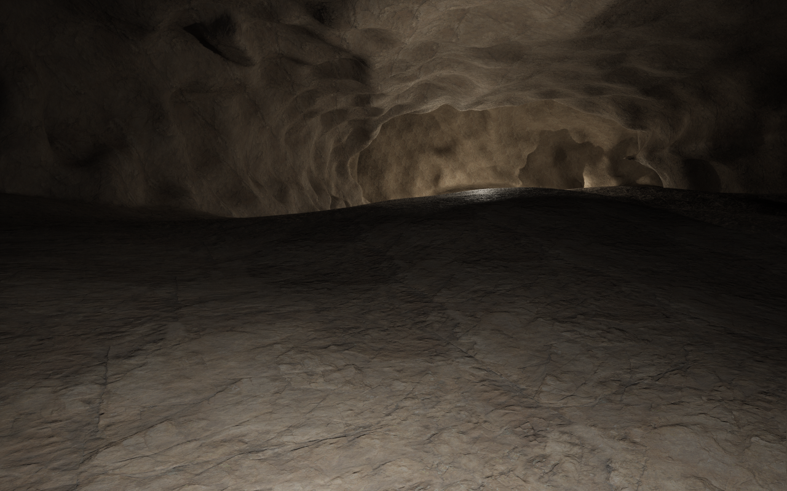
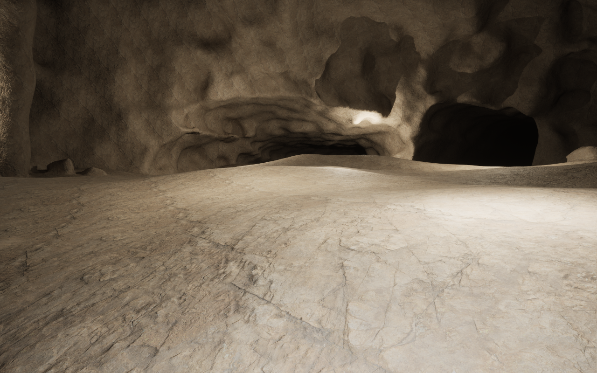
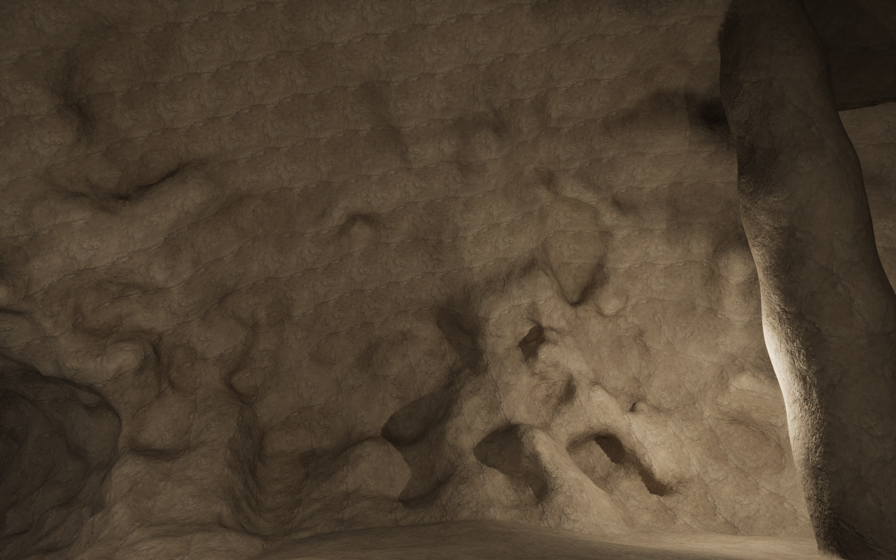
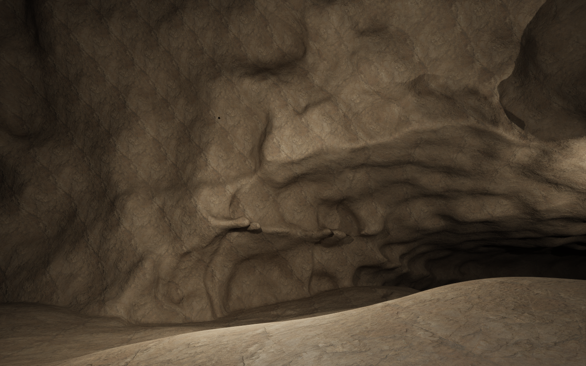

# Organic carbonate karst, profile 7

This revision follows the user's direct rejection of profile 6: openings still
looked regular, floors looked flat, and walking forward from the entrance fell
through the floor. The earlier 80 m native review started inside a passage and
paused at a test-only collision look-ahead check. Its result did not qualify the
manual entrance route.

## Direct reference comparison

| Reference | What is visible | Change in this family |
| --- | --- | --- |
| [Mammoth: Little Bat Avenue](https://www.nps.gov/places/little-bat-avenue.htm) | Unequal walls, projecting beds, offset undercuts, a roof that varies across the passage and an uneven natural floor apron beside the paved tourist route. | Off-centre dissolution lobes and unequal shoulders replace the shared roof clip. Real bed remnants are fitted to the actual native wall boundary and checked for attachment. The paved tourist route is not the geological floor reference. |
| [Carlsbad: Big Room](https://home.nps.gov/cave/index.htm) | Large adjoining bays, varying vault heights, irregular rock masses and substantial floor relief around the walking route. | Unequal chamber bays, bedrock remnants and transported breakdown sit on the same rolling floor field as the passages. Secondary calcite growth is not modeled by this construction. |

NPS describes the [Mammoth passage](https://home.nps.gov/places/audubon-and-little-bat-avenue-beneath-your-feet.htm)
as approximately 60 ft wide and 30 ft high (18.3 × 9.1 m). The fixture retains
human-scale broad passages and chambers tens of metres across. It is not a
reconstruction of either surveyed cave, or of Carlsbad's entire Big Room.

## Form and floor

Profile 7 retains the positively soluble carbonate host, watershed-conditioned
network, canonical bedding horizon and physical dimensions. Four unequal native
sphere lobes form each passage or chamber before subordinate wall weathering.
The roof is no longer clipped by one broad plane. Opening height, lateral extent
and undercuts vary independently along the passage, including its mouths.

The floor is a shared physical height field over the restored rock horizon,
using native noise at 19 m, 7 m and 2.5 m scales. Its large forms dominate its
small surface detail. A constant network relief scale is independent of local
roof/width section edits. The same floor field continues across the passage,
room and entrance joins; it has no separate flat navigation strip. Marginal
banks, in-place rock and transported blocks contribute real native terrain.
Displaced blocks retain their roof-rock provenance; in-place rock retains its
original geological position.

Bed remnants use the real succession and are fitted to the native dissolved
wall, rather than positioned against a guessed oval. Native probes require both
rock attachment and air exposure. All runtime sampling retains immutable plain
data; no mutable assets are read on workers.

## Entrance fall and native collision admission

The reported entrance failure was reproduced with normal forward input at the
600 cm/s movement limit. The character penetrated the intended floor after about
42 m. Native sparse field queries agreed with the canonical solid/air field, but
the next physical collision component was absent. After native state settlement,
the floor collider appeared at the same frozen location. A native computed-chunk
entry alone did not prove that physics could use that floor.

The fix belongs to the existing radial movement adapter. The cave host explicitly
binds its one native collision world. While that world is processing a state,
the adapter checks the current real walking floor and the next real walking
floor. If the next floor has not reached physics, it stays on the last genuinely
supported pose and admits movement once collision exists. It does not add floor
geometry, change gravity, correct positions or replace the native collision
owner. Jumping/falling remains stock character physics. Other hosts that do not
bind this option retain their previous movement behavior.

The new entrance proof holds ordinary forward input from the exact manual spawn;
its controller has no floor look-ahead pause. Production native collision waits
are counted separately and remain visible in the evidence. The passage-to-room
reference proof also removes its old controller-only collision pause. Its
remaining stops are for settled still captures before sculpting.

## Compatibility and ownership

Saved profiles 1–6 retain their morphology. Typed settings, fresh factory planets
and explicit Character edits select profile 7. The historical UObject/CDO cave
default remains 2 for delta-package compatibility. A separate create-only
`DA_OrganicKarst` asset and `Examples/OrganicKarst.json` hold this reference;
`DA_BeddedKarst` is preserved as the rejected historical candidate.

The existing editor eye, indicator, Character knob, reseed, details and movement
remain the UI. VPP retains voxel generation, meshing, LOD, collision, sculpting
and compressed persistence. There are no engine or VPP source changes. The new
walking review uses native game LOD quality 2, with the same 20 cm collision
resolution, 25 m moving invoker and six native background workers. Earlier
profile walking reviews retain quality 4. Editor navigation keeps its existing
native settings and the 50 ms gate.

The subsequent [VPP data-delivery review](VPPDataDelivery.md) treats the recorded
streaming holds as an unresolved performance gap. Passing walking and settled
editor checks does not qualify generation latency or ecosystem headroom.

## Qualification

Native geometry, walking, save/reload and actual image evidence are recorded
with the final qualified revision below. Finite field probes and one route do
not establish clearance over every network edge. Human visual acceptance remains
separate from field and integration checks.

## Qualified development checkpoint

On 7 November 2026, macOS arm64 UE 5.7.4/VPP 2.0p8 passed all 28 editor/field
cases and the native rendered/navigation case. The
[complete record](../conformance/OrganicKarst/qualification-mac-arm64.json)
retains commands, source hashes, warnings, native metrics, entrance failures and
the same-profile-6 admission control. Three editor warnings are external Google
connectivity checks; their exact messages remain in the record.

The new reference has four networks, 20 passages, four chambers and 115 native
solid features. Its 206 independent floor-root probes range from −1.269 to
+1.375 m relative to the deformed bedding datum. Maximum sampled local grade is
0.248 (about 14°), below the unchanged 35° field-test bound. Sampled eye-level
lateral extents differ between the two sides; the reported mean includes
cross-sections near adjoining chambers and is not a uniform opening width.
The saved profile-6 control retains its 224-probe result and 0.0993 m maximum
floor offset. These probes supplement actual walking; they do not certify every
surface point or network route.

The initial cold-reader attempt stopped before comparison because an inherited
small-room check demanded four surrounding native collision hits within 30 m.
The broad-passage start had three and a valid native floor. The final reader
retains that physical-floor requirement, grounded walking and every saved
field/material/geology comparison; the small-room four-contact gate remains
for its original fresh-fixture mode. This is a reader-only Lab-harness change
after the entrance/writer runs; both harness hashes and the failed attempt are
retained in the record. Component source and writer behavior are identical.

The original profile-6 entrance walk fell after about 42 m. Its frozen failure
witness acquired the missing physical floor after native state settlement. The
same profile-6 geometry and native quality-4 setting then passed 100 m with
production collision admission, isolating that fix from the new geometry and
quality-2 review setting.

The new profile-7 entrance proof holds ordinary forward input at 600 cm/s from
the exact manual spawn for 100.03 m. All
1,540/1,540 frames with actual movement and
3,592/3,592 total route frames were grounded. Its minimum
sampled actual capsule-foot field is 0.0236 m above the solid boundary.
Production native collision admission waited 19.40 s across
2,050 frames. There is no test-controller floor pause and no
uninterrupted-movement claim: visible streaming waits remain a usability limit.

The passage-to-room character crosses 79.14 m with
5,810/5,810 total route frames grounded. Those totals include
production holds; this older route counter does not separately count moving
frames. Its production holds total 45.29 s; remaining stops settle
native geometry before still captures. Measured eye height is
1.619 m. The 25 m moving collision invoker and native owners remain stable.
In the same world, mining changes the queried field from -96.46 to
138.02 cm and placement back to -74.86 cm. Outside-brush field and
geological identity remain unchanged. The 245,307-byte compressed native save
cold-loads in a separate process, reproducing 134 retained field/material/
geology probes with maximum field error 0.000000 cm. Negative field is solid.

Native editor navigation measures 22.33 ms p95 against the unchanged 50 ms gate.
Its 1,024,180 native vertices have maximum field residual
0.469159 m against the unchanged 0.5 m gate. Maximum Character
produces 8 networks in 7 domains with 590,570 native vertices
and maximum residual 0.463125 m. Navigation starts no new generation
inputs and copies no meshes. This is the pinned desktop host, not cooked,
mobile, ACF or multiplayer qualification.

These are pristine native captures at normal character eye height, before the
native edit/save proof, with the fixture's Rock material and temporary Lab review
lights. The uneven floors, unequal openings and adjoining vaults are the changes
to compare with the NPS references above. Secondary mineral growth and the full
Carlsbad Big Room are outside this family. Artistic acceptance remains open.

