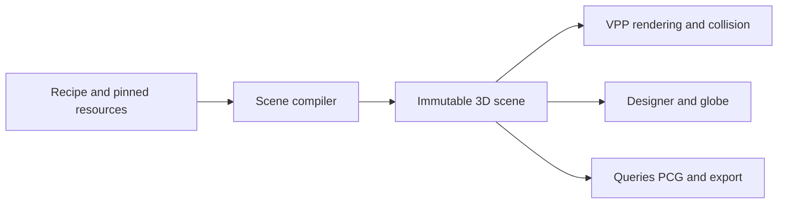

# Planet geological design proposal

2 November 2026. Proposed design and implementation sequence for review. The
existing UE 5.7.4 / VPP 2.0p8 proof remains the executable baseline. This document
adds no geology implementation and changes no saved planets. The [3 November
recipe-to-world research](#recipe-to-world-architecture-research--3-november-2026)
extends the proposal to general volumes, measured data and planetary precision.

Build planets from a shared geological history and structure, refine them through
landscape processes, then use reusable Landforms to express the resulting terrain.
The recommended approach combines bounded tectonic construction, explicit rock
units, connected drainage and accepted erosion products. It retains artistic
control over continents, belts and landmarks, with an efficient immutable field
for Unreal presentation.

The primary user experience is assembling presets into a realistic planet. The
world builder must be able to complete that workflow without opening geological
parameters. Detailed controls are available by choice through progressive disclosure.

## Existing work and what to retain

The current compiler has broad oriented uplift/basin shapes and heightmap
features, structure-guided cellular regions, reusable terrain sources, native VPP
geometry/materials/collision and globe-to-ground inspection. These establish the
presentation and composition path. An uplift currently has no crustal cause,
tectonic age, plate motion, rock sequence or connected drainage model.

The older research workspace contributes useful concepts:

- [Planet descriptions](../../../../landform-workspace/CatalystPlugins/Plugins/CatalystLandform/Docs/PlanetDescriptionAndExample.md): one shared structure, geological types, explicit contacts and accepted derived fields.
- [Watershed and karst family](../../../../landform-workspace/CatalystPlugins/Plugins/CatalystLandform/Docs/WatershedKarstFamily.md): continuous bedding and drainage across provinces; rock properties affect terrain processes.
- [Automatic watersheds](../../../../landform-workspace/CatalystPlugins/Plugins/CatalystLandform/Docs/AutomaticWatershedGeneration.md): spherical analysis, deterministic routing, bounded refinement and qualification gates.
- [Research review](../../../../landform-workspace/research/unreal-landform/README.md): process-based formation families, multiscale refinement and hybrid procedural/derived data.

Those documents distinguish scalar experiments from native execution. Their
prepared C++ and watershed experiments are research inputs, not qualified code in
the current plugin. Reuse selected algorithms only after separate tests. Their
absolute/datum-radius conventions do not supersede the current normalized guides
and outer-sky radius contract.

## Research basis

| Primary source | Finding relevant to this proposal | Proposed use |
| --- | --- | --- |
| [Procedural Tectonic Planets, Cortial et al., 2019](https://perso.liris.cnrs.fr/apeytavi/website/publication/hal-02136820/) | Controllable approximations of plate motion and crust interaction can construct large planetary structures, subsequently amplified with terrain data. | Bounded tectonic construction and editorial motion controls. |
| [USGS, Understanding plate motions](https://pubs.usgs.gov/gip/dynamic/understanding.html) | Different convergent settings, spreading and transform motion have different geological expressions. | Distinct boundary operators, including mixed motion; no generic mountain at every boundary. |
| [NASA, Venus crust study, 2025](https://science.nasa.gov/science-research/astromaterials/nasa-study-reveals-venus-crust-surprise/) | Venus illustrates crustal evolution and volcanism without Earth's moving-plate/subduction pattern. | Explicit geological regimes rather than Earth tectonics on every body. |
| [Tectonic uplift and fluvial erosion, Cordonnier et al., 2016](https://onlinelibrary.wiley.com/doi/10.1111/cgf.12820) | Uplift and erosion together provide a basis for mountain and watershed structure. | Couple generated relief to drainage and erosion. |
| [Terrain Amplification using Multi-scale Erosion, 2024](https://research.adobe.com/publication/terrain-amplification-using-multi-scale-erosion/) | Coarse terrain can be amplified with hydrologically consistent detail at several scales. | Constrained regional refinement rather than unrelated fine noise. |
| [Stochastic Geomorphological Transport, McDonald and Cordonnier, 2026](https://erosiv.studio/publications/stochastic-geomorphological-transport) | Momentum-aware transport models produce meanders, braided channels, fans and deposits. | Evaluate a higher-quality upstream erosion producer after a simpler baseline. |
| [Arenite, Yang et al., 2025](https://jango6324.github.io/arenite/) | Stress and erosion/deposition support sandstone structures such as alcoves, arches and buttes. | Later material-specific Landform generation, with retained accepted outputs. |
| [Priority-Flood, Barnes et al.](https://arxiv.org/abs/1511.04463) | Depression analysis and watershed labelling can operate on irregular meshes. | Adapt to a closed sphere with explicit oceans, lakes and internal terminal basins. |

These inform the design; the stages below are Catalyst proposals. Research
implementations need separate licensing, representation and platform evaluation.
The official [2026 transport implementation](https://github.com/erosiv/geotransport)
is a CUDA core reference, while the [multiscale erosion release](https://github.com/H-Schott/MultiScaleErosion)
is an OpenGL application. Neither is an established Mac/VPP integration.

## Planet inputs and physical regimes

The planet references a geological profile, a Radial Guide Set and existing
celestial/environmental domain inputs. Where available, consume mass, gravity,
rotation, obliquity, heat and water/climate forcing from their owners. Landform
owns their terrain consequences, not a replacement astronomy or weather service.

Initial profile: active tectonic rocky worlds. Subsequent distinct profiles:
ancient eroded rocky worlds, volcanic single-lid worlds, crater-dominated airless
bodies and fractured icy bodies. Each enables relevant processes and records its
assumptions; a dry airless world does not acquire modern river erosion by default.
A body can retain evidence of processes from an earlier declared environment.

Radius remains the outer sky envelope. Guide values remain fractions from centre
0 to that envelope 1. The solid reference surface, sea reference and terrain
limits are separate resolved radii. Guides are references, not geological layers.
Layer thickness, rock properties and structural coordinates belong to geology.

Sea level needs an explicit policy: either a pinned ocean guide, or a water-
inventory calculation that proposes a sea reference for acceptance. Do not claim
both are independently satisfied. A pinned sea level can yield a different land
fraction when geology changes; forcing a target land fraction is an editorial
constraint and should be labelled as such.

Distinguish physical planetary scale from deliberate miniature presentation.
Earth-like tectonics on a 100 m game world is an explicitly scaled artistic
profile, not a prediction for a natural 100 m body. A proportional resize
rebuilds dimensioned fields; a physically different planet requires regeneration
of physical process outputs. Do not infer mass or gravity from the sky envelope.

## Shared spherical geological model

Use an analysis mesh on the sphere, independent of render chunks, PCG points and
Landform regions. Prototype with an icosahedral mesh and explicit spherical areas;
refine by measured error and process needs. About ten thousand vertices is a
starting tectonic experiment, not an established drainage resolution or budget.

Maintain a canonical body frame and seam-free 3D directions. Plate motion uses
an angular velocity and Euler pole: tangent velocity is `omega cross position`.
For adjacent plates, resolve relative motion into boundary-normal convergence or
extension and boundary-tangent shear. A boundary can contain both components.

Plates and continents are separate objects. A plate can contain continental and
oceanic crust; continents can span several plates. Track crustal type, thickness,
density, age, thermal state and inherited structure on the plate material, not
only on an unmoving Voronoi cell. Cellular methods can seed a partition, but the
visible world must not inherit a pattern of independent polygon-shaped hills.

| Setting | Structural products |
| --- | --- |
| Continental collision | Broad mountain belt, thickened crust, elevated interior plateau and adjacent basins |
| Oceanic subduction beneath a continent | Trench, asymmetric margin, volcanic arc and related basins |
| Oceanic subduction beneath oceanic crust | Trench, island arc and associated basins |
| Continental extension | Rift, faulted shoulders, subsiding basin and possible later ocean opening |
| Oceanic spreading | Ridge, newly formed crust and age-dependent seafloor depth |
| Predominantly transform motion | Fault/displacement corridor; local relief only where the selected mixed-motion model supports it |
| Interior plume or hotspot | Broad dome and volcanic province; chains require a motion/history model |
| Stable continental interior | Old basement, subdued inherited relief and sedimentary cover where supported |
| Impact event | Basin, rim/rings and ejecta; later deformation, deposition and resurfacing change their preservation |

Boundary polarity and structure depend on the crust and process profile. They
must not be chosen from plate ID or speed alone. Broad support includes simplified
isostatic response and flexural basin effects, calibrated as approximations.
An uplift becomes a product of these processes or an explicit editorial override.

Preserve a bounded geological history: ordered rifting, collision, volcanism,
subsidence, sedimentation, deformation and erosion phases. Young and old belts
must have different exposure and morphology. The first tectonic milestone can
show current forcing with a declared maturity approximation; it must not claim
to have simulated continental drift or a full geological history.

## Geological units and landscape processes

Rock units carry identity, composition, strength/erodibility, thickness and a
structural coordinate field. Sedimentary bedding can be tilted, folded, faulted
or exposed by incision. Contacts, intrusions, erosion surfaces and deposits have
explicit process order. Continuous surface relief need not imply a blurred rock
contact; a deliberate fault must remain a fault.

An interior/geological section in Planet Builder can inspect this model. The
Landform Designer keeps its flat, fixed-size core-to-sky terrain preview and uses
a disposable context snapshot; it does not become a second planet-history editor.

Compile landscape construction in this order:

1. Planet figure, envelope, profile, reference levels and environmental forcing.
2. Crust and tectonic structure, including authored constraints and inherited events.
3. Geological provinces and initial Landform assignment.
4. All major Landform relief and macro stamps, producing the combined coarse surface.
5. Connected drainage, erosion and deposition on that combined surface, with
   rock resistance and climatic forcing. Coarse climate supplies rainfall,
   temperature and rain-shadow context; ecology remains a downstream consumer.
6. Fine Landform detail and PCG stamps constrained by accepted ridges, channels,
   shorelines and contacts. Validate that this refinement preserves the drainage.
7. Material exposure, regolith/deposits and the shared native presentation field.

Preliminary drainage may help assignment, but it cannot be treated as final
before major Landforms are applied. Macro edits invalidate dependent watersheds
and erosion products; this dependency can extend far beyond the edited footprint.
Use a bounded rebuild sequence with explicit convergence checks rather than an
unlimited circular solve.

Derive drainage globally across province boundaries. Distinguish an ocean outlet,
a real closed basin, a lake spill connection and a numerical depression. Priority-
Flood is an analysis tool, not an instruction to erase every lake or cut channels
through lake floors. All-dry, all-ocean and internally draining worlds need explicit
valid policies; the older mixed-land/ocean draft's rejection rule is not universal.

Start with stream-power incision and hillslope/talus transport. Track sediment
sources, storage and exports, including declared approximations. Advance to
momentum-aware transport for fans, braided channels and deltas after measured
quality gains. Glacial, aeolian and karst processes follow as separate qualified
families. Surface water rendering remains outside this milestone, while terrain
still needs sensible bathymetry and drainage.

## Landforms and regional assignment

A geological province, tectonic plate, drainage basin, biome and VPP chunk are
different partitions. Regions may be guided by cellular structure, but coherent
belts, basin outlines, terraces and drainage divides should shape their domains.
Shared ridges, rivers and faults have identities independent of those regions.

Extend Landform suitability with geological setting, lithology, relative age,
uplift/subsidence, erosion/deposition state, ridge/fold direction, climate context
and characteristic scale. Pass resolved context into an immutable field. The
Landform describes how to express a local terrain family; it does not choose the
planet's plates or own their geological history.

A mountain source follows an orogenic axis; a plateau source expresses an elevated
block or resistant cap; alluvial terrain follows depositional lows. Canyon and
river networks are shared structural features, not independently repeated
rectangular stamps in every cell. Detail stamps remain PCG candidates conditioned
on those constraints, with their accepted deterministic placements shared by the
Designer and native planet.

Preserve palette semantics: one selected Landform fills every generated Landform
region over the common base. Report unsuitable combinations without silently
substituting another source. With several selected Landforms, use contextual
suitability and deterministic variation, provide an explanation and allow manual
overrides. Do not silently introduce unselected terrain types.

## Preset assembly and editorial controls

World Builder assembles a planet through the Planet Builder editor. Its default
workflow is:

1. Choose a base planet preset with a coherent geological style and defaults.
2. Combine structural presets such as a continental collision belt, island arc,
   rift, volcanic province or impact basin, plus a palette of reusable Landforms.
3. Let the builder arrange them appropriately, or position and pin selected
   features on the globe. Adjust a few meaningful controls such as extent,
   prominence and variation.
4. Generate a preview, vary selected presets while preserving pinned work, then
   inspect the globe or walk the surface and accept the result.

Provide visual preset cards and a clear list of applied presets. A complete world
preset can bundle a base, structural features and Landform palette; individual
presets remain composable and editable. Adding a preset supplies constraints and
parameters to the shared geological construction, rather than constructing an
independent planet fragment. Compatibility rules and sensible defaults resolve
the relationships. Explain conflicts in terms of the selected features and offer
concrete alternatives rather than requiring the user to understand the solver.

A preset's primary intensity control coordinates many underlying variables along
an authored progression, rather than multiplying all values uniformly. Its seeded
identity remains stable as the effect becomes more pronounced. The knob generates
live previews during use, with bounded coalescing and optional draft quality;
release refines quality rather than triggering the first visible change. Advanced
parameters can be explicitly pinned while the other values follow the knob.

Basic controls express intent. Plate motion, crust thickness, rock properties,
erosion coefficients, process history and diagnostic overlays belong in optional
Advanced controls. They edit the same recipe; there is no separate advanced
generation path or loss of preset editability when details are opened. The
Radial Guide Set remains a planet reference, separate from Landform definitions.
Preset identities, versions, overrides and variation scopes are retained in the
saved description so the backend can reproduce the assembled result.

Usability acceptance is a complete preset-only workflow: create a coherent planet
with several presets, vary one, preserve a pinned landmark, inspect and save it
without opening Advanced. The first implementation should expose a small useful
preset collection while its geological machinery is developed and qualified.

Planet Builder owns the globe, plates, continents, broad process features,
history, global guides, palette and accepted generation. Keep preset assembly and
controls in the left panel. Advanced diagnostic views include elevation, crust, plate motion,
boundaries, age, uplift, lithology, drainage, sediment and Landform assignments.

Through optional detailed tools, the creator can sketch or move continents, edit boundary curves and Euler motion,
place a hotspot or impact, draw a desired mountain belt and pin important basins
or landmarks. Constrained generation adjusts unpinned content and reports conflicts.
An arbitrary requested mountain range is either reconciled with the structure or
retained as an explicit override; the UI must not imply a solved inverse geology
problem when it has merely added relief.

Separate cheap draft preview from explicit quality generation and acceptance.
Dragging changes draft constraints; expensive history/erosion is coalesced and
cancellable. Idle frames never rerun generation. Stable IDs, transactions and
seed scopes preserve unaffected editorial work. Walk here inspects a frozen
accepted snapshot and returns to the same authored planet.

### Surface inspection presentation — user direction, 2 November 2026

Use the shared [curvature presentation](CurvaturePresentation.md) and projected
camera/interaction path for subsequent ground-level Landform and base-planet
inspection. The host's [curvature handover](../../Projects/LandformLab/Docs/CurvatureHandover.md)
records the completed implementation and qualification limits. Natural, half and
flat views must use matching terrain, camera and picking state; recipe geometry,
native collision, radial gravity and returned gameplay positions stay canonical.
The globe remains spherical and the Designer retains its fixed-size flat section.

Ordinary Builder **Walk here** now adopts that path for the supported native
Rock/Scree/Soil profile, retaining its snapshot/return contract. The globe stays
spherical, including Tab transitions. The [continental checkpoint](ContinentalPreset.md)
records the bounded integration and checks. General custom-material support and
the strict 60 fps gate remain open.

## Compiler and backend boundary

Extend the existing compiler with a structural producer and typed compiled
products. Retain one composition/presentation path. Preserve old oval/heightmap
recipes through a versioned legacy lowering; do not silently reinterpret them as
tectonic events or add generated uplift twice.

A saved generative description contains exact profile/operator/library versions,
seeds, guides, body/frame conventions, editorial constraints, ordered history and
resource references. Accepted derived products contain spherical crust and
process fields, feature graphs, topology and sparse refinement data where needed.
The planet references their exact content digests and dependency closure.

The backend eventually owns generation and accepted planet revisions. Local
Builder authoring first exercises the same inputs and outputs without inventing
a new backend service or Connect protocol. Connect delivers the agreed recipe and
resources through its existing architecture. A seed alone cannot reproduce an
unversioned numerical simulation.

The client resolves installed operator/asset IDs, validates the snapshot and
resources, and compiles immutable native evaluators. Expensive global geology,
erosion and routing run upstream or in authoring. A voxel query reads accepted
fields and nearby indexed features; it does not solve the planet again. No mutable
UObjects enter worker evaluation. Native VPP noise does not establish cross-platform
bitwise agreement; accept exact derived artifacts when regeneration could differ.

Hybrid resources are legitimate: procedural operators for compact structure,
coarse fields and sparse residuals for irreducible process output. A whole-planet
SDF/streamed surface remains a separate measured experiment. A radial sign field
must not be labelled an exact signed-distance field without establishing that
property. Navigation is a consumer of the resulting geometry, not the geological
analysis mesh.

Every generation job has explicit time, memory, resolution and feature budgets,
progress, cancellation and a generation fence. Failed or unfinished products
never replace the last accepted snapshot. A quality failure is recorded with its
recipe; do not reroll seeds or relax tolerances invisibly.

## Implementation sequence and acceptance

| Milestone | Work | Evidence required before advancing |
| --- | --- | --- |
| 1. Spherical tectonic base | Explicit body basis, crust/plate model, Euler motion, boundary classification, curved structural belts and draft controls; retain existing Landforms downstream | A global continent/subduction case, a collision plateau, a rift/spreading case and a transform case; native globe and walking output; canonical IDs and coordinate compatibility |
| 2. Inherited structure and rock | Bounded history, crust age/thickness response, lithology, bedding, faults, basins and hotspots | Young versus eroded belts, exposed units in sections, rock continuity across regional boundaries and explicit material contacts |
| 3. Watersheds and aging | Global routing over the composed macro surface, explicit lakes/closed basins, incision, talus and sediment baseline | Downstream connectivity, conservative accounting under the selected model, strictly graded channels where required, resolution sensitivity and recorded failures |
| 4. Contextual Landforms | Geological suitability, ribbon/basin domains, conditioned stamp distribution and protected feature corridors | Selected palette semantics, stable placements, Designer/native parity and no blocked drainage after detail |
| 5. Quality and regime expansion | Compare multiscale/2026 transport producers; add single-lid and cratered profiles, then icy/glacial/karst families | Visible and measured improvement on reference classes, bounded generation/runtime cost and platform qualification for each producer |
| 6. Backend activation and scale | Deliver exact accepted resources, exercise missing/stale dependencies and extend beyond the small proof | Server/local snapshot parity, atomic activation, deterministic conformance within declared profiles, multi-scale error and streaming budgets |

Each milestone keeps the existing end-to-end proof working. Backend data contracts
are designed from milestone 1; actual backend activation waits for the relevant
owner/integration work, not a speculative parallel service.

### First implementation scope

The first executable subset is the [one-control tectonic preset](TectonicPreset.md),
which provides bounded kinematic relief and live preview. Milestone 1 still needs
full editorial plate controls and the wider geological cases below. Use a small explicit Earth-like test setup with
continental and oceanic crust distributed independently of its plate partition.
Compare convergent, divergent, transform and stationary versions of the same
constraints. Produce real curved belts and basin/trench structure before adding
fine terrain. Existing Mountain ridges and Plateaus then express the appropriate
regions; the existing canyon remains an editorial feature until drainage-derived
canyons are qualified.

The current `FCLCompiledPlanetFeature::Frame` uses a latitude convention with +Y
as its pole, while the geographic material grid uses +Z as north and +X as zero
longitude. Introduce a declared authoring basis and versioned conversion before
tectonic editing. Preserve existing 3D feature frames and placements while
converting their displayed coordinates. A camera rotation is not a migration.

Tests must cover closed spherical topology and area, tangential velocity,
relative-motion signs, boundary orientation/polarity, degenerate cases, input
reordering, pole/dateline/cube-edge continuity and native field/collision parity.
Movement reversal must change the structural setting; zero relative motion must
not create a fresh boundary mountain by default. Pin stable feature IDs and test
that unedited accepted instances retain identity.

Use the existing globe-to-ground workflow for visual and collision inspection.
Repeat native walking at poles, equator, patch boundaries and selected belts.
Validate publication/cancellation and preserve old saved planets byte-for-byte
unless an explicit migration is committed.

### Continental foundations and boundary settings

The controlled [continental preset](ContinentalPreset.md) now implements this
bounded proof with nested tectonic algorithm 3. It provides independent crust
domains, shared geological samples and six comparison fixtures. This advances
milestone 1; full editable plate topology and geological history remain future
work. The requirements below describe its intended scope and acceptance boundary.

Complete more of milestone 1 before adding erosion or additional fine noise.
The current preset is a bounded kinematic relief generator with approximate
continental contrast; it is not yet the proposed crust/history model.

Start with one **Continental rocky world** preset: coherent continental interiors,
broad ocean basins, continental margins and thickened collision terrain. Keep
continental domains independent of plate cells, preserve seeded/pinned identities,
and use the planet's resolved guides for scale and any pinned sea datum. Water
rendering is outside this proof. Store crust and boundary context as shared
compiled data so later regional Landforms can respond to the same structure.

Use the existing live Tectonic activity control and inline Advanced disclosure.
Prove four controlled settings of the same construction: continental collision
with a broad plateau and flanking basins; a subduction margin with distinct arc
and trench; rifting/spreading; and predominantly transform motion. Include a
stationary control and reverse relative motion to check the structural response.
These remain declared approximations, without claiming simulated geological age.

Inspect the same accepted terrain in the globe and through the shared projected
walking view at natural, half and flat curvature. Require field/collision parity,
native grounded movement, canonical return/pick coordinates, and no source mesh
or collision regeneration caused solely by changing presentation curvature.
Keep generation/cancellation and frame-time evidence separate. This provides the
foundation for subsequent rock units, drainage and erosion; it does not authorize
ecosystem, water-rendering or Architect implementation.

## Current layer boundary — 2 November 2026

[Planet layers](PlanetLayers.md) now separates continental foundation from
tectonic deformation in schema 15. Both can be enabled on one planet, with
independent controls and seeds. The inspector uses native Details rows grouped
by the design workflow. A preset maps a layer's one knob to its underlying data;
it does not replace other geological layers. Pinned schema 14 examples remain
available with their original combined semantics.

## How to judge realism

Use a suite of comparable terrain classes and parameter ranges, not one attractive
seed. Compare reference hypsometry, slope/curvature distributions, ridge and valley
orientation, drainage organization, relief by scale, sediment placement and
lithological exposure. Compare ocean-floor patterns separately from continents.
Use class-appropriate references; lunar or miniature artistic profiles should not
be penalized for differing from Earth.

Measure graph/field convergence, shared-feature continuity, generation time,
peak memory, voxel query cost and native render/collision error. Record numeric
thresholds after establishing baseline cases, before tuning the generator. Keep
expert visual review alongside metrics: a smooth seam or a plausible histogram
alone does not establish believable geology.

## Recipe to world architecture research — 3 November 2026

The [implementation plan](#recipe-to-world-implementation-plan--3-november-2026)
below turns this research into ordered, reviewable delivery slices.

The product contract is: an accepted recipe and its referenced resources produce
an ultra-realistic, reproducible world. The recipe must describe more than a
radial height surface. Recommend a versioned, engine-independent scene program
with full 3D shape, geological/material attributes, resource providers and
placement outputs. Compile that program into an immutable, spatially indexed
scene; lower it into VPP through qualified native adapters. Meshes, previews,
collision and exported data are products of that scene.

This is a proposal for review, not an implemented replacement or a change to
current saved recipes. The inspected baseline is component `19490fe` and workspace
`fdf311f`, UE 5.7.4 / VPP 2.0p8 on Mac arm64. The current radial kernels, source
assets, one-knob authoring and canonical curvature/picking work remain useful.
The representation boundary must widen before more features depend on it.

### Evidence and architecture choice

Earlier research already proposes a canonical body description, immutable
composition, bounded operators, accepted process artifacts and a composite VPP
volume adapter. See [the research composition proposal](../../../../landform-workspace/research/unreal-landform/COMPOSITION.md)
and [the research review](../../../../landform-workspace/research/unreal-landform/README.md).
Their old absolute-radius guide conventions do not override today's normalized
Radial Guide Set and outer-sky radius contract. Their prototypes are not evidence
that the current plugin implements general volumes.

| Candidate | Strength | Limitation for this product | Recommended role |
| --- | --- | --- | --- |
| Radial heightfield | Compact exterior terrain, DEMs, noise and regional relief | One boundary per direction; no general caves, arches or detached solids | Optimized exterior provider within the scene |
| One fully sampled planet SDF | Arbitrary solid topology | Fine dense storage scales with volume; global high resolution is impractical | Avoid as the authoritative world format |
| Procedural 3D field everywhere | Compact recipe, arbitrary topology | Cost can grow with feature count; process output and measured data cannot always be regenerated from a seed | Default shape semantics with spatial pruning and cached providers |
| Hybrid scene with procedural fields, tiled rasters and sparse volume artifacts | Supports all known terrain families, measurements and expensive process output | Requires explicit resource, precision, LOD and readiness contracts | Recommended foundation |
| Cesium or 3D Tiles as the whole terrain system | Mature planetary frames and streamed geospatial geometry | Streamed meshes alone do not supply our editable volumetric geology | Reference architecture and optional derived geometry/data adapter |
| UE Sparse Volume Texture as solid terrain | Sparse sampled volume data | Its documented workflow targets volumetric media; no established Landform solid meshing/collision bridge | Do not adopt as the solid-terrain foundation |

[VPP stamp domains](https://docs.voxelplugin.com/knowledgebase/working-with-stamps/stamp-types/)
provide height and fully volumetric contributions. VPP should retain ownership of
native terrain meshing and collision generation. A new custom planetary mesher is
not required to define the canonical scene. [UE SVTs](https://dev.epicgames.com/documentation/en-us/unreal-engine/sparse-volume-textures-in-unreal-engine?application_version=5.7)
are useful volume assets, but their existence does not establish a solid-terrain
pipeline. [Cesium's Moon/Mars workflow](https://cesium.com/learn/unreal/unreal-moon-mars/)
provides a concrete reference for non-Earth figures and global dataset presentation.

### Recipe and compiler boundary

Keep authoring intent, accepted world data and renderer activation distinct:

1. The authored recipe contains planet/frame identity, figure, normalized guides,
   geological construction, Landform instances, feature programs and explicit
   source/scale policies. One-knob presets expand to resolved settings with a
   preset version and seed; clients must not reinterpret old positions through
   a newer curve.
2. An accepted scene revision pins operator versions, resolved parameters,
   referenced assets/data, coordinate definitions, numeric profile, dependency
   digests, any upstream simulation outputs, and target capability requirements.
3. The runtime plan binds installed kernels and cooked assets, spatial indices,
   resource residency, render quality and collision requirements. Camera LOD,
   caches and origin placement do not change the accepted world identity.

Declare the reproducibility profile. A seed and vendor algorithm name do not
establish bitwise cross-platform output across future releases. Pin kernels and
numeric settings; use accepted data artifacts where exact identity is required,
and declare measured geometric tolerances where a qualified procedural path is
permitted. Never let each client independently rerun an unversioned erosion or
learned-generation job to recreate an accepted world.

Use typed providers and operations rather than serialized UE object layouts or
raw editor graph strings. A contribution can supply exterior elevation, a 3D
solid field, material/geological attributes, a mesh-derived field, a feature
network, or placements. Composition specifies channel rules, transforms, order,
blend/contact policy and bounds. Static and time-dependent edits have explicit
ordered semantics. Natural caves may belong within geological chronology, rather
than always being applied after every other process.

The server can rearrange and parameterize installed capabilities and reference
new accepted data. A recipe cannot introduce an uninstalled C++ operator, shader
or uncooked asset. The runtime must validate capability/resource closure and
report unsupported inputs before activation. New operator kinds need an
implementation/content release; ordinary planet variation does not.

The source inspection confirms that VPP supports compiled runtime graphs, while
editor graph construction/translation has editor-only paths. Arbitrary runtime
graph authoring is not qualified. Start with the Catalyst composite runtime and
reusable cooked VPP graph/asset templates. Prove any more dynamic graph compiler
path in a packaged build before making it a recipe dependency.

### One 3D scene with explicit query contracts

The primary query accepts body-local XYZ, a scene revision, a requested footprint
or precision, and requested channels. It returns a signed implicit shape field,
validity, normal/gradient information where supported, and geological/material
attributes. Multi-hit ray queries, surface extraction and contact queries are
separate consumers. An exterior-height query remains a useful optional shortcut;
it must not substitute for the full scene when a cave or detached surface exists.

Declare field metric and validity. Radial sign fields, transformed fields and
CSG combinations must not be silently advertised as exact Euclidean distances.
A marcher needs a qualified conservative step bound or another intersection
method. SDF export can re-distance sampled, bounded bands at a declared error.
Known solid/air, outside-contribution identity, unavailable resources and VPP void
are different states. Missing DEM tiles must not become terrain holes.

Geological units and structural coordinates exist in 3D, so excavating a passage
exposes the appropriate rock. Exposure, scree, soil and deposits are later material
rules. Walkability compares a surface normal with the selected gravity policy;
radial height alone cannot choose a cavern floor or distinguish it from a ceiling.
Material IDs are logical catalog references; the current eight-surface blend cap
is a target/profile constraint, not a permanent planet-schema limit.

Existing terrain kernels can be wrapped as the initial exterior provider. Import
legacy schema-17 recipes through their pinned algorithms to preserve geometry;
introduce the generalized scene through an explicit versioned adoption. Do not
rewrite every terrain asset or discard its authoring UI to make this boundary.

### Coordinates, body figure and precision

Use an explicit body-fixed frame in double-precision metres, with handedness,
axes, angular conventions and a sphere or ellipsoid definition. Keep the solid
reference figure distinct from the outer-sky radius. A guide remains a normalized
radius from Core; ellipsoid-normal height and areoid elevation require declared
conversion and must not be treated as that radius fraction.

Rendering and physics operate in bounded local frames. Subtract a high-precision
anchor before conversion to floats; shader position, texture phase and procedural
noise must retain canonical meaning across rebases. Use UE translated-world/LWC
facilities instead of transporting absolute planet-scale float positions through
UVs. [Epic's rendering guidance](https://dev.epicgames.com/documentation/en-us/unreal-engine/large-world-coordinates-rendering-in-unreal-engine-5?application_version=5.7)
explains DoubleFloat and camera-relative material coordinates. [UE georeferencing](https://dev.epicgames.com/documentation/en-us/unreal-engine/georeferencing-a-level-in-unreal-engine?application_version=5.7)
already provides round-planet coordinate transformations; custom-body and datum
support still need qualification against our input profiles.

The current native adapter converts radial height offsets to float before its
final radius subtraction. That must be audited and changed where necessary so
large offsets are cancelled in double precision and only small local distances
are demoted. Float32 preview UVs fix overflow but do not establish centimetre
precision everywhere on Mars. Precision budgets cover model evaluation, source
quantization, native distance transport, mesh error, collision and material phase
separately.

Gravity/frame transitions are owned by the body/physics integration. Terrain
provides surfaces and metadata, including detached solids; it does not automatically
turn disconnected terrain into moving physics bodies. Multiple nearby planets
need explicit frame and velocity handovers. Preserve the shared canonical
curvature camera: its flat/curved presentation must not change source fields,
collision or authoritative positions. Rebased frames and curvature projection
are separate transforms. Other future content consumes that same transform
contract rather than acquiring an independent world bend.

### Detail, streaming and native VPP use

Index exterior data on a spherical atlas with declared chart domains, seams,
metric/Jacobian and polar handling. Index volumetric features in body-local 3D.
Projection belongs to each asset/operator: a georeferenced global raster and a
small tangent-chart stamp have different mappings. A wide planar stamp cannot
assume an undistorted global chart; a warped 3D distance field also needs an
explicit metric/error treatment.
Storage tiles, geological regions, PCG cells, render chunks and navigation tiles
are independent partitions. Each feature declares its support, derivative/read
halo, minimum meaningful scale and conservative bounds.

Use VPP bulk/sparse volume queries, bounded native stamps and instancing where
qualified. A composite stamp can advertise child bounds and partial invalidation;
there need not be an actor per feature. [VPP instancing](https://docs.voxelplugin.com/knowledgebase/working-with-stamps/instanced-stamps)
avoids actor/component overhead, but its instance transforms are world-space and
do not follow movement of the instanced component. Body/frame movement therefore
needs explicit rebinding; attaching the component is insufficient.

[VPP 2.0p8](https://docs.voxelplugin.com/resources/change-log/2.0p8-changelog)
already samples chunk contents sparsely near surfaces and offers background-task
and render-chunk controls. Its bounds and valid-band semantics remain important:
[VPP bounds and voids](https://docs.voxelplugin.com/knowledgebase/working-with-stamps/bounds-ranges-and-voids)
are not equivalent to a globally valid SDF. [Layer order](https://docs.voxelplugin.com/knowledgebase/working-with-stamps/execution-order-layers-and-priority)
and [Override channel rules](https://docs.voxelplugin.com/knowledgebase/working-with-stamps/blend-modes/override-stamps-and-get-previous-nodes)
must be preserved when lowering the scene. Execute each contribution exactly once.

First qualify native VPP LOD across the required planetary extent. Keep the
render-plan interface able to use localized VPP detail and scene-derived distant
geometry if native whole-planet generation does not meet resource budgets. A far
proxy must include significant detached formations and silhouettes; a single
radial height globe is insufficient as the general fallback. Every representation
carries scene revision and geometric error, with collision available before a
player is released into the region. Native LOD transitions and any far/near
handover require seam and topology tests. The [3D Tiles specification](https://docs.ogc.org/cs/22-025r4/22-025r4.pdf)
provides a useful geometric-error/hierarchical-streaming model, without requiring
us to adopt that mesh format as terrain authority.

Avoid evaluating full-resolution procedural octaves at distant footprints.
Filter detail by requested scale with stable phase, preserve gameplay-critical
openings in the active collision domain, and budget memory, sample cost,
generation latency, bandwidth and visible feature density. A render LOD may
omit a subpixel cave entrance; it cannot authorize closing its collision or
navigation connection beside the player.

### Measured data and sparse volume resources

Treat DEMs as georeferenced providers with source CRS, body/figure, longitude and
latitude convention, datum, units, pixel registration, NoData/coverage mask,
interpolation, source resolution/uncertainty, and provenance. Preserve original
source values. Generate tiled multiresolution data with calibrated local offsets,
lossless or explicitly error-bounded compression and border/halo ownership.
[GDAL's COG driver](https://gdal.org/en/stable/drivers/raster/cog.html)
provides tiled georeferenced files and overviews for ingestion/distribution; it
is not an existing VPP network-streaming integration.

[MOLA products](https://pds-geosciences.wustl.edu/missions/mgs/megdr.html)
distinguish planetary radius from areoid-relative topography. Use those definitions
when converting Mars data to our body frame. Regional [HiRISE DTMs](https://hirise.lpl.arizona.edu/dtm/about.php)
provide finer terrain with their own coverage, artifacts and precision. Interpolating
or adding procedural detail cannot be presented as new measured accuracy.

The current VPP height data API accepts float as well as uint16 data and holds a
resident height-data array. This does not establish an out-of-core, network-paged
DEM backend. Implement and qualify a read-only tiled provider with bounded
residency and explicit NotReady results, or pre-stage bounded assets for the
first proof. Voxel generation jobs must not block on network I/O or load UObjects.

Use the same resource-provider contract for accepted erosion fields, sparse
volume blocks, mesh-derived solids and sculpt/edit payloads. OpenVDB is a candidate
upstream interchange/processing format; NanoVDB is a candidate compact query
representation. [NanoVDB documentation](https://www.openvdb.org/documentation/doxygen/NanoVDB_FAQ.html)
and the [current release notes](https://www.openvdb.org/documentation/doxygen/changes.html)
need to be read together: tooling evolves beyond the older static-topology FAQ.
Neither is a qualified Mac/VPP terrain streamer here. Do not require CUDA on the
Unreal client or make one storage codec the planet's semantic representation.

An export of the entire planet can be a manifest of sparse SDF bands/tiles,
transforms, error bounds and constant regions. It need not allocate the interior
at the same resolution as a walkable cave wall. Sparsity alone is insufficient:
storing the complete exterior at walking resolution is still enormous. Keep
global structure coarse, derive requested fine detail on demand, and retain
irreducible measured data and accepted edits in the appropriate tiles.
Navigation is a separately derived
product tied to the same scene, agent/gravity profile and revision; a conventional
flat navmesh is not assumed to cover a spherical world.

### Guide policies and scientific fidelity

Keep the user's exact final SurfaceMin/SurfaceMax requirement for existing
procedural recipes. General volumes introduce an explicit design decision:
whether those names constrain the exterior relief, every solid/air boundary,
or a selected traversable envelope. Underground floors and floating formations
make those meanings different. Record that scope in the new recipe profile;
do not silently reinterpret old recipes.

Measured-data profiles preserve physical elevations and derive matching guide
extrema unless the author explicitly requests a calibrated resize or exaggeration.
A global post-composition height remap cannot be applied blindly to caves,
wall thickness, imported measurements or local edits. Any constrained procedural
policy must validate the final composed result and its topology. Solving exact
global extrema also creates nonlocal dependencies: a local edit can change the
scale of everything if the present global remap remains active. Avoid hiding that
cost inside a supposedly local terrain edit.

### Realism, materials and interaction

Use geological structure and accepted drainage/erosion products to organize
relief and deposits. Reusable Landforms express those constraints, with PCG used
for smaller contextual features. [Multiscale erosion research](https://research.adobe.com/publication/terrain-amplification-using-multi-scale-erosion/)
supports coherent refinement of coarse terrain. [Arenite](https://jango6324.github.io/arenite/)
demonstrates stress/erosion-driven 3D sandstone structures. These are upstream
producer candidates, not constant-cost runtime operators or proven Mac plugins.
[Implicit multiscale geometry research](https://graphics.unizar.es/projects/MultiscaleGeometry_2025/)
is relevant to porous and granular material detail; its renderer is not VPP's.

Compile geometry, geological contacts, materials and placements from the same
accepted scene. Treat structural/collision geometry, visual displacement and
shading-scale detail as distinct error budgets. A normal map does not make a
walkable ledge, and material displacement must not be assumed to update collision.
Nanite/material quality does not replace coherent source geometry or good assets.
One-knob curves require a reference portfolio across seeds and the entire range,
including extreme endpoints, with visual review plus slope/relief/connectivity
checks. A valid recipe is not automatically aesthetically good at arbitrary
advanced settings.

Use native VPP Nanite/MegaMaterials as the primary runtime target on qualified
hardware, preserving the owned native lifecycle bridge. Match cave lighting,
shadows and fallback representations to actual geometry. [UE's Nanite overview](https://dev.epicgames.com/documentation/en-us/unreal-engine/nanite-virtualized-geometry-in-unreal-engine?application_version=5.7)
describes fine-grained geometric LOD, with remaining material/instance budgets;
[Mac requirements](https://dev.epicgames.com/documentation/en-us/unreal-engine/macos-development-requirements-for-unreal-engine?application_version=5.7)
mark Nanite/VSM as M2+ beta support. Newer UE features are capability-gated, not
an implicit host upgrade. World Partition may stream authored actors, but is not
terrain authority or proof of spherical navigation. UE volume effects are not a
replacement solid-terrain renderer.

PCG, object placement, collision and navigation bind a named scene revision and
stage. PCG placing stamps reads a declared predecessor stage to avoid feedback;
downstream dressing reads the final terrain. Publish readiness only when required
resources and native collision correspond to the accepted region. Missing data,
failed generation and cancelled/stale jobs keep the previous coherent scene or
an explicit unready state, rather than dropping the player through empty terrain.
A coherent activation boundary must be proved against native VPP publication
signals; partial invalidation APIs do not establish an atomic mesh/collider swap
across several worlds or chunks. This may require staged regions or an explicit
movement hold while the required collision becomes ready.
Gravity, water, ecosystem and Architect remain external consumers/owners; this
architecture introduces interfaces, not work on those systems.

### Proof sequence before broad migration

| Gate | Bounded proof | Required evidence |
| --- | --- | --- |
| Semantic scene | Adapt the existing mountain/plateau planet; add an arch, cave with two floors, exposed rock contact and detached formation | Several radial intersections; native bulk/sparse parity; same 3D result in globe, cutaway and walking; old recipe output preserved |
| Planetary precision | Same synthetic features at 100 m, 1 km, Mars and Earth scales, near poles/seams and across local-frame changes | Double-reference comparison, explicit distance/material error budgets, unchanged texture/noise phase, stable gravity/picking and native contact |
| Measured source | One real Mars regional DEM plus coarse global context and missing-data boundaries | Datum/coordinates independently checked; original elevations retained within source/error budget; borders and pole/longitude handling verified |
| Streaming and edits | Cold/warm caches, interrupted loads, rapid recipe changes and a local cave excavation | Bounded residency/work, no missing-as-air, stale results rejected, measured dirty closure, collision readiness before movement |
| Globe to ground | Native VPP LOD first; compare any necessary scene-derived far proxy at the same revision | Error-controlled silhouette/topology, detached objects retained, no visible/collision cracks across transitions, multiple views considered |
| Multi-body and navigation boundary | Transfer between two 100 m bodies; traverse cave floors and a body/patch seam | Explicit frame/velocity/gravity handover; spherical pathfinding/export strategy proved separately from character walking |
| Production quality | A seed/knob portfolio with actual materials and lighting in a packaged build | Reviewed realism, CPU/GPU/memory/IO results, worst-case traversal and edits; retain the existing strict 16.67 ms wall-p99 gate and its open status |

The first implementation slice should be the semantic-scene gate plus the
precision oracle, before adding new geological families or importing a whole
planet. Keep the runtime plan replaceable while freezing coordinate, query,
resource, versioning and readiness semantics. Height operators and imported
assets then remain useful regardless of later meshing, streaming or codec choices.

This research changes documentation only. No engine/VPP code, project settings,
assets or running editor state are modified. Documentation checks do not qualify
any of the proposed runtime capabilities. The existing research graph contained
165 primarily vendor-source nodes and did not index the planet-design notes;
those notes were inspected directly. Current public documentation was checked
alongside the installed VPP 2.0p8 headers. Installed licensed source is not copied
into this proposal.

## Recipe to world implementation plan — 3 November 2026

Status: implementation plan requested by the user; the capabilities below are
planned, not qualified. Baseline: component `632a86a`, workspace `90d1615`, UE 5.7.4,
VPP 2.0p8, Mac arm64. Keep the editor and existing assets untouched for this
planning change. Record actual source/dependency revisions at each implementation
checkpoint; these baseline hashes do not pin future builds automatically.

### Delivery strategy and ownership

Deliver a complete local volume scene first, then planetary precision and measured
data, then the scaled runtime and live delivery. Each milestone must produce a
usable recipe and observable result. Preserve the current height compiler behind
one versioned provider while its callers move to the common scene. Do not build a
second terrain renderer or migrate every asset in one change.

| Owner | Responsibility in this implementation |
| --- | --- |
| Landform model/compiler | Terrain meaning, guide resolution, recipe validation, immutable scene, composition, resource requirements and query contracts |
| Landform UE runtime adapter | Capability binding, VPP evaluation, resource residency, scene activation and native terrain readiness |
| Foundation/editor adapters | Existing described models, transactions, validation and Details controls; Landform-specific layer authoring remains Landform-owned |
| Connect | Delivery through its existing supported communication path; it does not define terrain semantics or imply accepted world state |
| Backend Landform domain | Future recipe/resource acceptance and durable revisions; local JSON is a development input, not the backend protocol |
| LandformLab | Bounded fixtures, packaged traversal, visual comparison, precision/performance evidence and preserved user assets |
| Body/physics integration | Frame, gravity and velocity handover; terrain exposes geometry and readiness through a narrow boundary |

Keep implementation in the existing runtime/editor/render/test modules initially.
New scene model/query headers contain no VPP or editor types and no UObject
references. UE Core value types may be used initially; engine-independent
semantics do not require a speculative standalone SDK extraction. Native VPP
handles and strong asset owners remain in the adapter. Reuse Foundation's
described-model serialization rather than maintaining a second authored field
list. Use existing Runtime/Connect services when live delivery is implemented;
Landform does not acquire another transport or general-purpose scheduler.

Landform Designer continues to own reusable local feature definitions, not planet
identity, radius, global seed or guide-set ownership. Planet Builder owns their
assembly and planet-global context. Preview contexts are transient resolved value
snapshots. Keep the fixed-size flat cross-section, 500 m default area, guide UI,
clean inspector and curated one-knob/inline Advanced workflow. Add volume controls
only where the new operators need them. The shared curvature camera, canonical
collision and inverse picking contracts remain the supported presentation path.

### P0 — Freeze semantics and capture a preservation baseline

Deliver the smallest contract needed by the first vertical slice:

- Body/frame ID, double-precision metre positions, figure/datum definitions,
  outer-sky radius and explicit placement/chart transforms.
- Authored recipe identity, operator/preset versions, resolved parameters,
  resource digests, required capabilities and immutable scene identity. Keep
  content identity distinct from an activation epoch and transport sequence.
- Batched XYZ field query with requested channels/footprint and per-sample
  validity. Declare sign, units, valid region and conservative metric/gradient
  bounds. Query channels include shape, geological/material identity and optional
  gradient; exterior elevation is an optional capability, never a universal query.
- Distinct known solid, known air, no contribution, unavailable data and invalid
  query results. Multi-hit ray/contact queries distinguish a clear miss from
  unready, outside-domain, budget and unresolved outcomes.
- Operator support/read bounds, dependency halos, deterministic ordering,
  attribute ownership and resource lifetime. Bounds include detached geometry
  and smoothing support, rather than assuming the exterior relief is the extent.

Preserve normalized Radial Guides, Core 0 and the outer sky boundary 1; no terrain
may exceed that outer boundary. Existing recipes retain their exact final radial
SurfaceMin/SurfaceMax fitting behavior. Do not silently reinterpret that rule for
volumes. Before exposing a new generalized height policy, settle whether the
limits include every cavity/detached boundary or the exterior surface envelope.
The contract carries an explicit versioned height policy, so this decision does
not become a hidden compiler assumption. A measured-data policy must preserve
source elevations and use matching guides unless an explicit calibrated transform
is requested. These are policy decisions to record, not permission to change
existing recipes during migration.

Capture representative mountain, plateau, mixed-region, stamp, continental and
tectonic recipes plus sampled geometry/materials, placements and screenshots.
Record source/asset hashes, current failures and platform limits. Preserve user
edits separately; use new proof assets rather than overwriting working planets.

Exit: documented contracts and reference fixtures are committed; no existing
recipe changes on load, save or evaluation. Height-policy scope is recorded as a
decision gate if it remains unresolved, and blocks adoption of the affected new
recipe profile, not unrelated query/adapter work.

### P1 — One shared volumetric scene, end to end

Proposed internal names below express responsibilities; they are not a mandate
to introduce one class for every row.

| Boundary | Proposed implementation location |
| --- | --- |
| Immutable scene and query values | `Source/CatalystLandform/Public/Scene/CLScene.h` and `CLSceneQuery.h`, implementation under `Private/Scene` |
| Compile and validate a scene candidate | `Scene/CLSceneCompiler`; call existing `FCLPlanetCompiler` for pinned radial providers |
| Coordinate/reference-frame values | `Scene/CLBodyFrame`; one metre-to-native-centimetre conversion boundary |
| Legacy radial and bounded solid providers | `Private/Scene`; retain existing noise, stamp and regional kernels |
| Native VPP volume integration | Extend `CLPlanetStamp` and its runtime; all new-profile distances/materials come from the compiled scene |
| Globe/cutaway integration | Existing `CLPlanetPreview`, `CLSectionGeometry`, `CLRecipeEditor` and inspection paths |
| Physical/package proof | Existing LandformLab runtime recipe host, projection binding and native collision lifecycle |

Implement a closed radial provider plus a bounded analytic solid provider and
ordered union/subtraction/smooth composition. Use spheres/capsules or another
small qualified set for the first cave and arch; a general node editor is not a
prerequisite. Prove transformed metrics, nonuniform scaling, operation order,
no-contribution identity and material attribution. Compile a spatial index so
workers visit relevant bounded contributions, not the complete feature catalog.

Introduce a versioned operator capability catalog with typed parameters, input/
output channels, transforms, bounds, resource requirements and implementation
identity. Track native heightmap/volume graphs, mesh/spline contributions,
blending, painting/metadata and persistent edits in an explicit support matrix.
Add adapters incrementally through the same contract; each feature is usable by
server recipes only after its combination/order/material/cooked-runtime checks
pass. Do not claim all VPP features are supported because arbitrary operator
names can be serialized. Reusable cooked graph templates are resources; arbitrary
runtime graph authoring needs its own packaged proof before becoming a dependency.

Extend both native bulk and sparse query paths. Resolve/load assets on the owning
thread and capture immutable native references before worker dispatch. Keep
distance arithmetic in double until near-surface local values are converted to
native float distances. Ensure native heightmap contributions execute once;
the scene must not apply them and then allow the old adapter to apply them again.
Do not create a duplicate actor or VPP world for each feature.

Replace exterior-only material sampling for volume profiles with XYZ geological
and contact attributes, followed by exposure/deposit rules using the actual 3D
normal and gravity. Retain logical surface IDs independent of native blend slots.
The proof must expose a different rock unit in a cave and show the same blend in
all presentations, not merely render an untextured hole.

The general scene preview uses native VPP surface extraction/rendering in a
bounded preview world where feasible. Reuse the scene and materials, and clip
the cutaway only for display; supply section-face geometry from that scene if
the native clipping path needs it. Do not introduce an independent terrain
mesher. Retain the radial mesh fast path only for scenes proven height-only;
otherwise it cannot be authoritative for picking, sections or silhouettes.
Inspect native preview-world lifecycle and collision cost before selecting its
exact binding. Preserve flat section display and normalized display coordinates
without flattening the underlying geometry.

One new recipe combines existing mountains/plateaus, an arch, a connected cave
with two vertically separated floors and a detached solid. A ray through the
fixture must encounter multiple interfaces. Walking and picking must reach the
lower cave floor rather than selecting the exterior height at that direction.
Use conservative query bounds/bracketing or qualified stepping; never use a
radial field as an exact SDF and interpret an exhausted search as a clear miss.

Exit: automated analytic and bulk/sparse parity tests pass; Designer, globe and
native walking show the same fixture with matched materials; native collision
supports both cave floors and arch traversal. Existing recipe regressions and
curvature/picking tests pass. Include one cooked Mac build here to expose
editor-only dependencies early. Preserve the old profile until parity is shown.

### P2 — Qualify planetary precision, frames and multiple bodies

Run the same analytic geometry at 100 m, 1 km, Mars and Earth body scales, near
poles/atlas seams and with different local origins. Source coverage does not
require generating an entire Earth-resolution mesh: evaluate selected windows
and a bounded native terrain neighborhood against independent double-precision
oracles. Add an ellipsoid/datum conversion oracle before measured data adoption.

Initial precision targets are acceptance targets, not reported results:

- Analytic local field/zero-interface error no greater than 1 mm after canonical
  transforms, and native float-distance error no greater than 1 mm inside a
  declared near-surface band. Record that band's extent; far-field sign/validity
  is tested separately and cannot require the same absolute float error.
- Native mesh and collision contact within one configured voxel of the analytic
  fixture, initially 25 cm in the existing host. Narrow openings and walls have
  explicit minimum feature thickness; reduce voxel size for finer qualification.
  Meshing error is reported separately from numerical evaluation error.
- Rebase/reference-frame round trips preserve canonical position and normal to
  the declared budget, with no visible material/noise phase jump. Retain the
  existing projection/picking tolerances rather than replacing them with the
  coarser mesh tolerance.

Adapt body/frame movement explicitly; VPP instance world-space transforms do not
follow a moved instanced component. Test terrain, material phase, invokers,
native collision and picking through frame changes. Transfer between two 100 m
bodies and verify local gravity, heading and velocity continuity using the
body/physics boundary. A detached terrain solid remains static body-relative
geometry; moving rigid formations require a separate physics instance contract.

Exit: errors and actual contact results are recorded per size/frame/profile.
Any missing native precision or world-size capability is a gate failure with a
bounded adapter/local-frame remedy before large datasets or geology depend on it.

### P3 — Resource residency and one real Mars dataset

Define a typed resource manifest with body/CRS/datum, extent, units, source and
content digests, tile/overview layout, masks, error bounds, interpolation and
halo rules. Build the first provider from local staged tiles, then exercise the
same provider with delayed/missing/corrupt delivery. Use one real regional Mars
DEM and coarse global context; independently verify sample coordinates/elevations.
Allow a procedural cave beneath the imported surface without rewriting the DEM.

The resource owner maintains bounded caches and request queues. A job retains
an immutable tile lease; eviction cannot invalidate it. Evaluation never blocks
on I/O or accesses live UObjects. Required-but-missing data produces NotReady.
Prefetch and residency depend on render/collision demand plus source halos;
tile boundaries must agree in values, normals and material phase. Coarse fallback
is allowed only under the declared geometric/collision error profile, never by
substituting zero elevation or air. Cached derived output keys include scene,
provider/operator version, source digests, scale and numeric/error profile.

Exit: measured samples retain source values within the declared ingestion error;
tile seams/poles/longitude wrap and NoData behave correctly. Cold/warm loads,
cancellation, held leases, eviction, interrupted input and bounded memory/work
are verified. Source uncertainty, interpolation and added procedural detail are
reported separately. This qualifies the provider contract, not an unlimited
planetary streaming service or a chosen VDB/COG codec as the permanent format.

### P4 — Globe-to-ground LOD and performance

Measure native VPP at the required extent before adding another representation.
Keep VPP's supported Nanite/material/collision path and the owned projection
lifecycle bridge. Instrument query/sample counts, source residency, chunk work,
GPU/memory use and worst-case traversal. Requested sampling footprints must
filter high-frequency detail consistently instead of executing every octave at
all distances. Qualify aliasing, opening visibility and material transitions.

If native whole-body LOD misses measured budgets, add a scene-derived distant
representation through the render plan. It carries the same revision and error
metadata and includes significant detached formations. Qualify the transition,
including simultaneous globe and surface views; storage/chart boundaries must
not leak into visible or collision seams. Never fall back to an exterior-only
globe for a general 3D scene.

Collision has independent residency and detail demand. A render-ready region is
not walk-ready. Retain required collision ahead of movement; hold or limit entry
until native readiness is confirmed. Verify ordinary traversals, rapid travel,
LOD seams, multiple bodies/views and moving invokers. Keep the existing strict
16.67 ms wall-frame p99 production gate open until the actual packaged workload
passes; good game-thread timings alone do not close it. Record peak/steady
memory, frame tails, input-to-first-preview and input-to-final-generation latency.

Exit: publish the qualified size/detail/hardware/resource envelope and evidence.
Only introduce distant proxies when the native measurement shows their need.

### P5 — Live recipe revisions and edits through one activation path

Introduce the candidate lifecycle with local inputs during P1; complete its
streamed/backend integration here. State transitions are validating, resolving,
compiling, preparing, ready and retiring, with failed/cancelled outcomes. The
current scene remains active when a candidate fails. One owning world instance
admits changes, increments generation epochs and rejects stale publications.
Workers retain immutable plans/resources until their tasks finish. Retirement
releases native worlds, callbacks, tile leases and pending work positively.

Prove coherent native publication; a compiler pointer swap does not establish
that all VPP render/collision chunks changed together. Use measured chunk/region
readiness, staging or a bounded movement hold where native publication requires
it. Preview drafts may update progressively while dragging; walking snapshots
and published accepted scenes have explicit revision/readiness rules. Coalesce
slider changes into bounded work without requiring users to release the knob.

Define a portable delivery envelope containing scene/recipe identity, resource
closure, operator capability versions and accepted revision. Local-file and
Connect inputs enter the same candidate path. Connect owns transport; the
Landform domain owns acceptance and terrain errors. Agree the backend owner and
wire integration before implementing it; do not resurrect the old BVC experiment
or mutate GT-managed source outside GT MCP. A package containing the installed
operators and cooked materials must accept a newly delivered parameter/resource
combination without rebuilding the game. Unsupported capabilities are rejected
before activation. New shader/operator implementations remain content/code releases.

Add ordered local edits with dependency-based dirty bounds; include source halos
and any global normalization dependency. PCG that places stamps reads a named
predecessor stage, and downstream dressing reads the final scene. Neither may
query its own incomplete output. Local cave edits must not unexpectedly rescale
the rest of the planet under a supposedly local height policy.

Exit: packaged recipe replacement and resource delivery, cancellation, reconnect,
duplicates, stale completion, invalid input, teardown and local excavation retain
coherent geometry/material/collision state. Tests distinguish delivered,
accepted, compiled, visible and walk-ready revisions. Backend round-trip evidence
is recorded separately from the local packaged fixture.

### P6 — Production terrain, presets and derived products

Once P1/P2 protect the representation, improve continental/tectonic coherence and
introduce drainage, erosion, deposits and 3D geological structure in bounded
slices. Start from one realistic mountain/canyon portfolio with rock contacts,
scree and soil. Expensive simulation output becomes a versioned accepted resource
consumed through P3; it is not independently rerun by every client. Preserve
editorial control for broad features and contextual PCG for smaller ones.

Version each one-knob curve and its resolved settings. Curate at least five
positions across its full range and several seeds per position, plus continental/
tectonic combinations, mixed regions and volume features. Review shape/material
quality from globe and ground; measure slopes, feature thickness, drainage and
traversability where relevant. Defaults should be production-ready; extreme
endpoints are intentional compositions, not uncontrolled parameter maxima.
Advanced edits remain possible and visibly follow the knob's resolved data.

Keep two derived-product boundaries in the P0 scene contract, then qualify them
as separate delivery slices when their consumers are ready:

- Sparse signed-distance export: declared band/grid transforms, error and
  constant regions, with re-distancing where the source is only an implicit
  sign field. Re-import a bounded cave/arch tile and compare geometry. No dense
  full-resolution planet allocation and no codec lock-in.
- Navigation: body/gravity/agent profile, multi-surface connectivity, revision
  and rebuild bounds. Prove routes on both cave floors and across a sphere/patch
  seam; export/import preserves those links. Ordinary character walking and a
  conventional UE navmesh do not establish spherical navigation correctness.

Exit: curated packaged examples meet the declared visual, collision, resource
and performance profile; exports/navigation receive their own qualification.
Ocean simulation, ecosystem and Architect implementations remain outside this
Landform delivery. Their coordinate, scene, placement and revision interfaces
remain explicit so later consumers do not force a terrain representation change.

### Checks, migration and the first implementation change

Each coherent component slice gets focused existing/new meaningful tests, a
concise commit and component push before the workspace pointer is pushed.
Preserve unrelated edits and user assets. Stage/build from maintained component
sources with the editor safely closed when a C++ rebuild needs it; do not use
plugin restaging as an incremental rebuild shortcut. Keep licensed engine/VPP
overlays pinned and change them only for a demonstrated blocker.

Run model/field/oracle tests in the existing component test owner; real VPP bulk/
sparse checks in the adapter tests; editor ownership/preview checks in the editor;
and native movement, projection, streaming and timing in LandformLab. A passing
model test does not establish native contact, a screenshot does not establish
material parity and an editor run does not establish cooked runtime support.
Retain machine-readable reports with workload, hashes, actual errors, exclusions
and open gates. Do not repeat the entire qualification portfolio for documentation
or an unrelated low-impact change.

The first implementation change is P0 plus the beginning of P1: capture the
reference fixtures; add frame/query/scene values and the legacy radial provider;
route one existing native VPP planet through it with unchanged output. Verify
worker isolation, coordinates/units, bulk/sparse shape/material parity, old recipe
loading and existing projection regressions. Then add the bounded volume
operators and complete the cave/arch/detached-formation example. Do not mark P1
complete until preview, picking, real collision and the cooked fixture all pass.

The critical order is P0 → P1 → P2 → P3 → P4 → P5 → P6. Candidate cancellation,
resource descriptors and revision identity start in P1; P3/P5 deepen those same
contracts. Visual geology work may proceed on bounded examples after P1/P2,
but production readiness waits for resource, activation and performance gates.
No runtime capability is implemented or qualified by this planning change.
