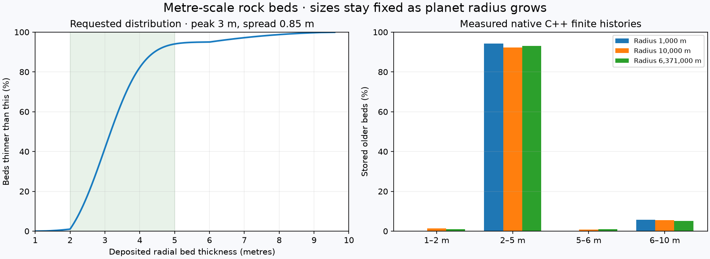
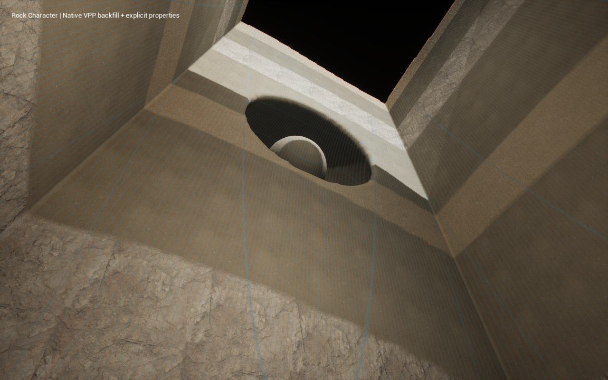

# Physical rock beds

Rock algorithm 5 uses physical deposited-bed thicknesses, independently of planet
radius and the Rock Character position. The default distribution has a 3 m peak,
0.85 m core spread, 1% of beds between 1 and 2 m and 5% between 6 and 10 m.
The main population is 2–5 m. Endpoints are bounds, not frequently selected sizes.
This is a configurable mining-play profile, not an asserted universal geological
law. An exposed fragment can be thinner after erosion, onlap or excavation.

## Native audit and justified specialization

The installed VPP 2.0p8 native `FVoxelNode_HeightSplitter` splits a scalar height
into authored layers and falloffs. Native surface types, metadata, stamps, noise,
generation, LOD, collision invokers, sculpt tools and compressed sculpt saves
already supply execution and presentation. A source audit found no finite,
seeded geological history with physical bed-thickness statistics. Landform owns
that domain relationship; VPP remains the sole voxel platform. There is no new
streamer, noise implementation, mesh generator, preview path or sculpt serializer.

The new distribution uses native UE `FRichCurve` and its clamped cubic tangents,
through the existing surface-distribution helper. Native `FRandomStream` selects
one thickness per actual bed. The former radius-scaled packet was split into a
primary/weak pair; algorithm 5 does neither. Native geological palette/surface and
full-float property bindings remain shared through mining, caves and fill.

The research and mechanical limits in [RockFolding](RockFolding.md) and
[regional deposition](RockDeposition.md) still apply. This feature changes physical
bed statistics, not a sediment-transport, compaction or continuum-mechanics model.

## Distribution and Character

Rock's native header contains its eye toggle, Character slider and reseed icon.
Opening its category chevron reveals the detailed native fields directly below,
with no separate Advanced button. Optional measured/requested bed plots remain
in Preview Advanced.
Min/max, the thin-tail upper edge, peak, spread, thick-tail lower edge and the two
rare-tail percentages are independently editable. Percentages are **by bed count**.
The core is a numerically integrated truncated Gaussian between the two tail
edges. Thin/thick tails use finite square-root quantiles favouring their inner
edges. A small density floor keeps native float curve times strictly ordered for
narrow peaks. A 256-interval core and 32 intervals per tail define the versioned
curve; it is not an exact analytic Gaussian. The native curve is monotone.

Character still changes dip, inherited plate displacement, folding, fault throw,
onlap and lithology. It curates peak and spread across the default 2–5 m range;
rare-tail percentages, edges, limits, seed, palette and rheology remain authored.
Zero means quiet layered rock. Older profiles still provide their saved massive
or periodic settings. In algorithm 5, Interbed Fraction is the weak-unit selection
probability before adjacency conditioning; it no longer splits bed thickness.
Adjacent units are conditioned to differ so provisional artwork can expose a
contact. It is not an exact weak-rock population guarantee.

Blue/orange diagnostic curves compare requested and measured bed-count
histograms. Green weights the stored beds by radial depth: thick rare beds occupy
more metres than their count suggests. Statistics describe the older deposited
sequence before erosion/onlap and omit its last possibly partial bed. They are
not an outcrop-area or player-route histogram. The same data is available through
`ThicknessStatistics()`. The native VPP globe/cutaway remains the terrain preview.

## Finite contacts, deformation and basin fill

Each algorithm-5 contact is a double-precision radius and one palette byte.
Indexed `GetBedCount()` / `GetBed()` inspect the immutable history without
expanding it. `GetBeds()` is retained for legacy algorithms 2–4 only. The total
budget is 4,194,304 beds; exceeding it fails explicitly without thickening beds,
repeating a sequence or silently dropping contacts. This bounds data, not streamed
terrain. The Earth-radius qualification measures the actual allocation.

The older sequence runs from basement to the fixed depositional datum. Folding
still derives its wavelength from actual competent beds and shares one ordered
restoration across all contacts. Thickness is measured radially in the undeformed
reference sequence; dip/folding changes the local normal thickness and outcrop
width. No overturning, lateral fault restoration or volume conservation is added.

A separate finite younger sequence runs radially from zero to the datum and is
clipped by the existing subsided basin floor. It retains physical thickness as
accommodation changes; it is no longer stretched from one short reference packet.
The floor can truncate a bed. These level-filled deposits assume sufficient
sediment and do not reconstruct transported sediment mass or basin chronology.

## Compatibility and qualification

Saved algorithms 1–4, constructor defaults, random draw order and sculpt formats
remain unchanged. Loading does not adopt algorithm 5. A new Character gesture or
explicit enable of an older profile adopts it. Reauthoring an already mined world
is not qualified migration. Rock edits retain schema-21 elevation settings.

New review recipes and assets live in `LandformDesigner/RockBeds`, alongside
unchanged earlier reviews. The cooked proof uses native 25 cm voxels to expose
metre-scale beds, mine a wall, paint fill and compare 51 fields/properties/identities
in a separate reader process. At distant globe scale, 1–3 m beds can be smaller
than pixels or native LOD material samples; inspect the quarry at human scale.
This profile does not promise per-pixel geological contacts in every overview.

The [qualification record](../conformance/RockBeds/qualification-mac-arm64.json)
records the measured distribution, compact history, native editor frames, cooked
excavation and published-build save compatibility. No multiplayer or production
performance/persistence claim is made.
