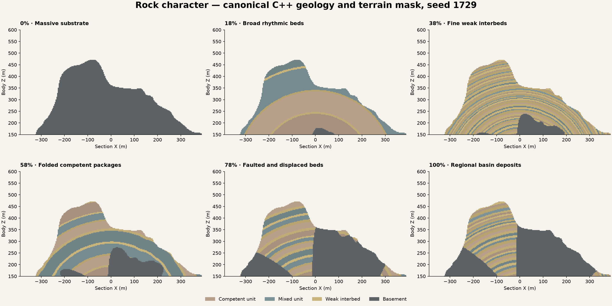

# Rock Character and excavation

Rock Character is a schema-20/21 geological material/property layer over the
existing spherical terrain. New Character gestures adopt algorithm 5's
[physical bed distribution](RockBedThickness.md), retaining algorithm 4's
thickness/viscosity-derived early folding and the shared regional deposition model.
It adds no terrain height. In Planet Designer choose **Geology → Rock → Character**.
Advanced exposes resolved structure, physical thickness statistics and the
three-unit palette directly. The current review is `RockBeds/DA_RockBeds`.
`RockFolds`, `RockDeposits`, `RockHistory` and `RockCharacter` retain v4, v3, v2
and v1 recipes. A complete knob gesture has one Undo. Saved planets retain their
original geology until explicitly reauthored; edited-world migration is not qualified.

## Native audit and ownership

The installed VPP 2.0p8 source was inspected before implementation:

| Native feature | Use |
| --- | --- |
| `AVoxelWorld`, native stamps, layer stack, Nanite, LOD and moving collision invokers | Sole terrain generation, presentation and contact platform; same native owners through edits |
| `FVoxelVolumeModifier::GetUsage`, sphere/cube modifiers | Native mining changes distances without painting the remaining geological volume |
| `FVoxelVolumeSculptCache::ComputeChunk` | Native base-distance cache, not a geological store; unpainted materials/properties still come from the underlying stamp |
| `FVoxelPaintVolumeModifier`, metadata overrides and native surface types | Explicit backfill material, resistance, erodibility and placed-material contribution |
| `UVoxelQueryBlueprintLibrary::MultiQueryVoxelLayer` and native futures | Query current edited solid, material and properties, including native readiness |
| `AVoxelVolumeSculptActor::GetSave/LoadFromSave`, `FVoxelVolumeSculptSave` | Native compressed distance/material/metadata serialization; UE SaveGame is only the qualification envelope |
| `FVoxelNode_HeightSplitter` | Audited native graph strength splitter; it supplies no geological history, finite bed identity or canonical planetary recipe. This profile classifies beds once for semantic IDs/properties and emits weights into native VPP blending; it adds no generic graph splitter |
| Native Perlin via the existing `FCLNativeNoiseKernel` | Retained v1 compatibility kernel; v2 uses the existing plate warp and adds no independent noise field |
| Existing recipe volume operations | Authored cave subtraction lowered to native sphere/cube and native blends/index |

VPP already supplies sculpting, material blending, metadata and save/load. It does
not supply Catalyst's recipe-specific stratum identities or the relationship
between planetary guides, tectonic displacement and those units. The previous
Landform `FCLGeologicalUnit` only selected radial material intervals: it had no
bed identity, rock properties, folding/dip or shared excavation query. That is the
demonstrated semantic gap addressed here. No streamer, mesher, collision manager,
sculpt cache, custom edit format or replacement material renderer was added.

`FCLCompiledRock` compiles finite deposited sequences with stable bed identities.
[Material-aware folding](RockFolding.md) documents the current v4 prescription.
[Regional deposition](RockDeposition.md) documents the retained v3 field, its research,
exact native ownership, filled-accommodation assumption and remaining physical gaps.
Older beds onlap regional basement conditioned by the accepted crust and extensional
plate context. They are deformed by the same finite plate network. Younger episodes
fill subsided areas and taper to zero at basin margins; uplifted areas are truncated.
Rock supplies no terrain-height contribution and uses no edited surface height.

The retained [v2 finite-history proof](RockStratigraphy.md) uses a radial basement
and fixed younger cover after truncation. V1 retains its global dip/noise/plane
and repeating material cycle only for saved-data compatibility. Loading either
older version never changes the accepted geology. The early save/load passes
proved consistency, not geological realism. Character gestures or explicit layer
activation adopt v4; migrating an already mined planet's recipe is unqualified.

## Character progression

The knob uses independent smooth tracks, stored as resolved recipe values. It
traverses a palette of structures rather than increasing every effect together:

| Anchor | Structure |
| --- | --- |
| 0% | Quiet layered substrate; peak 3.8 m, spread 0.7 m |
| 18% | Rhythmic beds, sparse weak units and gentle deformation; peak 3.4 m, spread 0.8 m |
| 38% | Fine, weak-unit-rich beds; modest deformation; peak 2.8 m, spread 0.55 m |
| 58% | Strongest shortening and dip in existing compression; peak 3.2 m, spread 0.85 m |
| 78% | Narrow fault transitions, larger bounded throws and regional deposition; peak 3.8 m, spread 0.9 m |
| 100% | Basin-rich, greater regional differentiation; deformation recedes; peak 3 m, spread 0.75 m |

These physical peak/spread anchors use the default 2–6 m core edges. Authored
rare-tail percentages, edges and limits remain independent. Algorithms 1–4 keep
their saved radius-relative behavior, including the original massive zero.
These are smooth anchor ranges, not switches, a geological history clock or new
geological processes. They retain the current finite deposition and early-fold
approximations. Compression and accommodation still depend on the accepted
tectonics and crust; a quiet plate setting cannot acquire a compression belt from
Rock alone. The sharp-throw range uses the existing bounded displacement proxy,
not a lateral-slip fault solver.

Character preserves seed, palette IDs/properties, selected competent unit,
viscosity contrast, crust depth and contact feather. Saved resolved settings are
unchanged on load. The new curation is applied by a Character gesture or explicit
activation of a legacy layer; published struct defaults are frozen independently
of the current authoring curves because UE assets can omit default values.

Each layer's Advanced dropdown reveals native UE property rows directly below it.
There is no embedded second Details view or extra layer container. Native nested
values such as the Units array retain their own appropriate expanders. External
structure drafts retain validation, native editing and single-step asset Undo.
The [authoring qualification](../conformance/RockCharacter/authoring-mac-arm64.json)
records actual dropdown clicks, rendered layouts and fixed-spacing variation.

The retained image below records the earlier radius-relative authoring palette;
the [physical-bed qualification](../conformance/RockBeds/qualification-mac-arm64.json)
records current metre-scale authoring.

This is a diagnostic C++ section with the recipe's radial terrain mask. The
native VPP globe/cutaway captures are recorded separately; the plot is not a
replacement preview or generator.

Algorithm 5 zero retains quiet physical beds and mining properties; older profiles
retain their original homogeneous zero.
Disabling the layer restores the prior surface-stack path. The enabled profile
owns exposed-rock material classification; weathering and topsoil cover are
separate future layers. The knob never changes
terrain heights, including exact SurfaceMin/Max fitting. Advanced values can be
edited directly; the next gesture reapplies the profile's structural tracks while
preserving palette IDs/properties and Variation seed.
Orientation is a v1-only control; newer structure follows the plate network.
DepositionalVariation is available from v3 onward. YoungerCoverRadiusFraction controls the finite
younger reference sequence in v3, whose actual thickness follows accommodation. V4 derives wavelength from actual
competent-bed thickness and explicit viscosity contrast. Its shortening proxy is
separate from mining hardness; the old wavelength control is hidden in v4. Numerical sweeps and native
rendered frames qualify a bounded set of seeds and positions, not every possible
Advanced composition.

Unit GUIDs identify the three prototypes. Stratum GUIDs additionally identify an
individual bed in the sequence and are deterministic for the accepted immutable
recipe, independent of caves and edits. Changing the geological recipe changes
the world definition; migrating existing excavations to a different recipe is
not qualified. Structural boundaries are distinct beds even when adjacent artwork
looks similar. Generic Rock/Scree/Soil client surfaces are provisional artwork
bindings; a weak interbed is not scientifically classified as topsoil.

## Native properties and querying

`MD_RockProperties` is a native VPP LinearColor metadata asset with full-float
channels. R is normalized mining resistance, G normalized erodibility, B is the
valid rock-property contribution, and A is placed-fill contribution. Native smooth
contacts blend these values. GUIDs are never encoded into interpolated floats.
They are reconstructed from the same accepted canonical body-space recipe.

`UCLRockQueryLibrary::QueryRock` / Blueprint `QueryExposedRock` queries the live VPP
layer first. It refuses unavailable worlds and native state transitions, stale snapshot/runtime/actor
poses, absent metadata and air more than 2 cm outside a contact. Unmapped native surfaces fail closed. The returned
surface is VPP's current dominant client surface; natural unit/stratum IDs come
from the immutable geological model. Painted fill has an explicit placed-material
category once its native contribution is at least half. Contact blends retain
fractional resistance, erodibility and placed contribution.

`FCLScene::SampleGeology` answers what geology occupies a position in the immutable
recipe, including positions that excavation has made air. Gameplay must use the
live query when checking what can actually be mined. Do not use a height/slope
surface rule to choose underground rock. Backfill must explicitly paint its
material and properties with VPP's native tools; distance-only addition inherits
the underlying geology by native design. The proof demonstrates both operations.

Schema 20 currently accepts whole spherical recipes with an active native surface
library. It rejects simultaneous legacy radial geological units and measured
profiles instead of guessing a migration. Caves use existing recipe volume
subtraction. This profile does not introduce a custom cave generator or soil
weathering/erosion process. Those are separate authoring layers.

## Proof and review

See the [host qualification and launch guide](../../Projects/LandformLab/Docs/RockCharacter.md)
and its machine-readable record. The bounded excavation host loads a portable
recipe, exposes native cave-wall contacts, mines with native sphere sculpting,
places native painted fill and saves VPP's compressed sculpt data. A separate
process reconstructs the recipe, loads the native save and compares fields,
materials, properties, unit/bed identities and actual native contact. Its save
fixture is a qualification envelope, not a production persistence service.

The proof holds one accepted geological recipe while editing; it does not qualify
editing that recipe after mining, arbitrary nonuniform actor scaling, mixed
geological profiles or a planet-wide performance budget. VPP's own versioned save
format remains its compatibility boundary.

## Qualification boundaries found during this work

The independent asset bootstrap reproduced a VPP 2.0p8 editor-lifecycle ensure in
`FVoxelTextureUtilities::RemoveBulkData`: a deferred render→game callback found
its weak texture already collected while the startup VPP world was replaced.
That is an editor world-replacement/readiness boundary, not a missing geological,
sculpt or streaming feature. Asset creation now requires an empty editor map and
refuses to replace a live VPP world. The installed VPP source is unchanged.
The cooked excavation and cold reload require clean logs without this ensure.

On this Mac, `RequestExitWithStatus` reports that the generic implementation
ignores the requested status. The qualifier therefore requires the native JSON
outcome and no created world for the missing-save control, rather than trusting
a nonzero process status. Positive cases still require process exit zero.

Seven legacy rendered tests assume an exact 800×600 target. Offscreen mode added
10 pixels to their native target height; normal-display reruns pass. This is a
qualification-launch constraint; their assertions and production rendering were
not weakened or rewritten.
