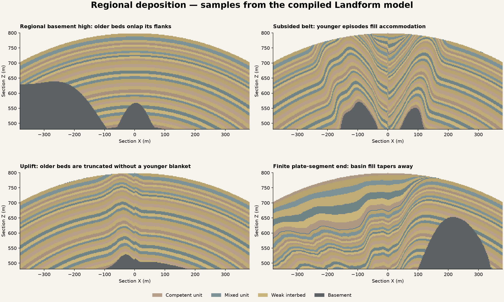

# Regional deposition and filled basins

This retains the algorithm-3 milestone. Current authoring adds
[material-aware early folding](RockFolding.md); loading v3 keeps this model.

Algorithm 3 advances the finite rock-history proof with regional onlap and basin
fill. VPP remains the sole voxel generation, presentation, material, collision,
sculpting and sculpt-save platform. Landform specializes the canonical geological
field and the relationship between its existing crust/plate model and bed identity.

## Audit and research

The installed VPP 2.0p8 native graph HeightSplitter supplies height/falloff strengths;
its stamps, layers, native surfaces, sparse queries, LinearColor metadata, sculpt
cache, invokers and compressed sculpt serializer already supply voxel execution.
They do not supply Catalyst's geological history, accepted crust/plate relationship
or stratum identities. The new profile emits the same native weights/properties as
its predecessors. It adds no noise generator, province network, renderer, mesher,
streamer, collision owner or edit serializer.

Natali, Klausen and Patel's [2014 geological-deposition work](https://vis.test.uib.no/publications/Natali14Sketch/)
represents sequential erosion/deposition events. Its author abstract supports the
ordered-event reference; a full implementation of that method was not adopted.
[Quantitative stratigraphic analysis in a source-to-sink numerical framework](https://gmd.copernicus.org/articles/12/2571/2019/)
(2019, DOI 10.5194/gmd-12-2571-2019) distinguishes accommodation from sediment
supply and links upstream erosion to basin deposition. [Sedapp v2021](https://gmd.copernicus.org/articles/14/4925/2021/)
(DOI 10.5194/gmd-14-4925-2021) models transport/deposition in shallow marine settings.
These are references for the next physical coupling, not packages or solvers
integrated here. No third-party geological modelling dependency was added.

This proof assumes enough sediment to fill available accommodation. It does not
estimate sediment supply, conserve transported sediment mass or simulate the
source-to-sink processes in those papers.

## One canonical history

The sequence is inherited basement relief → finite older deposition → existing
plate deformation → truncation and younger basin deposition → exposure by the
accepted terrain solid. Terrain heights do not change when Rock is enabled or
Character moves. Native caves/mining expose the fixed 3D history. No edited surface
height is used to reclassify the remaining solid.

The recipe compiler passes its accepted `FCLCompiledContinents` to Rock. Without
that layer, Rock consumes the existing tectonic continentalness or the declared
neutral crust .75. No new continental map is generated. The existing finite,
warped plate belts additionally supply a bounded extensional weight from their
relative motion and existing rift-strength/relief channels.

For a crust value C and bounded extension E, the artistic inherited-deposition
prior is `clamp(4*C*(1-C) + .08*(1-C) + E, 0, 1)`. It favours margin/extensional
settings and reduces cover potential at the end members. This is a declared
heuristic, not reconstructed palaeogeography, a craton classifier or an ocean
sediment-thickness calibration. DepositionalVariation blends from uniform older
cover to this regional prior. The resulting basement contact clips lower older
beds; their horizons and identities continue across domains. Beds onlap that
contact instead of a new sequence restarting in every province.

The older deposited top is SurfaceMax before deformation. If its displacement
is positive, the sequence is truncated at that level. A negative displacement
creates local accommodation between the lowered top and SurfaceMax. The same
finite younger episodes occupy that interval, with contact fractions interpolated
between the basin floor and the fixed top. Their thickness goes to zero at the
basin margin and beyond the finite plate-segment ends. Dry/uplifted columns acquire
no blanket younger package. The native terrain can subsequently expose or remove
these deposits; their presence at every modern surface location is not promised.

YoungerCoverRadiusFraction is the younger template's reference thickness in v3;
its minimum reference is two bed packets. It controls the finite episode count,
not a physical sediment budget. Actual fill thickness equals local accommodation.
V2 retains that field's original fixed-cover-thickness meaning. Both sequences
share the existing 1024-bed limit; unsupported fine Advanced data fails closed.

`FCLCompiledRock::SampleColumn` exposes the immutable crust/extension context,
restored basement, displacement, younger floor and thickness for inspection. It
is not a live terrain or persistence service. The existing `SampleGeology` and
native `QueryExposedRock` remain the canonical and current-solid queries.

## Versioning and review

New Character gestures and explicit layer activation adopt v3. Loading a saved
v1 or v2 planet preserves its accepted model. Variation changes only the existing
rock seed; it does not silently change a saved algorithm. Recipe migration after
excavation is not qualified. The original v2 four-section oracle remains explicit
v2 and is retained as a regression.

Open `RockDeposits/DA_RockDeposits` for the new Designer review. The separate
`DA_RockDepositsExcavation` fixture uses actual compiled tectonics (seed 26) and
exposes both older strata and younger basin fill in its native quarry wall.
A bounded development search selected the fixture; the published test loads its
resolved portable recipe directly and checks its age coverage and initially solid
walls. No runtime search selects geology.

See the [host review and reproduction guide](../../Projects/LandformLab/Docs/RockDeposits.md)
and [qualification record](../conformance/RockDeposits/qualification-mac-arm64.json).
The diagnostic sections below sample the compiled C++ field. Their idealized
800 m clipping surface is an illustration, not a second terrain/preview path.
The blue line marks the older/younger boundary where visible.

## Remaining gaps

The inherited depositional prior needs calibration against geological settings.
There is no temporal plate reconstruction, sediment routing/supply, compaction,
climate/sea-level evolution, erosion/deposition feedback on terrain or measured
planet-wide sediment budget. Mechanical folding and true lateral fault restoration
remain unqualified; the prior kinematic fold/dip/throw approximations are retained.
Three provisional property/artwork prototypes are not a full geological composition,
resource, intrusion or metamorphism system. Multiplayer and production persistence
are outside this proof.

The next bounded gap is mechanically justified folding: audit layer-thickness and
strength-dependent wavelength/response while retaining a coherent shared structural
coordinate and explicit limits on overturning/fault displacement. Source-to-sink
coupling must later own actual sediment mass and terrain changes, rather than
silently introducing another height contribution inside Rock Character.
