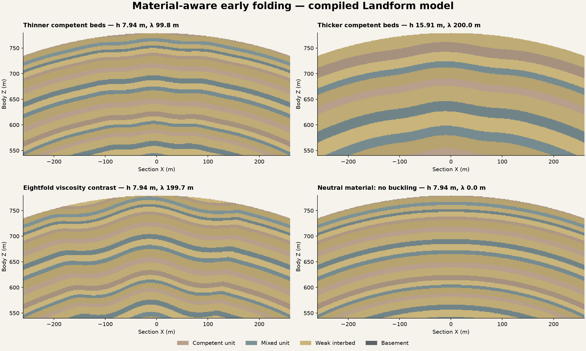

# Material-aware early folding

Algorithm 4 replaces the free fold wavelength in new authoring with a bounded,
mechanically informed prescription. It reuses the existing crust, finite plate
network and one canonical geological field. VPP owns voxel generation, native
preview/materials, LOD, moving collision, sculpting and compressed sculpt saves.
No UE actors are moved to represent folding.

## Research and native audit

Schmalholz and Mancktelow, [*Folding and necking across the scales*](https://se.copernicus.org/articles/7/1417/2016/)
(2016, DOI 10.5194/se-7-1417-2016), equations 13/14, review Biot's thin-layer,
linear-viscous dominant wavelength and maximum dimensionless amplification rate.
The approximation is unreliable at low contrast; this profile accepts a neutral
ratio of 1 or a bounded contrast of 10–1000. Neutral material has no added buckling.

Cordonnier et al., [*Sculpting Mountains*](https://doi.org/10.1109/TVCG.2017.2689022)
(TVCG 2018), links fold scales to stratigraphic thickness/competence and uses a
compression-directed procedural construction. Its layer-pair law, skeletons,
transport tensors, volume preservation and erosion coupling are not implemented
here. It explicitly limits sinusoidal folding to early stages. The chosen v4
single-effective-layer law and its assumptions are distinct from that full method.

The installed VPP 2.0p8 Source was searched for folding, buckling, viscosity and
stratigraphic implementations. No such geological model was found. Generic graph
math/height splitting, native surfaces, metadata, generation, sculpt cache and
save/load already cover voxel execution. Landform adds only this geological
relationship and native binding; there is no new graph/math/noise framework,
streamer, mesh generator, collision manager, preview path or sculpt serializer.
Native UE math and the existing compiled plate sampler are reused.

## Explicit mechanical inputs

FoldViscosityContrast is the effective long-term Newtonian viscosity ratio of a
competent bed to its weak matrix. MiningResistance and Erodibility remain gameplay
and landscape properties; neither is silently converted to viscosity, yield stress
or an elastic modulus. FoldCompetentUnit explicitly selects a palette unit.

The compiled finite older beds of that unit provide mean actual bed thickness H
and mean bed-centre radius. That radius is the declared physical wavelength
reference. A single shared angular mode keeps all contacts coherent; physical arc
spacing changes with depth on the sphere. There is no independent displacement
per bed or reset of phase at a province boundary. An absent selected finite bed
has zero effective thickness and no added mechanical folding.

With viscosity ratio R, the selected linear prescription is:

- dominant wavelength: `lambda = 2*pi*H*(R/6)^(1/3)`;
- dimensionless maximum amplification rate: `alpha = (4*R/3)^(2/3)`;
- local shortening proxy: `epsilon = FoldShorteningStrain * (1-exp(-drive))`,
  using the accepted finite compression belts and their relative plate motion;
- added amplitude relative to an initial imperfection of `.03*H`:
  `.03*H * (exp(alpha*epsilon)-1)`.

The maximum shortening input is .15. Amplitude is capped by the existing artistic
FoldAmplitude control and `.05*lambda`, with the exponent bounded before evaluation.
This is an early-mode amplitude/wavelength ceiling, not a bound on the slope of
the combined tectonic/dip/fault field. The existing belt waveform is normalized
by its compression weight; zero compression/extension produces no new buckling.

FoldWavelengthRadiusFraction remains a v1–v3 compatibility control and is hidden
in v4. Character supplies a shortening progression and retains the author's
viscosity ratio and palette properties. Explicit adoption initializes the competent
selector from the profile's first competent prototype. Advanced can choose another
accepted unit. Unsupported ratios or unmapped identities fail closed.

One radial restoration is used at every depth. Its radial derivative is exactly
one, so these graph-like folds cannot invert contact order or overturn. Regional
onlap and younger basin fill remain in their existing event order. Rock does not
change terrain heights; caves, mining and save/load query the same immutable
accepted geological recipe through native VPP.

## Qualification and review

The independent scientific oracle uses a 10 m bed and ratio 48: wavelength
125.66370614359172 m, amplification rate 16 and added amplitude
1.1859097273185345 m at shortening .1 and full compression. Doubling thickness or
multiplying contrast by eight doubles wavelength. The resolved-field period is
also checked spatially at the competent beds' reference radius.

Further checks cover 660 bounded amplitude samples, neutral/extension controls,
513 contact-order points, bed identity, independence from mining hardness, portable
data, native VPP properties, Designer Undo and globe/cutaway frames. Retained v2
and v3 event fixtures remain explicit saved algorithms.

Open `RockFolds/DA_RockFolds` for current authoring. The independent native quarry
uses `DA_RockFoldsExcavation`; its resolved compression setting changes canonical
wall properties against an otherwise identical neutral-rheology recipe. The
published test loads this resolved fixture directly; no runtime search chooses it.
All wall probes begin solid, and the mechanical control leaves shape unchanged.
Native writer/reader runs verify actual VPP properties, mining, painted fill and
cold compressed sculpt reload. Published v1/v2/v3 saves are checked independently.

See the [host guide](../../Projects/LandformLab/Docs/RockFolds.md) and
[qualification record](../conformance/RockFolds/qualification-mac-arm64.json).
These diagnostic sections sample the compiled C++ field; they do not replace the
native VPP preview.

## Limits and next gap

This is a homogenized effective single-layer prescription, not a continuum
mechanical solution. The compression-to-strain relationship is a bounded artistic
proxy, not integrated shortening history. The growth increment does not model
the initial imperfect geometry, strain-driven thickening or conserved material
volume. Multilayer interference, per-unit/local rheology, finite weak-matrix
thickness, gravity, pressure/temperature, elasticity, anisotropy, plastic failure,
large-amplitude evolution, overturning and secondary faulting remain gaps.
The original kinematic dip/throw and inherited deposition assumptions are retained.
No calibrated planetary geology or performance budget is claimed.

The next bounded structural gap is true fault restoration, including explicit
lateral slip and contact offsets. It must preserve a coherent volumetric history
and accepted VPP edit coordinates; moving UE actors or adding a terrain manager
would not solve that domain problem. Sediment transport, erosion coupling,
measured material calibration and full composition/resources remain separate work.
