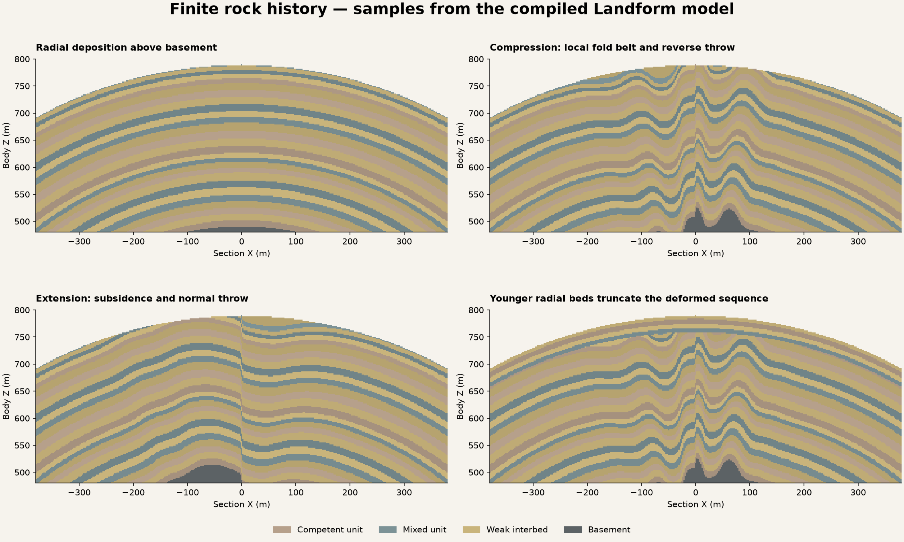

# Finite rock history — research and acceptance

The user's rejection of the first Rock Character globe is the acceptance trigger:
rock strata should begin locally horizontal/radial and respond to the same plate
structure as the terrain. A global tilted periodic palette is not an acceptable
substitute. Technical persistence checks cannot qualify geological appearance.

## Research reviewed

- Cordonnier et al., *Sculpting Mountains: Interactive Terrain Modeling Based on
  Subsurface Geology* (TVCG 2018, DOI [10.1109/TVCG.2017.2689022](https://doi.org/10.1109/TVCG.2017.2689022)).
  Layered crust, compression-directed early folding, uplift and erosion provide
  the process/visual reference. Its mechanical wavelength treatment and coupled
  erosion are not implemented by this bounded kinematic step.
- Grose et al., [*LoopStructural 1.0: time-aware geological modelling*](https://gmd.copernicus.org/articles/14/3915/2021/)
  (2021, DOI 10.5194/gmd-14-3915-2021). Separate implicit structural coordinates,
  fault/fold frames, unconformities and chronological constraints support the
  choice to classify a fixed 3D sequence with ordered restoration. We do not
  reproduce its interpolation/reconstruction framework.
- Wellmann et al., [*pynoddy 1.0*](https://gmd.copernicus.org/articles/9/1019/2016/)
  (2016, DOI 10.5194/gmd-9-1019-2016). Parameterized event sequences are a useful
  generative reference. No Noddy code or runtime dependency is introduced.
- de la Varga et al., [*GemPy 1.0*](https://gmd.copernicus.org/articles/12/1/2019/)
  (2019, DOI 10.5194/gmd-12-1-2019). Implicit volumes and geological relationships
  are relevant to contact validation; this is not an automatic planetary geology
  generator. No GemPy dependency is introduced.

The earlier Landform WatershedKarst research already used a shared body-space
stratigraphic coordinate, finite units and basement. Its experimental scaffold
and deferred native conformance were not production evidence. The current
PlanetDesignSystem contract already requires ordered geological processes.

## Native feature audit

VPP 2.0p8's `FVoxelNode_HeightSplitter` accepts a scalar Height and height/falloff
pins and produces strengths. Native surface types, sparse volume queries,
LinearColor metadata, stamps, sculpting, cache, collision invokers and compressed
save/load already cover presentation and excavation. The installed source has
no Catalyst plate-network/history/stratum identity model. That specific domain
relationship is Landform's specialization; material blending and all voxel
execution remain in VPP. The retained v1 path is a versioned saved-data contract,
not an alternative generation platform.

The new tectonic query reuses the existing network, warp and support; no second
plate network is generated. Kinematic dip, folds and normal/reverse displacement
are bounded within those finite belts. A pure transform is not assigned an
invented vertical fault throw. This does not model lateral strike-slip offset.
The current terrain's existing scalar displacement is an approximate inherited
uplift/subsidence channel; full process reconstruction remains a gap.

## Acceptance

`Catalyst.Landform.Rock.FiniteHistoryAndPlateSections` checks:

1. Finite positive-thickness intervals without gaps/overlap, distinct bed IDs,
   exact radial agreement across meridians/poles and no repeated sediment in core.
2. Compression folds at the controlled boundary, absence of compression folds
   in extension, reversed normal/reverse throw and undeformed plate interior.
3. Unchanged younger bed identity across a deformed older sequence: deformation
   precedes truncation and younger deposition.
4. Four canonical cross sections sampled from the real compiled C++ model:
   undeformed radial deposition, compression, subsiding basin and unconformity.

The test exports CSV under `Saved/Verification/rock-history`. The host plotting
script turns these samples into a diagnostic image; it does not generate voxel
geometry or replace the native Designer preview. The existing 24 native VPP
globe/cutaway frames, material/property sampling, Designer Undo and cave-coherence
checks exercise the new Character progression. The separate finite-history
cooked fixture qualifies native mining/painted fill and cold VPP sculpt reload.

This is a bounded improvement in geological construction, not a completed
planetary history simulator or proof of realism for every knob/seed. Review the
cross sections and native globe before accepting visual quality. Next gaps are
regional depositional domains and basin fill, mechanically justified folding,
true fault restoration, intrusive relationships and erosion/deposition coupling.
