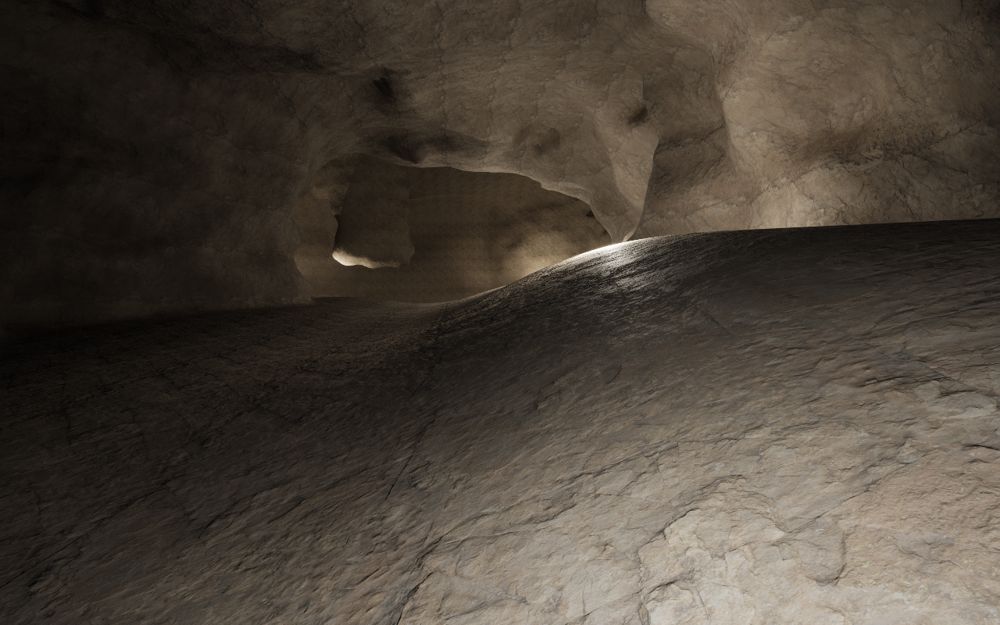
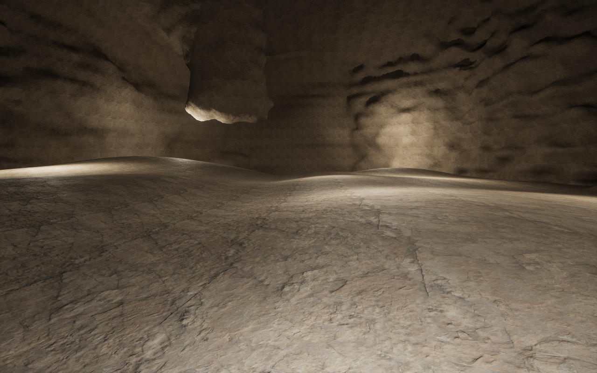
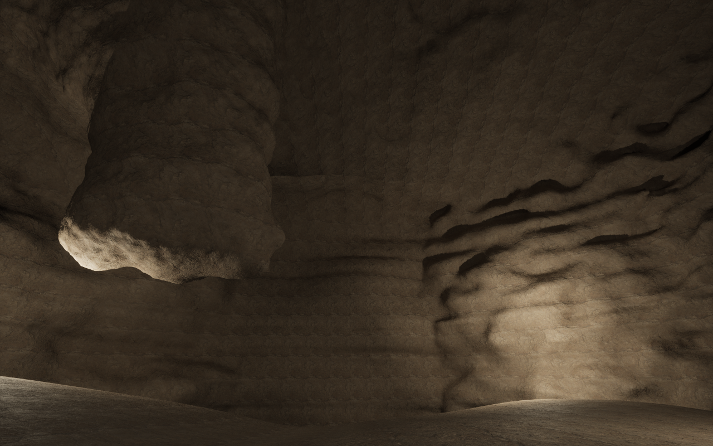

# Spatial cave prototype

Current follow-up: [moving-demand delivery](CaveStreamingDeliveryFix.md) removes the rejected whole-cave residency workaround and qualifies the compiled directional inputs. The [residency experiment](ChamberCollisionResidency.md) is historical.

7 November 2026. Opt-in profile 8 replaces swept passage sections with one
spatial passage/chamber composition. It follows the
[cave work diagnosis](CollisionStreaming.md#follow-up-the-actual-work-explosion).
The existing UI, profile-7 defaults, canonical geology, ordered authored edits,
and native VPP terrain, LOD, collision, sculpting and persistence remain in place.

The subsequent [free-walking fix](CaveWalkingFix.md) replaces the distant
admission probe, adds native foot readiness and qualifies a 32 m collision lead
on a broader route. The original measurements below retain their captured scope.

## Shape and reference comparison

[Mammoth's Broadway passage](https://www.nps.gov/maca/learn/nature/images/Broadway-001-by-Jackie-Wheet.jpeg)
and the [Mammoth passage descriptions](https://www.nps.gov/maca/learn/nature/how-mammoth-cave-formed.htm)
set the broad, asymmetric, bedding-controlled passage target. The prototype's
sampled main openings are about 23–41 m wide and 9–13 m high, with an enlarged
side recess. Its roof and wall profile change through space rather than following
one scaled oval along a centreline.

[Carlsbad's chamber geology](https://www.nps.gov/cave/learn/nature/geologicformations.htm)
and [Big Room photographs](https://www.nps.gov/cave/learn/photosmultimedia/photogallery.htm)
set the larger chamber and irregular roof target. The prototype opens to about
80 m across at the measured section and 33 m high, with separate roof pockets,
undercuts and a retained roof pendant. These are physical dimensions at a roughly
1.62 m eye height. This is an anatomy and scale study, not a surveyed replica of
Carlsbad's complete Big Room.

One rolling floor runs through passage, threshold and chamber. The measured
route has 3.018 m of relief and a maximum tested local grade of 9.19%, without a
floor clipping plane at the chamber mouth. Low banks and a shallow channel vary
across the floor. The pristine native captures below precede mining or backfill.

The user accepted this composition's cave appearance on 11 November, while
requesting the missing strata appearance. The original captures use one uniform
Rock surface and the existing review lighting. The [strata follow-up](CaveStrata.md) restores the earlier three-surface
rock-bed palette on this same composition. Sediment transport,
fracture evolution, sulfuric-acid chemistry, collapse simulation and speleothem
growth are not implemented. The visible forms are an authored procedural prior,
with a real carbonate site and bedding datum from the canonical geological plan.

## Representation and VPP delivery

`FCLSpatialCave` compiles three irregular joint-like footprints, a spatial roof
field, contact-local wall recesses and an independent retained rock mass. UE's
polygon distance/containment operators evaluate the footprints. VPP's native
Perlin kernel supplies correlated spatial variation at fixed wavelengths;
wall detail fades out near the floor. The floor and wall contact heights use
the same restored coordinate as the existing Rock plan. Workers retain immutable
plain data and the existing native noise binding.

There are **no spline curves or nearest-spline queries** in profile 8. Its single
passage record and chamber node retain inspection and walking metadata only;
they do not generate the field. The finite composition uses 31 polygon edges,
rather than thousands of independently unioned spline intervals. Queries outside
its support take a cheap closed-rock path.

Positive field is air. The new profile defines its complete field as
`max(body field, cavity field)`, followed by existing ordered volume edits.
It evaluates the cavity first. The calibrated minimum terrain height supplies
an upper bound on the body field through the existing native radial figure.
Only points where that bound can exceed the cavity require actual terrain
height evaluation. Unbounded terrain plans retain full evaluation. This new
profile does not change the historical profile-7 floating-point blend semantics.

The canonical scene and the opt-in C++ stamp call the same evaluator. VPP still
receives native bulk/sparse distance, surface and metadata buffers and owns all
chunk requests, meshing, Nanite, physics publication and sculpt saves. There is
one terrain owner and the existing native sculpt actor; no proxy collision,
cave mesh actor, custom streamer or second geological provider is installed.

## Qualification

The native geometry test checks 251 densely spaced floor positions and a
capsule-width clearance band across the threshold, worker equality, 6,673 deep
field probes, 640 whole-body/exterior probes, canonical geological coordinates,
ordered backfill/excavation and default/C++ native distance parity. Deep pruning
and delivery comparisons have zero measured error. Deep probes request no
terrain heights. Fifteen existing cave, UI/undo, scene and volume tests also pass.

The 2.5 m/s review walked 78.80 m with 2,145 / 2,145 route frames grounded and
zero collision admission waits. The minimum sampled foot field is +0.0135 m,
within the cave air rather than penetrating the foundation. Native mining changes
its target from -90.31 cm solid to +190.05 cm air; backfill restores -74.79 cm
solid. The compressed native save is 147,435 bytes. A fresh process reproduces
all 14 retained field, surface, material and geological probes with zero field
error, then retains native grounded walking. Runtime and invoker identities
remain stable.

At the normal 6 m/s movement limit, the fixed-100%-resolution run walks 78.75 m
with 897 / 897 route frames grounded, zero collision waits and minimum sampled
foot field +0.0131 m. Readiness is 18.30 s. Active moving frames have 17.65 ms p95,
25.18 ms p99 and 32.54 ms maximum; GPU p95 is 16.67 ms. The 33.94 s reference
sequence includes deliberate still captures and settlement waits; its process
CPU consumption is 125.79 s. That is about 3.71 CPU-core equivalents over this
sequence, not a measurement of ecosystem CPU capacity.

The synchronous coarse replay uses VPP's actual 25 m invoker chunk keys and
installed coarse selection rules. It measures 1.421 s for 604,274 passage probes
and 1.500 s for 610,929 chamber probes, with zero terrain-height requests. VPP
skips 278 and 116 rock chunks respectively. This is single-thread CPU time,
not live collision latency. The new geometry differs from the frozen spline
family, so these figures are not an identical-geometry speedup comparison.

Fixed-room rendering uses 1280 × 800, explicit 100% screen percentage, dynamic
resolution off, native game LOD quality 2 and 20 cm collision voxels on an Apple
M3 Max / 128 GB Mac. Each row has five seconds of warmup and at least 15 seconds
of samples, with zero pending terrain tasks and zero native state-busy frames.

| Native sphere instances | GPU p95 ms | Frame p95 ms |
| ---: | ---: | ---: |
| 0 | 11.475 | 17.248 |
| 1,024 | 12.112 | 13.341 |
| 4,096 | 13.287 | 14.580 |
| 16,384 | 17.399 | 18.875 |

The proxy uses the existing native ISM sphere fixture, up to 15,728,640 potential
LOD0 input triangles. It measures rendering load, without ecological simulation,
object collision or animation. The fixed room has about 3.38 ms below a 16.67 ms
GPU budget at 4,096 spheres; 16,384 exceeds it. During the lit moving review the
GPU already reaches that budget at p95. Terrain generation is substantially
cheaper to classify, but the current lighting/material/render cost still needs
attention before claiming a full ecosystem budget.

Timing scopes remain distinct: coarse replay is synchronous CPU time;
moving-frame statistics exclude deliberate screenshot/settlement stops; fixed
headroom windows require settled terrain. The ordinary auto-resolution control
run is not mixed into the fixed-100% table.

## Scope and review entry points

`Examples/SpatialCave.json` opts into profile 8. It is one fixed composition for
morphology/performance study, with no surface entrance or planet-wide abundance
claim. Its physical layout is compiled by `BuildPrototype`; generic network
length, branching and density controls are not new profile-8 morphology controls.
The existing knob continues to resolve profile 7. Promoting the new representation
to the normal family needs visual acceptance, parameterization and multi-site
placement/host/cover qualification. Native graph performance has no new claim.

Use the workspace's **Walk Spatial Cave.command** to start on native footing in
the passage, facing the chamber, with the existing walking controls. The
**Open Spatial Cave Review.command** opens its separate recipe in the existing
Designer after `Tools/create-spatial-cave-review.py` creates the missing review
asset through Unreal. Existing recipe assets are never replaced.

`Tools/qualify-spatial-cave.py --project <physical Lab .uproject> --phase geometry
--output <directory>` runs geometry and chunk-work tests. Run phases `review`,
`reader` and `headroom` sequentially with the same slot to repeat native walking,
compressed save reload and rendering measurements. The review defaults to 600
cm/s; `--walk-speed 250` repeats the slower shape-review route. The qualified
host is UE 5.7.4 / installed VPP 2.0p8, Mac arm64. The source manifest, commands,
results and capture checksums are in [the evidence](../conformance/SpatialCave/README.md).

## Strata review — 11 November 2026

The user accepted the current cave appearance and requested the previously
generated rock strata. Geological beds were present, but all three carbonate
units used the same native Rock surface. [The material-binding correction](CaveStrata.md)
restores their distinct existing appearances without changing the cave field,
physical beds, geological properties or existing UI defaults. This acceptance
concerns the displayed composition; procedural family parameterization, entrances
and multi-site placement remain open.
