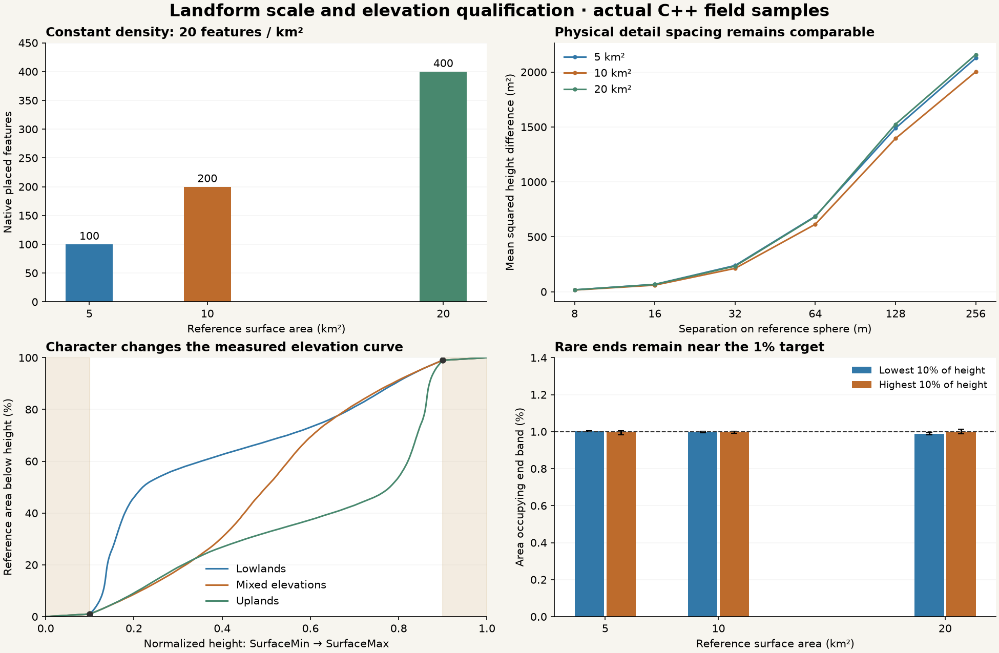

# Physical scale and elevation distribution

The same terrain character should retain comparable local dimensions when its
reference area grows. At 20 placed features/km², the 5, 10 and 20 km² reviews
contain 100, 200 and 400 native stamp placements. Footprints remain 80–120 m;
the native noise wavelength remains 250 m. This is a reference-surface density,
not a demand to double visible triangles or generate every LOD simultaneously.
VPP retains generation, surfaces, meshes, LOD, collision and sculpt ownership.

## Designer controls

Planet Designer's **Planet** page shows the reference surface area and two groups:

- **Terrain detail:** Largest feature rescales existing terrain noise wavelengths
  and stamp footprints together, retaining their ratios. Lock to metres converts
  radius-relative settings at their current size without changing the field.
  Add/Enable detail creates one named native noise layer; repeated use does not
  duplicate it. Continental and plate counts, angular belts and geological
  parameters retain their independent, planet-scale meaning.
- **Surface elevation:** Character moves between lowland-, mixed- and upland-heavy
  distributions. Low end area and High end area are independent percentages.
  By default, 1% of reference area occupies the lowest 10% of the SurfaceMin/Max
  interval, and another 1% occupies the highest 10%. Advanced exposes the end-band
  width, typical height, interquartile spread and calibration sample count directly
  below its native dropdown. The plot shows the target and measured cumulative
  area curves, and the readout reports actual end fractions and median height.

The target menu selects the whole surface or an existing enabled editorial
terrain region. Regional settings live on that region's self-contained recipe
snapshot. The regional review isolates a masked elevation override over identical
native noise terrain on both sides. Generated palette-cell-specific elevation
profiles are not implemented; generated terrain is included in the whole-field
calibration.

Physical locking applies to root terrain layers, unplaced regional snapshots and
region-generation palette snapshots. Placed Landforms keep their explicit source
and placement-transform ownership; edit their internal detail through Terrain
Designer. Native stamp density remains the existing per-km² setting in the terrain
layer's distribution settings. Overlap and later blends can hide placed features;
placement count is not a count of visible summits.

The reference radius is `RadiusMeters * BaseSurfaceNormalized`, inside the outer
sky boundary. Density uses its spherical area `4*pi*r²`. Slope and mesh-area
inflation do not feed back into density. SurfaceMin/Max remains the independently
authored vertical envelope: expanding its physical span can increase slopes.
The bounded size comparisons deliberately retain the same 160 m vertical span.

## Native audit and justified specialization

The installed VPP 2.0p8 source provides Perlin noise, native stamp/heightmap
execution, curves, material bindings and the existing generation/LOD/collision
and sculpt lifecycle. UE provides rich-curve evaluation, clamped tangent math,
PCG transforms and asset editing. These are reused.

VPP's curve function library wraps native `FRichCurve` evaluation and an optimized
graph evaluator. Its graph function requires a graph query/dependency context;
the existing Landform immutable worker plan evaluates native UE `FRichCurve`
directly, without sharing mutable function-library query state or introducing
another curve evaluator. Curve inputs are normalized before float evaluation;
height fitting and exact endpoints remain double precision.

The installed VPP Source search for hypsometry, quantile, histogram and CDF found
no area-calibrated terrain-distribution feature. Landform therefore adds only the
geographical calibration: measure the incoming field's area quantiles and fit a
monotone mapping to the requested elevation quantiles. It introduces no new noise,
scatter, mesh, collision, streaming or sculpt-save implementation. Existing UE PCG
placement and native VPP stamp execution remain the supported distribution path.

The previous 256-placement per-layer check prevented a 20 km² case at 20/km².
It now uses the existing 1,024-placement scene budget, including the native PCG
adapter's admission check. The composed total is checked too. Excess requests
fail explicitly; density is never silently reduced and placements are never
truncated. This is a qualified finite registry, not a solution for billions of
planet-wide placed features. Larger placement populations need a separate native
VPP capability audit and proof, without assuming a custom streaming manager.

## Data and execution contract

Schema **21** explicitly opts into elevation-distribution semantics and requires
native VPP terrain algorithm 2. Enabling it in the Designer deliberately adopts
the existing guided-geology/native authoring model for older recipes; loading an
old recipe never performs that authoring action. Old recipes
retain their schemas and the exact old linear mapping when the new settings are
disabled. Loading does not migrate existing worlds. Measured terrain retains its
measured elevation semantics and cannot be silently reshaped through this profile.

The recipe stores the resolved `FCLSurfaceDistributionSettings`: algorithm 1,
Character, LowEndAreaPercent, HighEndAreaPercent, EndBandHeightPercent,
TypicalHeightPercent, SpreadPercent and CalibrationSamples. Character changes
resolved typical height/spread and preserves independently authored tail areas.
All area/height/spread inputs carrying Percent are expressed as 0–100 values.
Native UE curves use normalized 0–1 values internally.

Calibration samples the completed, unmapped radial base field with deterministic
equal-area spherical directions. It excludes extra extrema-search footprint
probes from the probability sample, so small stamps do not receive extra area
weight. The native UE target curve has pinned endpoints, explicit rare-end
quantiles, median and quartiles. The fitted mapping uses native clamped tangent
math and curve interpolation; it preserves ordering within each profile.

The default is 65,536 calibration samples, bounded to 8,192–262,144. Calibration
checks both end frequencies, median and quartiles. Large tied/flat source levels
that cannot satisfy those constraints are refused, rather than split with hidden
noise. Regional calibration requires at least sixteen expected samples in each
requested tail. Too-small regions or unsupported requests fail before accepting
the asset edit.

At most eight explicit regional profiles are admitted. They use the existing
spherical or placed-Landform masks and existing priority/ID order. Calibration
uses full-strength interiors; fades blend mappings smoothly and are mixtures,
not separately normalized statistical domains. Overlapping overrides can change
the whole-surface distribution; the measured orange curve exposes the result.
Neither camera movement nor preview-window size refits a distribution.

The curve follows composed base terrain fitting and precedes recipe volume
operations. Caves, detached formations, mining and backfill retain the existing
base-terrain-only height policy. Sculpting never recomputes the world's elevation
statistics or relocates other terrain. Rock classification retains its accepted
canonical geological field. Schema 21 preserves the existing single-geological-
source rule: Rock cannot be combined with legacy radial geological units, and
disabled volume settings retain their existing inactive semantics. Reauthoring the recipe of an already mined world is
still an unqualified migration, not an automatic save upgrade.

One immutable fitted mapping is shared by the native spherical patches. Workers
read no authoring UObjects. Native VPP previews, zero-set queries and gameplay
consume the same accepted plan; the plot is statistical UI, not a terrain preview
or generation path. Character/detail drags coalesce updates and own one asset
Undo transaction; direct native percentage edits validate a draft before commit.

## Qualification and review

The [host guide](../../Projects/LandformLab/Docs/SurfaceScaleAndElevation.md) gives
interactive launch and reproduction steps. The [machine record](../conformance/SurfaceScale/qualification-mac-arm64.json)
contains exact source/binary hashes, checks, native frames, physical-spacing and
slope measurements, cooked persistence and protected-input evidence.

The area suite covers three sizes, three seeds and three character positions,
using 131,072 independent area probes per case. The physical-spacing diagnostic
uses squared height differences at fixed metric separations, alongside actual
native feature counts/widths. Native VPP zero-set and regional-fade checks exercise
the new mapping, and legacy guided geology, stamps, spherical patches, rock and
volume tests retain their own scope. A separate cooked quarry exercises schema
21 through native excavation, painted fill and cold compressed sculpt reload.
A published schema-20 writer additionally supplies a save to the current reader.

## Research and remaining gaps

[Parberry, Designer Worlds (2014)](https://jcgt.org/published/0003/01/04/paper.pdf)
uses real elevation statistics to inform procedural terrain. We adopt the idea of
controllable/reference-informed distributions while retaining VPP noise, rather
than implementing its separate value-noise generator.

[Keylock et al., Hölder-Conditioned Hypsometry (2020)](https://agupubs.onlinelibrary.wiley.com/doi/full/10.1029/2019WR025412)
shows the value of considering elevation jointly with topographic roughness.
This motivates recording physical spacing and slopes alongside the elevation
curve. Matching a histogram alone does not establish realistic terrain.

[Terrain Amplification using Multi-scale Erosion (2024)](https://research.adobe.com/publication/terrain-amplification-using-multi-scale-erosion/)
adds hydrologically consistent detail at several scales, while
[Cordonnier et al. (2016)](https://cs.purdue.edu/cgvlab/www/publications/cordonnier2016large/)
couples tectonic uplift and fluvial erosion. Those processes are not supplied by
this statistical shaping layer. Native feature dimensions and coherent existing
terrain are retained, but connected drainage, erosion/deposition feedback,
reference-DEM calibration and material-dependent refinement remain work.

The review's height span and feature scales are deliberately rugged. Arbitrary
Advanced combinations are not guaranteed geologically plausible. No production
performance budget, cross-platform bitwise determinism, exact area guarantee for
arbitrary overlapping masks, unlimited placement registry or multiplayer claim
is made. The next realism step is class-appropriate reference calibration and
connected geomorphic refinement, with another native-capability audit first.
