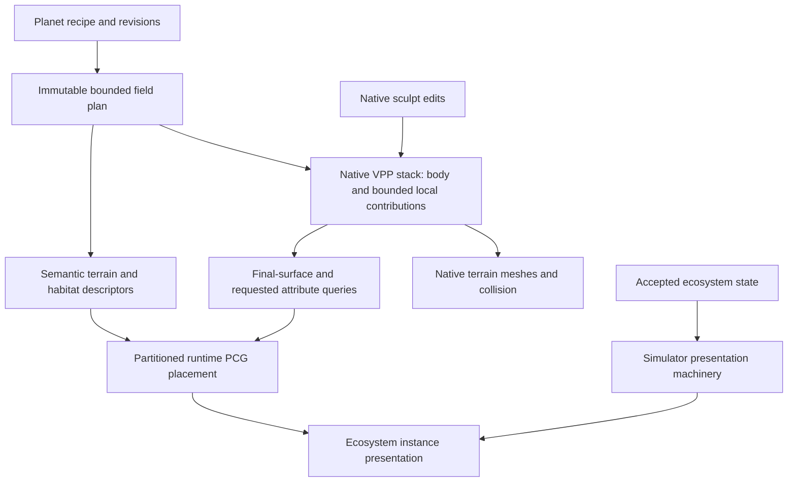

# Feeding Landform to VPP: target design and gap analysis

7 November 2026. Research and recommendation, not an implemented replacement.
Audited baseline: Landform `63430b2203e4b27668ac6955d68bb5781aeca636`, workspace
`8485fffc9d241461bf0f1f5a092f6548bac65a08`, UE 5.7.4 / VPP 2.0p8.
Existing UI, saved morphology, geological identity and native VPP ownership are
constraints. The subsequent [delivery prototype comparison](VPPDeliveryPrototype.md)
measures native graph/custom-node and optimized C++ stamp delivery around the
same frozen cave family. No generation or engine code changes form part of this report.

The subsequent [collision investigation](CollisionStreaming.md) identifies why
computed collision data can still leave our movement guard waiting for physics.

## Finding

Landform already returns one composed 3D field to VPP. It does not maintain a
separate cave mesh alongside a planet mesh in production. The serious gap is
between **one mathematical volume** and **an efficient executable description of
that volume**. Our broad callback preserves the former but loses opportunities
for spatial rejection, bulk evaluation, shared computation and local invalidation.

Separate definitions for surface, caves and rock remain useful. Evaluating all
of them eagerly for every point is the problem. Simply moving those calls into
one function, one noise, one enormous graph or one dense voxel array would not
solve it. The target is one authoritative composition with bounded, selectively
executed contributions and requested attributes.

We built the evaluator around correctness and iterated morphology, including
shortening spline intervals to retain reliable native nearest-point evaluation.
We did not establish and enforce a generation-cost contract alongside those
changes. Reusing native kernels was insufficient: the C++ loops, candidate
selection, allocations and repeated evaluations surrounding them are ours.

## What VPP expects

VPP pulls field data from a stack of stamps. A stamp supplies instructions/data;
it is not itself a terrain renderer. Volume inputs support caves and overhangs;
height inputs and static data offer different cost/storage tradeoffs. A final
3D terrain may therefore be assembled from heterogeneous inputs without creating
multiple authoritative worlds. [Stamps](https://docs.voxelplugin.com/knowledgebase/working-with-stamps/)

Its buffers process many positions together on the CPU, including ISPC kernels;
uniforms represent values shared by a query/chunk. The pinned documentation does
not offer GPU terrain generation as the current implementation. GPU rendering,
PCG processing and CPU voxel evaluation must be budgeted separately.
[Buffers](https://docs.voxelplugin.com/technical-information/buffers-and-uniforms)

Bounds and a valid distance band determine both cost and correctness. Overlapping
spline bounds are specifically identified as a concern. A void/NaN means absence
of a stamp contribution outside its valid support; it must not be confused with
known air or known solid. Tightening bounds requires conservative support,
including blending and query padding, rather than arbitrary clipping.
[Bounds](https://docs.voxelplugin.com/knowledgebase/working-with-stamps/bounds-ranges-and-voids)

The pinned native source adds concrete integration facilities: bulk queries retain
indices, start, spacing and strides; sparse queries retain requested surface types
and metadata; stamp runtimes expose child bounds and partial-invalidation hooks.
Native spline stamps use the latter two. Native layer traversal clips/splits
queries around stamp children before calling a runtime. These are audited source
facts, not inferred guarantees that any arbitrary graph is automatically optimal.

Metadata is demand-driven. Material use additionally creates per-chunk textures,
so rich habitat data should not automatically become terrain shader data.
[Metadata](https://docs.voxelplugin.com/knowledgebase/materials/working-with-metadata)

## Recommended target

Compile the recipe once per accepted revision into an immutable, spatially
bounded field plan. Lower that plan through native VPP stamps/graphs and public
extension points. VPP remains responsible for terrain requests, meshing, LOD,
collision, native edits and persistence. Landform owns the meaning and efficient
execution of the data it supplies. This is a recommendation from the research;
its fastest backend has not yet been established by an equivalent-workload test.

### 1. One volume, spatially factored execution

Use a cheap global body representation plus local terrain/cave composition groups
whose bounds, blend order and distance support are visible to the native stamp
hierarchy. A group may contain a complete cave network, its shared floor, in-place
rock and transported breakdown. Do not create one Actor per interval: native
stamp runtimes/children can share one compiled recipe and backing arrays.

A global body's bound must not also advertise every expensive local feature as
globally applicable. Merely adding child bounds to the current combined stamp
would not help if its global child still covers every query. Expensive local
contributions need distinct bounded runtimes or an equivalent bounded execution
plan inside the adapter. Native child bounds describe support; they do not hand
our callback a ready-made feature index.

Preserve CSG semantics when grouping. Our current network floor is clamped after
passage/room unions and infills have geological provenance. Splitting primitives
into independently blended stamps can change smoothing, junction floors and rock
identity. Native integration must lower the complete operation order, including
attribute attribution, not approximate it with superficially similar primitives.

### 2. Cheap decisions before expensive evaluations

For each native query region, determine relevant composition groups once. Use
conservative value/support bounds to skip branches that cannot affect the final
field. Evaluate uncertain regions with exact field semantics. For example, an
underground cave result can dominate the most positive possible exterior field;
that can prove the full surface-height evaluation unnecessary. Our inspection
path already contains a restricted example of this reasoning; production does not.

Retain grid bounds/spacing through the bulk path, use contiguous buffers and
batch kernels, and reuse immutable spline coefficients and query-local scratch.
Shared floor, deformation and provenance calculations should be shared when their
inputs are equal. Do not introduce a mutable global memo table or quantize cache
keys in a way that silently changes the field. Every cache needs an owner,
revision key, memory bound and invalidation rule.

The documented extension options include asynchronous C++ nodes and ISPC compute
nodes. Use them for missing Landform semantics while retaining native query
context. Graphs cannot optimize duplicate work hidden inside an opaque node.
[Custom nodes](https://docs.voxelplugin.com/technical-information/adding-custom-nodes-using-c%2B%2B)

Surface shape and climate often vary over a spherical 2D domain; caves require
3D information. Preserve those intrinsic dimensions in compiled data. A stock
world-XY height layer does not directly represent the complete curved planet.
Any spherical atlas/chart lowering must prove seams, poles, interpolation error,
scale and edit behavior. A cheap analytical radial core plus bounded 3D features
is the first reference design, with cached spherical fields a measured option.

### 3. Query only the information the consumer needs

Separate requested outputs while sharing the same composition plan and winner/
provenance semantics. Dense shape sampling should not compute habitat attributes.
Collision may still need surface/physical material information: it is incorrect
to promise that every collision query can omit all material work. Sparse attribute
queries can also legitimately need field values to calculate blend weights.

Use typed, versioned semantic fields for rock properties, substrate, moisture or
other agreed habitat descriptors; compute only selected channels. Keep authoritative
ecological state outside terrain material textures. A material requests its small
visual subset; PCG requests placement attributes; gameplay requests its own subset.
The ecosystem's usable terrain schema and coordinate/revision contract remain
unagreed and must be designed with its owner.

### 4. Local edits and bounded preprocessing

Keep native sculpt edits after generated terrain in the existing stack. Recipe
changes publish a new immutable revision. Local changes should invalidate their
old and new support plus halos; global reseeding can legitimately invalidate
much more. Reader lifetimes must retain the appropriate snapshot through native
completion. Origin shifts or visual curvature changes must not masquerade as
semantic terrain revisions.

Precompute expensive revision-stable structure, bounds, coefficients and suitable
low-dimensional fields. Benchmark native static-data representations for costly
stable local volumes if necessary. Do not pre-voxelize the whole planet: at a
600 m solid radius and 20 cm spacing, a dense sphere alone contains approximately
113 billion samples, or 452 GB for one 32-bit scalar, before attributes, LODs,
headers or edits. This is a calculated illustration, not VPP's sparse memory use.
Preprocessing must remain reproducible, bounded and compatible with native edits.

### 5. Preserve ecosystem headroom explicitly

Use final edited VPP surfaces for placement so objects agree with caves and
sculpting. Use hierarchical, partitioned runtime PCG near generation sources;
three-dimensional domains are needed where overhangs, cave levels or the planet's
orientation make a single world-XY grid unsuitable. These settings exist in the
pinned UE headers; exact spherical-world behavior is still an integration test.
[PCG configuration](https://docs.voxelplugin.com/knowledgebase/foliage/configuring-pcg)

Choose sampler cell size as a generation-cost control. Reducing output density
alone does not remove initial sampling work. Repeated projection performs many
field queries, so avoid projecting large unconstrained point clouds when surface
sampling is suitable. [Sampling](https://docs.voxelplugin.com/knowledgebase/foliage/using-pcg-on-voxel-terrains)

Classify placement using body-space position, local radial gravity and the final
surface normal, rather than a world-Z slope assumption. Distinguish exposed
ground, cave floors, walls and ceilings; a 2D climate map alone cannot establish
3D shelter or sky exposure. These descriptors need explicit query costs.

Batch habitat filtering after sampling. Voxel PCG Graphs are one supported option
for sharing mathematical work across a point set; many small graph crossings
also have overhead. This is a candidate for placement processing, not a new
simulation owner. [Voxel PCG graphs](https://docs.voxelplugin.com/knowledgebase/foliage/voxel-pcg-graphs)

Static vegetation and movable entities should use the project's instance/Mass/
pooling boundaries, appropriate content LOD and culling, rather than becoming
terrain voxels or one full Actor each. UE's instancing guidance supports batching
repeated meshes; exact representation choices remain target-platform tests.
[Epic instancing](https://dev.epicgames.com/documentation/en-us/unreal-engine/instanced-static-mesh-component-in-unreal-engine)

The workspace assigns ecology to CatalystEcosystem, shared accepted-state and
presentation machinery to CatalystSimulatorPlugin, and species/content policy to
CatalystEcosystemPlugin. Those implementations remain planned. PCG placement must
not create a second authority for simulated plants/animals. Instances needing
persistent ecological identity need a defined handoff from placement to accepted
state. Terrain modifications by organisms require explicit accepted terrain edits,
not side effects of voxel queries.

## Gap analysis

P0 blocks acceptable land-only streaming. P1 is required before credible ecosystem
integration or broader qualification. P2 is an optional optimization selected by
measurement. These are proposed priorities, not an approved implementation order.

| Priority | Concern | Current evidence | Target and closure check |
| --- | --- | --- | --- |
| P0 | Executable composition | One composed field, but a broad opaque stamp calls surface height then caves eagerly. | Bounded composition plan; exact branch rejection. Compare fields, attributes and native streaming against the frozen recipe. |
| P0 | Native spatial visibility | Production GetLocalBounds covers the planet; no custom GetChildren. Internal cave AABB tree exists but broad interval support admits repeated work. | Local composition-group support visible natively or equivalently pruned in bulk; measure candidate counts and point-feature visits. Preserve smooth-support halos. |
| P0 | Bulk execution | Native grids become point arrays; repeated 512-point allocations; scalar C++ work surrounds native kernels. | Region selection once per request, reusable scratch and substantial SIMD batches. Measure allocations, callback time and samples per resulting chunk. |
| P0 | Shared computation | Overlapping intervals repeat shared rolling floor work; profile 7 also computes unused old floor noise. | Shared dependency evaluation within a query, precompiled coefficients, no discarded work. Demonstrate savings without changing morphology. Floor optimization alone is insufficient. |
| P0 | Collision latency | Native invoker and collision owners retained; movement guard avoids the reproduced fall. Hold time does not identify cooking duration or rejection reason. | Requested/computed/published/physically usable timestamps plus guard reason. Continuous native-supported walking under normal streaming, with initial loading measured separately. |
| P0 | Performance acceptance | Settled editor p95 and functional walks/save tests exist; no terrain-generation budget was enforced. | Cold/warm generation, movement tails, edit latency, memory and total CPU work gates on named hardware; ecosystem headroom reserved. |
| P1 | Local invalidation | Custom runtime inherits ShouldFullyInvalidate=true when replaced. Native sculpt already has its own localized mechanism. | Old/new bounds and revision dependencies for local recipe changes; verify unrelated chunks and placement cells are retained. |
| P1 | Query detail and distance guarantees | Native LOD/grid context is discarded at the scene boundary; nonzero footprint rejected; HasConservativeStepBound=false. | Explicit query/detail contract and proven bounds. Do not assume Euclidean SDF behavior or turn off small cave topology by LOD without compatibility tests. |
| P1 | Attributes and provenance | Surface/rock requests are partly selective; rock attribution can resample cave provenance. Existing metadata is not an agreed habitat schema. | Shared exact attribution; requested typed channels with stable IDs/revisions. Check native queries, mining, transported rock and PCG consistency. |
| P1 | Ecosystem placement | Landform PCG code distributes terrain stamps; it is not a qualified ecosystem placement pipeline. | Final-surface sampling, partitioned runtime placement, bounded attribute queries, stable placement identity and edit-triggered local regeneration. |
| P1 | Object presentation | Ecosystem and common Simulator presentation implementations are planned; no representative object load is qualified. | Instance/Mass/pool lifecycle and CPU/GPU/memory budgets with representative vegetation and animals, not only empty terrain. |
| P1 | Upgrade boundary | Native noise ABI is checked; spline kernel uses a pinned exported ISPC binding; much evaluator work bypasses graph execution. | Prefer documented custom nodes/public stamp contracts; pin and test unavoidable ABI dependencies. Moving to a graph alone does not eliminate opaque internal loops. |
| P2 | Cached/baked data | Compiled semantic structure exists; no qualified bounded field cache for this workload. | Benchmark native static local data or exact bounded caches only if beneficial after pruning/vectorization. Include build time, RAM, persistence and fidelity. |

The ownership, body-space immutable plan, deterministic recipe and native sculpt/
meshing foundations are useful and should be retained. They do not establish that
the current execution representation is efficient.

## Backend decision and validation

A globally fastest backend cannot honestly be selected from documentation alone.
The recommendation is native-visible bounded composition and a shared compiled
plan. Compare these bounded implementations on identical inputs before choosing
the execution backend:

| Candidate | Expected advantage | Required proof |
| --- | --- | --- |
| Native volume/spline graph stamps with documented custom nodes for missing semantics | Native bounds/dependencies and bulk-node execution; less bespoke glue. | Same variable sections, post-union floor, surfaces and provenance; avoid one costly node dispatch per tiny primitive. |
| Optimized public C++ stamp runtime over the shared plan | Direct control over exact pruning, batching and specialized domain data. | Same native bounds/invalidation behavior and lower measured total cost; public API compliance, no hidden actor/worker reads. |
| Native static local data for expensive stable domains | Trades repeated computation for storage and lookup. | Bounded memory/build cost, stated interpolation tolerance, seams, sculpt behavior and native persistence. |

First establish the instrumented reference and output contract. Then implement
one bounded cave-network/body slice in the first two candidates; do not rebuild
the product UI or all planet families. Measure against a simple native VPP control
at the same resolution and comparable bounds. Controls distinguish callback cost
from native scheduling and meshing; they do not prove equal geological content.

Preserve saved profiles, stable operation order and original snapshots for exact
comparison. Floating-point tolerances must be explicit; spatial pruning must not
silently remove legitimate contributions. Keep native
20 cm collision and the 25 m invoker in the existing entrance case for the first
comparison. Do not improve the result merely by reducing shape fidelity, enlarging
prefetch distance, adding workers, hiding waits or weakening error bounds.

A complete acceptance matrix must include exterior, cave entrance, passage/room
join, intersecting networks, poles/chart seams, backfill, native save/cold reload,
local recipe change, origin shift, teardown and concurrent ecosystem placement.
Check shape and surface/metadata/provenance, not just silhouettes. Approximate
baking/filtering requires an explicit version and an agreed error allowance.

Keep separate budgets for background generation CPU and memory bandwidth, game-
thread publication/spawning, render thread, GPU, RAM and VRAM. Frame time with no
new terrain work is not a streaming budget. A proposed collision criterion is
that high-percentile physically usable latency fits inside the measured effective
prefetch margin divided by maximum travel speed, with safety margin. The nominal
invoker radius is not automatically that effective margin.

Product decisions still needed are target/minimum hardware and frame rate,
maximum movement speed, acceptable edit/loading latency, terrain accuracy and a
representative ecosystem population/content mix. The expectation that ecosystem
objects dominate rendering is a planning constraint, not a measured fact yet.
No arbitrary percentage of the GPU or worker pool is allocated by this report.

## Evidence and limits

The preceding diagnostic run used the published profile-7 binary. During one
five-second walking sample, six active background workers had 97.32% of sampled
stacks under our distance callback, including 51.19% surface-height work and
41.27% cave composition. Native collision cooking appeared in 0.03%. These are
inclusive sampled categories, not additive elapsed times or all-route averages.
The trace recorded 1,428 collider builds and roughly 58.95 million point visits
across native stamp Apply scopes, covering startup and walking. Profiling adds
overhead. The earlier 19.40 s was movement-guard hold time, not a cooking timer.
These measurements locate a bottleneck; they do not prove any proposed backend's
speedup. The 22.33 ms settled editor navigation p95 does not close these gaps.

[Research index](../conformance/VPPDataDelivery/research-index.json) pins source
hashes, audit locations, primary documentation and retained diagnostic summaries.
Vendor source was inspected in place and is not copied into this repository.
The official Epic pages currently resolve to 5.8; only general instancing guidance
is used from them. UE 5.7 PCG settings were checked against the installed headers.
No 5.8-only, beta VPP, GPU terrain generation, cooked/mobile or ecosystem readiness
claim is made. Native prototypes, performance improvements and an accepted habitat
contract remain outstanding after this research checkpoint.
