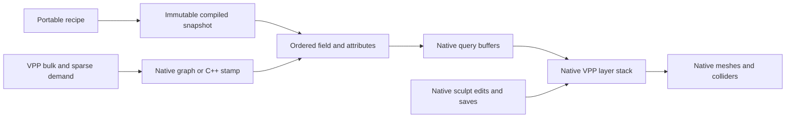

Current spatial-family follow-up: [moving-demand delivery and freeze correction](CaveStreamingDeliveryFix.md). Earlier workload/results below remain scoped to their recorded revisions.

# VPP delivery prototype comparison

7 November 2026. Opt-in UE 5.7.4 and VPP 2.0p8 prototype, following
[the delivery gap analysis](VPPDataDelivery.md). The frozen Organic Karst family,
geology, authored cuts and backfill, native sculpt edits and existing designer UI
are constraints. The production evaluator remains the default.

## Delivery paths

| Path | Native terrain input | Shape evaluator |
| --- | --- | --- |
| `legacy` | Existing `FCLPlanetStampRuntime` | Published scene evaluator, with optional diagnostic counters |
| `cpp` | `FCLDeliveryStampRuntime` | Shared optimized immutable field |
| `graph` | Actual `FVoxelVolumeGraphStamp` and saved `VG_Delivery` asset | Custom nodes call the same optimized immutable field |



The graph has independent bounds, distance, surface and rock-property nodes.
Native bounds queries do not execute position-dependent code, and shape-only
queries do not compute attributes. Instance parameters retain an immutable
compiled snapshot; their reflected GUID prevents two snapshots from sharing a
native graph cache entry. Native editor graph compilation and queued graph
notifications are prepared before terrain installation. Runtime pointers are
activation-only and are recreated from the portable recipe when loading a sculpt save.

Both adapters retain native base stamp properties, including layer, priority,
transform, blend mode, metadata overrides, LOD range and bounds extension. There
is one native terrain component and one existing native sculpt actor. The
existing sampling runtime remains a passive query source. VPP owns query demand,
scheduling, meshing, Nanite rendering, collision, sculpting and persistence.

The shared evaluator preserves the original order: terrain height and native
radial field, ordered cave unions and shared floor clipping, cave infills, then
ordered authored volume operations. Surfaces and mining properties use the
original geological provider, including source positions for displaced breakdown.

Optimization changes are deliberately independent of morphology:

- Native spline segment arrays are compiled once rather than rebuilt per query.
- Coherent packets traverse the native cave index once, then retain the exact
  feature/point pairs using VPP's outward-rounded float bounds. Scattered sparse
  packets retain native point traversal. Feature and group order remain stable.
- Rolling floor noise is shared per query and relief scale across overlapping
  intervals and rooms only when they request the identical complete packet.
  Partial feature packets retain their original point list and native batch. The
  discarded older floor-noise calculation is skipped for profile 7, along with
  unused scratch positions.
- Direct delivery avoids constructing and copying scene result records for
  finite native shape queries. Query buffers retain double local positions.

This is a comparison of native graph/custom-node delivery and direct stamp
runtime delivery around the same field backend. It does not reconstruct the
whole cave family as a graph of individual shape primitives or claim GPU field
generation.

## Exact geometry and edit qualification

The acceptance test compares 12,775 dense floor, junction, chamber and whole-body
positions against the published evaluator, then checks actual native sparse and
bulk delivery. Sparse controls contain both solid and air; queries start with
VPP's void sentinel. Surface blends and rock metadata must match exactly.
Ordered authored excavation, backfill and contact materials are also compared.
Saved native probe positions additionally exercise one-, three- and six-point
packets, protecting against partial-packet noise regrouping.
The native gameplay runs separately qualify grounded walking and compressed
sculpt saves loaded by fresh processes, including different delivery backends.

All 29 native automation tests passed with zero test warnings or errors. The
six final entrance runs each exceed 100 m with every recorded route frame
grounded. All three native sculpt writers complete their passage-to-chamber
walk, mining, backfill and compressed save; their outside-brush geological
controls remain unchanged. Five readers run in fresh processes, including C++
reading the control save and graph reading the C++ save. Every reader compares
134 probes with zero field error and matching material/geological identity.

| Native save | Compressed bytes | Fresh-process readers | Probe count per reader | Maximum field error |
| --- | ---: | --- | ---: | ---: |
| `legacy` | 245,252 | `cpp`, `legacy` | 134 | 0 cm |
| `cpp` | 244,786 | `cpp`, `graph` | 134 | 0 cm |
| `graph` | 245,061 | `graph` | 134 | 0 cm |

An initially tested height-pruning shortcut was excluded. VPP's zero-smooth
blend still uses floating-point interpolation; replacing it with mathematical
`max`, or dropping its terrain operand, changed some fields by up to
0.00048828125 cm. Reusing floor samples and batching candidate discovery preserve
the native operation and match bit for bit. The retained prototype does not
skip terrain-height evaluation or reduce voxel, morphology or material detail.

## Native measurements

Timing cells show the median and observed range in seconds across the two native trials.

| Metric | Published control | C++ stamp | Native graph |
| --- | ---: | ---: | ---: |
| Chamber fixture readiness | 96.38 (94.90–97.87) | 92.99 (92.53–93.46) | 208.64 (201.69–215.60) |
| Walk readiness | 35.73 (34.78–36.69) | 34.47 (33.31–35.64) | 70.69 (60.08–81.30) |
| Collision admission holds | 28.42 (19.22–37.62) | 26.77 (18.06–35.48) | 26.11 (17.80–34.42) |
| Whole entrance scenario | 80.83 (70.68–90.99) | 77.91 (68.03–87.79) | 113.48 (94.56–132.39) |
| Process CPU during walking | 353.21 (264.07–442.35) | 342.25 (249.87–434.62) | 342.64 (268.42–416.86) |

All measured entrance routes exceed 100 m with native floor contact on every
observed route frame. The same runtime and collision invoker survive each run.
Two trials expose scheduling variation; these ranges are not confidence intervals.

The steady render fixture gives the following GPU p95 values in milliseconds.
Each entry is the median of the per-trial p95 measurements.

| Native sphere instances | Published control | C++ stamp | Native graph |
| --- | ---: | ---: | ---: |
| 0 | 10.80 | 11.02 | 11.12 |
| 1024 | 11.30 | 11.51 | 11.81 |
| 4096 | 12.25 | 12.50 | 12.69 |
| 16384 | 16.01 | 16.16 | 16.25 |

The 16,384-instance fixture has 15,728,640 potential LOD0 input triangles. Native
visibility and occlusion determine actual draw work. All accepted windows have
zero pending terrain tasks and zero native state-processing frames.

Process CPU and frame context accompany the GPU budget. Each value is the
median of two per-trial measurements.

| Metric | Published control | C++ stamp | Native graph |
| --- | ---: | ---: | ---: |
| Walking process CPU seconds per wall second | 7.75 | 7.77 | 7.97 |
| Walking game-thread p95, ms | 1.43 | 1.45 | 1.49 |
| Walking frame p95, ms | 16.88 | 16.66 | 16.80 |
| Settled process CPU seconds per wall second, 0 objects | 1.98 | 1.95 | 1.92 |
| Settled process CPU seconds per wall second, 16,384 objects | 1.50 | 1.48 | 1.48 |
| Settled game-thread p95, ms, 16,384 objects | 1.08 | 1.09 | 1.08 |
| Settled frame p95, ms, 16,384 objects | 17.53 | 17.53 | 17.74 |

CPU seconds per wall second describe total process load across threads, not
reserved or available cores. They cannot be subtracted from the machine core
count to promise ecosystem capacity. With uncapped rendering, CPU load can fall
as object count rises because GPU-limited frames reduce the number of game and
render ticks per second; that is not a measured simulation budget. The walking
fixture retains active terrain demand; the render fixture is settled. Real placement, simulation and object
collision must be qualified together with moving terrain demand.

The editor query benchmark is balanced over three measured rounds after warm-up.
Numbers below are median seconds per pass; all output checksums agree.

| Query workload | Published control | C++ stamp | Native graph |
| --- | ---: | ---: | ---: |
| 117,912 fine-grid points | 1.5103 | 1.3371 | 1.3495 |
| 117,912 coarse-grid points | 1.4886 | 1.3729 | 1.3738 |
| 8,192 scattered points with surfaces and rock metadata | 0.1054 | 0.1055 | 0.1063 |

The grid-query improvement comes from shared work and data preparation. Graph
and direct C++ dispatch remain close with this shared field backend. Scattered
attribute queries remain essentially unchanged. The graph makes more shape
queries during cold startup in these editor standalone runs; the current
measurements establish that extra demand, not its underlying cause.

The completed chamber fixtures record about 31.3 million shape points for
the control, 31.3 million for C++ and 62.6 million for the graph.
Both graph trials show this additional demand. These counters exclude the
geological provider’s internal sampling and describe shape callbacks only.

The earlier diagnostic runs are excluded. They exposed whole-packet floor-cache
over-evaluation, then a partial-packet reuse precision error of 0.000762939453125 cm
at two saved control probes. Disabling reuse removed that difference. The final
cache shares only identical complete packets and preserves original native noise
batches for partial requests. No reload tolerance was relaxed. Earlier absolute
timings do not describe the final evaluator and are not accepted measurements.

## Measurement method

All native trials run serially in a physical isolated LandformLab project with
UE 5.7.4 CL 51494982, VPP 2.0p8, Metal SM6, an M3 Max with 16 CPU cores, 40 GPU cores and 128 GB
unified memory, and macOS 26.6.1. They use the same recipe and seeds, 20 cm voxels,
native LOD quality 2, Nanite enabled without tessellation, eight requested VPP
workers (six background workers reported by the native API in every accepted run),
the same moving collision invoker, a 1280 by 800 requested viewport and uncapped
frame rate. The retained Epic scalability groups are 3; dynamic resolution is
disabled and `r.ScreenPercentage=0` retains the engine automatic setting. No
engine or VPP source is changed.

The bulk benchmark uses 24 fixed passage, chamber and surface locations, each a
17 cubed native query: 117,912 points per measured pass. Separate scenarios use
20 cm and 320 cm spacing. A third scenario makes four native sparse queries of
2,048 scattered surface positions with surfaces and rock properties requested.
One warm-up pass per scenario is discarded. Three measured rounds rotate backend
order, and all result checksums must agree.

Readiness and scenario clocks begin at the diagnostic game mode’s `StartPlay`;
executable launch and editor initialization are outside those clocks. The runner
prints process wall times separately.

The streaming test holds ordinary forward input at 600 cm/s for 100 m from the
same entrance. The existing local native-collision admission guard remains
active. Its holds are reported separately from frame times and startup. A
successful route must retain native floor contact on every observed route frame.
Evaluator counters describe shape work only; summed evaluator durations overlap
across workers and must not be interpreted as elapsed time or process CPU time.
Process CPU time is measured separately with native process resource accounting.

The ecosystem proxy is a fixed screen-facing native instanced-sphere lattice in
the same chamber, using 0, 1,024, 4,096 and 16,384 instances. Mesh LOD0 is forced,
transforms use a deterministic permutation, materials and lighting are fixed,
and object collision is disabled. Each level warms for five seconds after
native terrain settles, then records 15 seconds of frame, game-thread,
render-thread, GPU, process CPU and resident-memory measurements. The same full
transform digest identifies each workload across backends. Triangle counts are
reported as LOD0 input potential; visibility and occlusion remain native.

This single chamber view measures marginal render-only instance/triangle cost
under fixed lighting. It does not establish an outdoor long-vista budget. Actual
ecology, placement/PCG work, foliage materials, wind, animation, object collision and
simulation need their own budgets. A frame margin at a stated target is specific
to this fixture and hardware, not a supported ecosystem object count.

## Delivery decision

The C++ entrance scenario has a 77.91 s median versus 80.83 s for the control,
about 3.6 percent less elapsed time. Its median admission hold is 26.77 s versus
28.42 s, with run-to-run variation. The graph's 26.11 s median hold
is offset by its 70.69 s median cold readiness, producing a 113.48 s total.
These are two-trial observations for this fixed route, not a general latency
promise. The remaining holds are too long for continuous gameplay.

Using 60 fps only as a reference gives a 16.67 ms GPU budget. The C++ fixture's
11.02 ms p95 without proxies leaves about 5.65 ms; 16,384 spheres leave about
0.50 ms. Frame p95 at that load is about 17.53 ms, so the GPU
margin is not a 60 fps guarantee. Changing delivery paths does not create a
material ecosystem rendering budget when terrain and object geometry remain the
same.

Direct C++ is the preferred base for the next optimization pass. It retains the
native stamp contract and exact shared field with less cold-start work in this
host. The native graph is a functioning alternative, with essentially the same
steady query cost; merely wrapping the field in a graph does not expose its
internal contributions to VPP's spatial traversal or reduce mesh rendering cost.
The existing production default remains unchanged while this remains a prototype.

The subsequent [collision investigation](CollisionStreaming.md) captures the
computed-data versus active-physics gap during five native movement holds.

## Remaining architecture gaps

Both prototypes still present broad whole-planet bounds. The packet optimization
reduces work inside the callback; it does not expose bounded contributions to
native stack traversal. Native child bounds, provably conservative distance
bands, local invalidation and filtered query footprints remain separate work.
No global body callback is claimed to become cheap merely by adding cave children.

The exact native blend is also a contract constraint. A future cheaper field
representation must explicitly qualify rendered geometry, ray queries, edits and
save compatibility rather than silently substitute algebraic operations. Shared
geology sampling for multiple requested attributes and real ecosystem placement
remain further opportunities. The scattered field-and-attribute benchmark shows
no query saving to count toward an ecosystem placement budget. Switching delivery
mechanism alone cannot remove those field costs or change the cost of rendering identical terrain meshes.

## Reproduce

Build the checked-in LandformLab host in an independent physical project, with
this plugin and the pinned VPP version installed. The prototype is selected only
by the diagnostic game mode's `-CLDelivery=legacy|cpp|graph` argument; the existing
UI and launch defaults remain unchanged. `-CLHeadroom` runs the render fixture;
`-CLCaveEntranceProof` runs ordinary entrance walking.

```sh
python3 Tools/compare-vpp-delivery.py \
  --engine /path/to/UE_5.7 \
  --project /path/to/isolated/LandformLab.uproject \
  --output /path/to/new-comparison
```

The script requires exact parity before accepting performance results, records
commands and source hashes, rotates order over repeated trials, verifies native
owners and grounded walking, and checks self/cross-backend cold save reloads.
Use `--create-graph` only to create a missing diagnostic graph in a disposable
project; the native authoring helper refuses to overwrite an existing package.

## Source and retained evidence

The adapters and native graph nodes live in
[`CLDeliveryPrototype.cpp`](../Source/CatalystLandform/Private/CLDeliveryPrototype.cpp);
the shared packet evaluator lives in
[`CLCaveVolume.cpp`](../Source/CatalystLandform/Private/Scene/CLCaveVolume.cpp).
[The parity test](../Source/CatalystLandformTests/Private/CLDeliveryPrototypeTests.cpp)
exercises the original control and both native delivery paths. Native graph
authoring uses [the editor helper](../Source/CatalystLandformEditor/Private/CLDeliveryGraphTools.cpp).
The workspace Lab module owns `CLGeneratedCaveProof.cpp` and
`CLDeliveryHeadroom.cpp`; neither changes the production designer UI.

[The conformance record](../conformance/VPPDeliveryPrototype/README.md) contains
the environment, exact source manifest, native automation output, query timings
and accepted standalone results. [The runner](../Tools/compare-vpp-delivery.py)
records a new comparison without rebuilding or mutating the project sources.

The next bounded experiment is conservative native contribution bounds and
filtered distance queries on the C++ path. Accept it only if this same parity,
walk, native edit/save/reload and render fixture passes, with reduced shape
point demand and shorter collision admission holds at unchanged quality.
