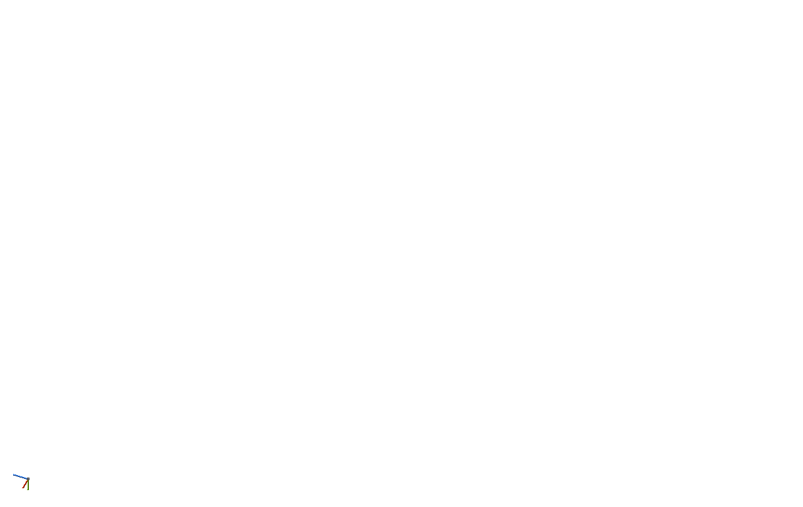
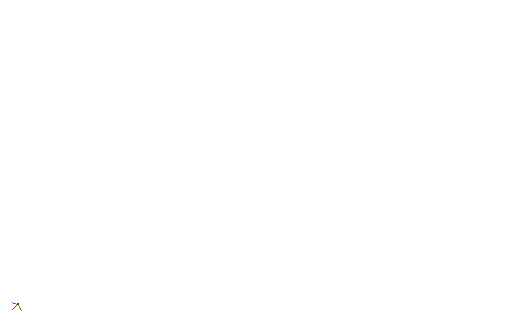

# Procedural family review candidate

11 November 2026, UE 5.7, Mac arm64. **User visual acceptance is pending.**
The previous editor output was rejected. These captures and passing checks do
not turn that rejection into approval.

The approved comparisons remain the original
[passage](../SpatialCave/passage.png), [threshold](../SpatialCave/threshold.png),
[chamber](../SpatialCave/chamber.png), [side view](../SpatialCave/chamber-side.png)
and [strata follow-up](../../Docs/CaveStrata.md). Their bytes are unchanged.

## Saved Rift recipe in the actual editor presenter

These unedited PNGs come from `SCLPlanetPreview` with its native geological
terrain presenter, camera LOD and existing studio lighting. They use the saved
`/Game/LandformDesigner/Provinces/DA_ContinentalRiftReview`, without rewriting
its authored recipe or palette. Cameras are about 1.6 m above the actual floor.
Native publication, tasks and shader compilation settled before capture.

| View | Width at 3 m | Height above floor | Capture |
| --- | ---: | ---: | --- |
| Passage | 34 m | 9.25 m | [Passage](editor/passage.png) |
| Threshold | 55 m | 31.25 m | [Transition](editor/threshold.png) |
| Chamber | 64.5 m | 34.5 m | [Chamber](editor/chamber.png) |
| Chamber side | 75 m | 34.5 m | [Side](editor/chamber-side.png) |
| Small chamber | 17 m | 8.75 m | [Small](editor/small-chamber.png) |
| Largest chamber by construction footprint | 74.5 m | 25.75 m | [Large](editor/large-chamber.png) |
| Deep network upper level | 46.5 m | 15.25 m | [Upper](editor/upper-level.png) |
| Connecting ramp | 25 m | 6 m | [Ramp](editor/level-ramp.png) |

Openings are sampled from the generated field at each camera section, not
inferred from chamber metadata. These sections do not describe the maximum
dimensions of every cave. The current small planet constrains the size and depth
distribution: its 25 published networks span one to four levels. The pale/dark
Rift materials and studio lights visibly differ from the warm reference study.

[Camera poses and per-network scale/depth](editor/review.json),
[whole-planet inspection](overview/all-caves.png) and
[native close-up](overview/zoomed-cave.png) provide the surrounding context.

## Same family with the approved carbonate recipe

The separate [comparison recipe](carbonate/recipe.json) changes only the name and
cave algorithm version (8 to 9) of `Examples/SpatialCave.json`. It renders the
whole procedural family through the same editor presenter. It is supplementary
to the saved Rift evidence, not a replacement asset or an isolated demonstration.
The 800 m body fits these larger branching layouts at smaller anatomical scale:
the selected passage is 14 m wide and 6.25 m high, with a 49–52.5 m by 17 m
chamber. These are not the frozen study's measured dimensions.

[Passage](carbonate/passage.png), [threshold](carbonate/threshold.png),
[chamber](carbonate/chamber.png), [side](carbonate/chamber-side.png),
[camera/size records](carbonate/review.json) and [command](carbonate/command.json)
retain that distinction. This additional editor run passed.

## Full-planet native walking and edits

The existing `CLGeneratedCaveProofGameMode` loaded the exact saved Rift snapshot
through the C++ terrain delivery path. It walked 78.79 m at 600 cm/s, grounded
for all 1,079 recorded route frames, with zero native collision waits and the
same runtime/invoker owner. Four native contacts, mining, placement and compressed
sculpt save passed. This run wrote a separate review save slot; it was not a cold
reader run. [Result](native-walk/result.json) and [command](native-walk/command.json)
record the scope and native demand settings.

These unedited captures use the existing warm walking-review lights and full
planet native renderer. They show another generated route, not the editor camera
sections above: [passage](native-walk/passage.png),
[threshold](native-walk/threshold.png), [chamber](native-walk/chamber.png) and
[side](native-walk/chamber-side.png). They supplement the actual editor evidence
and do not replace its visual acceptance gate.

## Verification scope

[All 14 selected checks passed](automation.json). These include independent
scalar/SIMD comparisons throughout the walls and roof, full walking-width head
and foot bands, graph connectivity, distinct physical floor levels, exact seed
regeneration, canonical rock/material identity, enabled minimum cases, unknown
and missing geology, tiny bodies, native persistence, frozen profile-8 geometry
and the rendered CurrentRift scenario. Three additional Rift seed runs include
five-level networks, different topologies and more than threefold size spread.

CurrentRift published 23 native inspection domains with 21,489 vertices and
5,407 visible cave pixels. Its overview maximum field/native-cell ratio was
0.451 (budget 0.5). Close-up maximum residual was 0.158 m (budget 0.5 m), with
1 m maximum native cell size. These are rendering accuracy checks, not a claim
that the appearance matches the approved caves.

[Measurements](measurements.log), [frozen study regression](reference.json),
[coarse-work replay](work.json), [build result](build.log) and
[exact automation command](command.json) retain their measured scope. The work
replay is not live streaming timing. [The manifest](manifest.json) identifies the
source bytes matching the staged plugin and hashes the original captures and
saved authoring recipe snapshot. The authoring snapshot remains in the temporary
review directory; this evidence does not publish unrelated asset edits.
